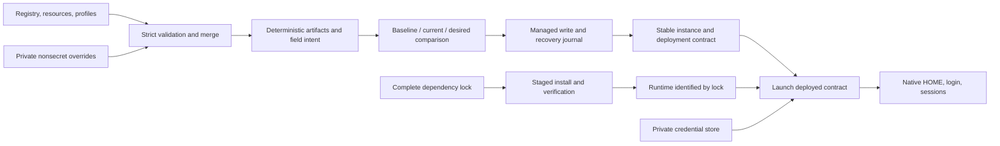

# Architecture

Rotom separates shared intent, native translation, dependency installation, configuration deployment, and process launch. DSH, Pi, and OMP implement distinct adapters; Codex is a native authentication/model route, not a fourth configuration adapter. `termcfg` has its own command and transaction model.

## Upstream hosts remain unmodified

Use official configuration, public plugins and extension APIs, official CLIs, and repository-owned adapters. Do not patch agent source, official binaries, cached distributions, or private host interfaces. Historical patch material is retained only for provenance and migration analysis. Its presence does not authorize rebuilding a patched host.

OMP now uses an official standalone runtime and an independent permission plugin. Current DSH uses unmodified Core/TUI and public extension points. Pi Base/Pro now use the unmodified official CLI and complete npm closures; old SDK/supervisor/delegate distribution has been retired. Required historical legal/source attribution remains. Implementation does not establish native or account acceptance. See [Roadmap](roadmap.md).

## Data flow

| Subsystem | Code entry points in `src/agentcfg/` |
| --- | --- |
| Commands and selection | `cli.py`, `commands.py`, `workspace.py` |
| Input and rendering | `config.py`, `schema.py`, `merge.py`, `render.py` |
| Ownership and recovery | `deployment.py`, `native_projection.py`, `storage.py` |
| Dependencies and launch | `backends.py`, `runtime.py`, `process.py`, `execution_environment.py` |
| Native adapters | `dsh.py`, `pi.py`, `omp.py` and related modules |
| Pi thin integration and admission | `pi.py`, `pi_dependencies.py`, `pi_runtime_packages.py`, `pi_inventory.py`, `pi_lifecycle.py`; common `lifecycle.py` and `run_owners.py` |

`src/termcfg/` separately implements zsh/tmux previews, transactions, pinned plugins, and explicit legacy metadata migration. Proxy service control has been removed. It does not run implicitly from agent setup or launch.

## Unified entry and observations

`rotom` is a thin facade over the existing agentcfg, termcfg, and work parsers and executors. Invocation context carries explicit scope and input policy; preferences cannot replace native argument ownership, deployment approvals, fixed workspace bindings, or session ownership. Static help and restricted completion avoid business effects. Managed zsh launchers use an explicit checkout binding and the existing terminal transaction journal.

Read-only `agent instances list` loads one selected machine/configuration snapshot, enumerates all profiles unless explicitly filtered, and validates existing ownership records under short existing physical/metadata leases. Linux manager liveness checks read only registered PID birth identities. They do not establish host, descendant, session, or resource-release proofs. Session views preserve scoped historical references without inspecting native session bodies. Fresh Linux OMP registration requires complete cooperative resource ownership. Explicit `resume --here` and precise `stop_only` are admitted only for the verified Linux managed-DSH combination. Resume rechecks the requested session scope and deployment before launch; stop requires the registered original-host control endpoint and the current reviewed plan. Full maintenance execution, original-pane recovery and automatic continuation remain unavailable; see [session evidence](rotom-session-capabilities.md) and [stop evidence](rotom-stop-capabilities.md).

## Configuration and secrets

Objects merge recursively; arrays normally replace wholesale, including empty arrays. `false` remains meaningful. The shared default model layer adds deduplicated provider/model choices and lets explicit role bindings take precedence. Stable local model IDs are separate from remote IDs and protocol routes.

SecretStore is separate from ordinary configuration. Renderers and digest builders receive no secret values. Shared secret files and legacy inline entries may coexist only under the documented conflict rules. Launch resolves the deployed references for the required operation; capture reads a narrow nonsecret allowlist. Workspace loading defers shared credential-file reads until an operation resolves a SecretRef. Configuration-only validate/render/plan/doctor paths do not read those bodies. Direct callers of `load_local` retain its eager default unless they explicitly request deferred loading.

Native authentication, trust, sessions, and logs remain native-owned. A user interface preference may be initialized once without becoming continuously managed. Unknown native fields survive field-level merges; unknown Rotom input fields fail validation.

## State, installation, and execution

A deployment has a stable owner, current field baselines, at most one previous configuration generation, and a pending journal during interrupted multi-file work. Three-way comparison preserves user drift and detects conflicting edits. Single-file replacement is atomic; the system does not claim atomicity across files or external processes.

After a successful deployment plan, the owner also retains instance-relative paths of files actually
managed by field selectors. This lets a module retire its fields and later reselect them while preserving
native fields. Only recorded provenance survives; a never-managed nonempty file or an existing new
managed field still conflicts. Provenance-only updates use the same journal and preserve the previous
configuration backup. This tracks paths, not inode identity or native content.

The dependency backend consumes a complete lock and verifies staged output before activation. DSH/Pi/OMP publishers use an exclusive repository lease and recoverable manifest-last journal; sync holds a reader lease for the full consumption period. Interrupted publication blocks readers until explicit lock recovery. `apply` installs nothing. `run` uses a saved deployment contract and performs no implicit sync or apply. A stale repository lock can block new deployment while an earlier deployed runtime remains launchable under its saved contract; preserve that distinction during source upgrades and recovery.

Private storage uses directory handles, no-follow traversal, ownership and ancestor checks, and rechecks before writes. Leases protect managed instance, state, and runtime operations. Ordinary DSH, Pi and OMP runs use shared admission; maintenance requires exclusive access. DSH prepares shared profile projections during journaled apply/rollback and only verifies them during run. Pi uses the common physical admission and an independent record for each main run. Active or unknown runs block exclusive maintenance; one ending run cannot clear another. On supported Linux Pi runs, child-subreaper observation starts before spawn and releases only the current owner after complete kernel exit evidence. Missing coverage, surviving descendants, manager failure and old unknown owners continue to block maintenance. Neither elapsed time nor parent exit alone clears ownership. Background descendants may also retain inherited physical lease descriptors.

These controls are not an OS sandbox against arbitrary same-user processes. Host sandbox and approval coverage must be assessed independently. See [state and recovery](design/configuration-state.md), [approval design](design/approvals.md), [adapter contract](adapters.md), and [testing](testing.md).

## Runtime and terminal boundaries

The [project refactoring record](design/project-refactoring.md) implements concurrent admission
of different native sessions with exclusive maintenance across all three adapters.
Deployment/profile, runtime package, run invocation, native session, Git worktree and credential
provider have separate identities. The record's old Pi SDK/supervisor results are historical; new
Pi native and account acceptance remain separate. Shared run admission does not authorize
uncontrolled writers in the same worktree or alter native sandbox and approval boundaries.

The versioned execution-environment contract separately controls ordinary caller
variables and native instance storage. OMP/Pi main sessions retain caller HOME/XDG;
DSH retains its TUI HOME and applies the caller environment at public subprocess
and stdio MCP boundaries. Restricted workers and installers keep their own minimal
environments. Explicit deletion and name-only one-shot controls share precedence
and value-free diagnostics; they neither expand filesystem permissions nor promise
credential or network isolation. See the [machine guide](local-config.md) and
[environment channel matrix](design/project-refactoring.md#implemented-environment-boundary).

Shared resources must be prepared or migrated under maintenance; ordinary run then
validates them and allocates only necessary private run state. Pi's fixed native home/session
directories are independent of runtime package activation. Opaque legacy activity/lease or worktree
owner state is preserved and blocks unsafe maintenance/startup; the retired recovery platform is
not retained as a prerequisite. A metadata-only inventory proposal cannot adopt a home or clear ownership.

## Pi thin adapter

`pi-base` and `pi-pro` share declared host/theme sources and selected public resources, with separate
profile lock slices and instance state. Runtime identities bind the selected profile slice, platform
and toolchain. Current-profile dependency selections and selected content require explicit relocking;
other profiles and retired source trees do not enter that recipe. Model/editor/UI changes stay outside
the npm recipe while remaining subject to configuration and deployed-contract checks.

Explicit CLI resource flags and read-only loading preflight prevent managed startup from silently
installing global packages or loading undeclared resources. Project AGENTS context remains available;
this is not an OS sandbox. UI preferences initialize once; managed model/settings selectors retain
three-way ownership. OAuth, trust and sessions remain native-owned. See [Pi](pi.md),
[migration](pi-migration.md) and [support and sources](pi-support.md).

## Terminal scope

`termcfg` now manages zsh/tmux. Its [explicit migration](termcfg.md#retiring-an-existing-mihomo-selection)
retires mihomo ownership metadata while preserving old targets, backups and private
proxy data. Strict v1 recovery remains available before migration to v2 state.
A future independent proxy project has not been created. Proxy environment values
remain an external-service contract consumed by agentcfg; `dsh-proxy` does not own
service startup. No existing proxy service is stopped or transferred by this change.
