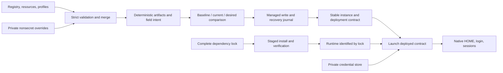

# Architecture

Rotom separates shared intent, native translation, dependency installation, configuration deployment, and process launch. DSH, Pi, and OMP implement distinct adapters; Codex is an authentication route or a delegated official CLI, not a fourth configuration adapter. `termcfg` has its own command and transaction model.

## Upstream hosts remain unmodified

Use official configuration, public plugins and extension APIs, official CLIs, and repository-owned adapters. Do not patch agent source, official binaries, cached distributions, or private host interfaces. Historical patch material is retained only for provenance and migration analysis. Its presence does not authorize rebuilding a patched host.

OMP now uses an official standalone runtime and an independent permission plugin. Current DSH uses unmodified Core/TUI and public extension points. Pi retains historical derived plugin and build material that still needs a source-by-source audit; it must not be described as fully migrated solely because it has a source URL. See [Roadmap](roadmap.md).

## Data flow

| Subsystem | Code entry points in `src/agentcfg/` |
| --- | --- |
| Commands and selection | `cli.py`, `commands.py`, `workspace.py` |
| Input and rendering | `config.py`, `schema.py`, `merge.py`, `render.py` |
| Ownership and recovery | `deployment.py`, `native_projection.py`, `storage.py` |
| Dependencies and launch | `backends.py`, `runtime.py`, `process.py` |
| Native adapters | `dsh.py`, `pi.py`, `omp.py` and related modules |
| Pi supervision and evidence | `pi_supervisor.py`, `pi_delegate*.py`, `pi_validation*.py` |

`src/termcfg/` separately implements zsh/tmux previews, transactions, pinned plugins, and explicit legacy metadata migration. Proxy service control has been removed. It does not run implicitly from agent setup or launch.

## Configuration and secrets

Objects merge recursively; arrays normally replace wholesale, including empty arrays. `false` remains meaningful. The shared default model layer adds deduplicated provider/model choices and lets explicit role bindings take precedence. Stable local model IDs are separate from remote IDs and protocol routes.

SecretStore is separate from ordinary configuration. Renderers and digest builders receive no secret values. Shared secret files and legacy inline entries may coexist only under the documented conflict rules. Launch resolves the deployed references for the required operation; capture reads a narrow nonsecret allowlist. Current `load_local` also loads SecretStore on configuration preparation paths. Avoiding early credential reads is a planned refinement, not a property already established for every validate/render/plan/doctor path.

Native authentication, trust, sessions, and logs remain native-owned. A user interface preference may be initialized once without becoming continuously managed. Unknown native fields survive field-level merges; unknown Rotom input fields fail validation.

## State, installation, and execution

A deployment has a stable owner, current field baselines, at most one previous configuration generation, and a pending journal during interrupted multi-file work. Three-way comparison preserves user drift and detects conflicting edits. Single-file replacement is atomic; the system does not claim atomicity across files or external processes.

The dependency backend consumes a complete lock and verifies staged output before activation. `apply` installs nothing. `run` uses a saved deployment contract and performs no implicit sync or apply. A stale repository lock can block new deployment while an earlier deployed runtime remains launchable under its saved contract; this distinction matters for the current Pi issue.

Private storage uses directory handles, no-follow traversal, ownership and ancestor checks, and rechecks before writes. Leases protect managed instance, state, and runtime operations. OMP ordinary sessions use shared leases and configuration mutation requires exclusive access. DSH and Pi still use exclusive run admission; DSH also prepares shared profile resources during run, and Pi ties admission to exclusive physical-instance and activation ownership. Background descendants may inherit lease descriptors; the unresolved lifecycle issue is tracked in the Roadmap.

These controls are not an OS sandbox against arbitrary same-user processes. Host sandbox and approval coverage must be assessed independently. See [state and recovery](design/configuration-state.md), [approval design](design/approvals.md), [adapter contract](adapters.md), and [testing](testing.md).

## Planned project boundaries

The [project refactoring plan](design/project-refactoring.md) targets concurrent runs
of different native sessions with exclusive maintenance across all three adapters.
Deployment/profile, runtime package, run invocation, native session, Pi execution
attempt, Git worktree and credential provider have separate identities. Shared run
admission does not authorize uncontrolled writers in the same worktree or alter
native sandbox and approval boundaries.

Shared resources must be prepared or migrated under maintenance; ordinary run then
validates them and allocates only necessary private run state. Pi's preferred direction
is independent per-run supervisors/namespaces with instance-wide maintenance
aggregation and cross-run worktree leases. Its state schema and migration protocol
remain an implementation design gate; a daemon or shared activation is not assumed.

`termcfg` now manages zsh/tmux. Its [explicit migration](termcfg.md#retiring-an-existing-mihomo-selection)
retires mihomo ownership metadata while preserving old targets, backups and private
proxy data. Strict v1 recovery remains available before migration to v2 state.
A future independent proxy project has not been created. Proxy environment values
remain an external-service contract consumed by agentcfg; `dsh-proxy` does not own
service startup. No existing proxy service is stopped or transferred by this change.
