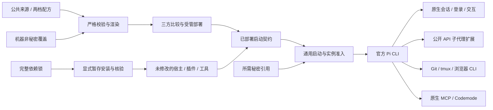

# Pi 工具集合 v2 整体设计

临时设计材料：仅用于开发分支讨论；合入 `main` 前必须删除，或整合到正式文档后移除本临时文件。本地提交不代表设计已采纳或产品已验收。

状态：设计草案。用户已确认高阶版默认灵活协作；具体组合尚未经过运行验证。

## 1. 问题与设计原则

旧方案同时管理宿主、权限、任务数据库、执行租约、子代理、外部 agent 委派、监督进程和恢复证据。能力之间相互依赖，升级单个社区包也可能影响整条执行链。其代码与历史验收不能推出当前版本已经可部署。

新版遵循以下顺序：先使用 Pi 原生能力，再选择声明式资源或跨宿主工具，最后才引入 Pi 专属扩展。同类能力默认只有一个提供方。公开接口不足时缩小功能范围，不补丁宿主或访问私有实现。

维护预算属于设计约束：基础版默认没有第三方进程内扩展；高阶版首版以一个子代理扩展为目标。增加第二个默认扩展必须证明其解决的实际问题、替代关系和禁用路径，不能仅因功能丰富入选。

## 2. 产品结构与配置维度

| 层次 | 职责 | 不承担的职责 |
| --- | --- | --- |
| 公共基础 | 官方运行包、精简规则、提示模板、终端偏好、来源及锁 | 账号、私人端点和具体项目状态 |
| `pi-base` | 单 agent 开发、原生上下文和会话体验 | 子代理编排和自动化开发流程 |
| `pi-pro` | 基础能力加子代理角色、复杂任务 Skills 和模块入口 | 自有任务调度服务、全链恢复承诺 |
| 能力模块 | 文档、搜索、浏览器、语义导航、外部隔离 | 各自再派生一套公开 profile |
| 机器覆盖 | 模型绑定、可执行文件位置、服务启用、非秘密端点 | 将秘密内联进配置或渲染产物 |
| 项目资料 | 项目规则、计划、任务和交接文档 | 绕过资源准入或改写受管实例 |

`pi-base` 和 `pi-pro` 是拟新增的配方名称，当前尚未注册。实施时复用现有 registry/profile/adapter 结构，不因本设计预先新增通用 schema 字段。模块是产品组织概念；具体配置优先使用已存在的插件、资源和服务绑定能力，确有不足再提出最小 schema 变更。

两档共享配置生成逻辑和运行包来源，正常情况下使用同一宿主版本，各自保有独立完整锁和实例状态。高阶版适配落后时可以暂时冻结其版本，不阻塞基础版升级；不得因此维护宿主分叉。

## 3. 运行与部署架构

管理器不代理模型请求、不重写 agent loop、不转接每个工具调用，也不为社区包建立兼容 facade。主进程、扩展与工具的执行方式由其公开接口决定。

### 3.1 命令的副作用

| 命令类别 | 允许行为 | 必须避免 |
| --- | --- | --- |
| validate/render/plan | 离线校验、生成非秘密意图、查看差异 | 加载扩展、解析秘密正文、访问服务 |
| lock | 显式解析来源、完整依赖及不可变身份 | 登录、调用模型、默认更新未选择模块 |
| sync | 按锁暂存安装、核验、激活运行包 | 启动 Pi、登录、改写依赖锁 |
| apply/rollback | 遵守所有权的配置变更与恢复 | 安装、软件降级、回滚原生状态 |
| run | 验证已部署契约并启动官方 CLI | 隐式 sync/apply、拉取缺包、修补宿主 |
| doctor | 默认离线诊断和非秘密状态 | 把版本检查变成宿主启动或认证读取 |
| 显式 live 检查 | 对声明服务执行获授权的可达性检查 | 自动登录、输出秘密、暗中调用模型 |

Pi CLI 选项及资源行为以 [v1.3.0 CLI 文档](https://github.com/earendil-works/pi/blob/v1.3.0/packages/coding-agent/docs/cli.md)为研究依据；未来支持的具体 argv 必须绑定最终版本。

### 3.2 受管资源与项目发现

官方 Pi 在信任项目后可加载项目资源并安装缺失包；`sessionDir` 又存在先于信任解析的特殊行为。仅把 `defaultProjectTrust` 设为 ask，不能满足仓库“run 不隐式安装”的要求。[项目信任规则](https://github.com/earendil-works/pi/blob/v1.3.0/packages/coding-agent/docs/security.md)

默认受管启动作以下选择：

1. `PI_CODING_AGENT_DIR` 和 `PI_CODING_AGENT_SESSION_DIR` 指向该配方的稳定实例位置；同时用显式 `--session-dir` 避免项目设置改变会话归属。
2. 不向受管 `settings.json.packages` 写远程 npm/git 声明；资源从 sync 已准备的本地锁定目录加载。run的只读preflight检查原生非秘密资源声明；发现用户漂移加入的未准入package时拒绝受管启动并报告位置，不自动删除或安装。保留漂移不等于接纳新依赖。
3. 使用公开的 `--no-approve` 忽略项目中受信任后才加载的配置和可执行资源。保留 `AGENTS.md` 等上下文文件的原生发现，不宣称它们经过隔离或安全审查。
4. 使用公开资源开关关闭隐式扩展/Skill/模板/主题发现，再通过显式参数加载已部署资源。基础版需要的官方内建扩展也显式列出；不能使用 `--no-extensions` 后误以为原生 MCP 仍自动存在。
5. 高阶版的子执行必须遵守同样的实例、会话、资源和禁止启动安装约束。前台可能是公开 SDK 创建的进程内会话，后台可能是子进程；按各自公开配置验证等效约束，不强求任意 CLI argv 透传。继承同一 profile 的 agent directory 可以接受，不要求为每个子任务建立新账号目录。

父进程候选 argv 结构是：官方 CLI + 明确的会话目录 + `--no-approve` + 各类发现开关 + 精确资源路径。它不是本轮可执行命令；资源相对位置、内建扩展集合、子会话的等效配置都要在原生验证后冻结。

代价是项目 `.pi` 中的任意新插件不会自动生效。需要的项目资源先显式审阅、登记来源和锁，再通过维护阶段准入。不能为了原生自动发现体验，绕过依赖契约；将来若需完整原生项目发现，应另行设计可验证的无安装路径。

### 3.3 原生 MCP 与独立工具

使用 `mcp.json` 的原生格式和公开配置，不建立第二套 MCP 路由。服务默认关闭或未配置；用户启用模块后，sync/apply 准备依赖与设置，下一次运行再连接服务。

默认使用原生 `codemode` 或 `deferred` exposure；仅少量高频工具考虑 direct。**延迟暴露工具不等于延迟启动服务**：Pi 可能在会话开始连接每个已启用服务器，配置较多服务仍有进程和网络成本。基础版不预启用外部 MCP，高阶版默认也只启用用户实际配置的模块。[MCP 连接与 exposure](https://github.com/earendil-works/pi/blob/v1.3.0/packages/coding-agent/docs/mcp.md)

stdio 服务使用已安装的精确可执行文件及参数；不使用无版本 npx/uvx 在 run 时安装。HTTP 服务由机器覆盖声明，凭据在启动时按需注入。每个 Pi 会话可能建立自己的连接或服务进程，不设计跨会话共享常驻中转层。

## 4. 配置、秘密与状态所有权

| 资源 | 拥有者 | 新设计处理 |
| --- | --- | --- |
| 运行包、插件、工具 | 依赖后端 | 内容身份和完整锁；暂存验证后激活 |
| settings 的受管字段 | agentcfg | 三方比较；冲突失败；未知非受管原生字段保留 |
| 模型目录、提示、精选 Skills | agentcfg | 静态资源，不加载执行；保留相对引用与许可 |
| UI 偏好 | 原生用户为主 | 优先初始化一次；持续受管字段应逐项声明 |
| MCP 服务定义 | agentcfg 与非秘密机器覆盖 | 只管理已声明服务器；不接管其它条目 |
| 原生 auth、MCP auth、trust、会话和日志 | Pi 实例 | 不 capture、不入配置备份、不跨配方复制 |
| SecretRef 与秘密正文 | 私人 SecretStore | 启动按模块解析；配置摘要只保留引用 |
| 项目计划与交接 | 项目/用户 | 普通文件，路径与是否进入版本库按项目约定 |
| 浏览器 profile、缓存、语义索引 | 对应工具 | 独立实例/项目位置，明确删除与保留策略 |

秘密引用属于管理器输入；不能假设任意 `SecretRef` 对象可直接放入原生 Pi JSON。适配器应输出上游支持的环境变量引用，秘密正文只进入启动环境或明确支持的私有通道，不进入 argv、摘要、异常和备份。

上游支持某些配置值执行命令，不代表本项目采用该功能。首版不生成从配置执行任意认证命令的表达式，避免扩大秘密和 shell 求值路径。

## 5. 高阶版的灵活协作

### 5.1 任务复杂度与默认行为

| 场景 | 默认行为 |
| --- | --- |
| 单点修改、解释、局部排查 | 主 agent 直接完成，做与风险匹配的验证 |
| 多文件改动但依赖清楚 | 简短计划，按需调用调试/验证 Skill |
| 独立调查与实现可并行 | 主 agent 分配具体任务包，最多两个子任务 |
| 事务、锁、恢复、秘密边界等关键改动 | 主 agent 决策与最终验收，子代理只提供有边界的执行和证据 |
| 大型功能、多人协作或长期维护变更 | 显式采用项目已有 OpenSpec 或 Spec Kit 流程，保持单一任务真相源 |

复杂度判断是行为规范，不能宣称是可靠的自动分类器。用户可随时要求直接执行、禁用委派或完整规划。完整 Superpowers 引导不默认加载，以免为所有任务增加流程和上下文。

### 5.2 子代理任务包与约束

初始角色为 `scout`、`worker`、`reviewer`。每个任务包提供目标、必要输入、可写路径、接口与不变量、验收命令、返回格式和升级条件。模型与推理强度从机器角色绑定解析；缺少绑定或凭据时明确失败或经用户指定回到主 agent，不静默切换至另一费用/认证路径。

默认不递归委派，同时最多两个子任务；同一文件由单一写入者负责。共享工作树适用于只读调查加一个明确写入者。多个写任务需要各自工作树与主 agent 集成；worktree 只隔离 Git 工作副本，不隔离文件系统、进程、网络或凭据。

社区插件能否落实并发上限、工具集、启动参数、取消和资源继承，列为准入条件。仅靠提示约束达不到硬限制的项目，文档应标记为行为约定；若用户需要强制隔离，则采用外部执行边界。

### 5.3 结果、失败与上下文

子代理返回变更路径、实际验证、失败、未覆盖范围和需要主 agent 决策的事项。大输出保存到有归属的本地结果文件，主会话接收摘要与引用。文件只包含当前任务必要信息，保留策略由用户/项目决定，不自动上传会话。

首版验收同步完成、失败返回、有限并行、用户取消和正常退出。若后台任务不能可靠回收或重新定位，后台模式保持关闭。恢复采用原生会话和任务交接文件，不新增任务数据库、执行事件总线或跨崩溃重放协议。

## 6. 管理器维护锁与运行时编排的区别

放弃旧 Pi 执行平台不等于删除公共部署保护。保留每实例稳定身份、共享运行准入、独占维护、pending 恢复和不自动终止用户进程的约束。新路径复用通用运行生命周期，避免 Pi 专属逐工具租约和监督服务。

这里有一个必须由主代理在实现前解决的技术验证项：官方 CLI、MCP 与子代理进程的存活期怎样与公共实例准入关联。只等待主进程退出或随意向后代继承锁描述符，都不能自动证明维护安全。应检查现有通用 runner，并用假进程覆盖后台后代、异常退出、未知 owner 和维护冲突。

验收不满足时，先限制后台功能和维护并发，不以强制终止进程、删除 owner 或恢复旧监督平台来通过测试。实现若需要改变公共生命周期契约，必须单独设计、复核和验收，不能伪装成 Pi 配置简化。

## 7. 宿主和插件升级策略

Pi 1.3.0 与 Node.js 22.19+ 是本次来源研究基线，尚未成为部署支持声明。[版本包清单](https://github.com/earendil-works/pi/blob/v1.3.0/packages/coding-agent/package.json)

每个支持组合记录宿主发行物、插件发布包、源码提交、依赖锁、模块工具版本和平台。npm 直接依赖固定版本仍不等于完整可复现；不能只写 `pi install ...@版本` 就宣称传递依赖已锁。

首版候选获取方式按以下顺序评估：

1. 仓库已有依赖后端在暂存目录使用完整锁安装官方发布包和未修改扩展。
2. 若官方发行物提供可验证、可固定的完整安装资料，评估是否简化宿主依赖准备。
3. 源码构建仅使用未改动上游、固定输入和官方流程，作为必要时的备选。

本轮不决定更换依赖后端，也不直接执行官方安装脚本。选择条件包括完整锁、校验、可离线检查、实例 home 不变和运行时不更新。升级按组合验证后推广；基础版和高阶版可分别冻结，禁用问题插件优先于本地修改上游。

配置 rollback 仅回滚受管配置。软件版本切换与状态格式兼容是另一项维护操作；保留旧运行包不等于允许用旧二进制打开已被新版写入的会话或数据库。

## 8. 能力边界与未承诺事项

目标是覆盖软件开发闭环，不承诺与 Claude Code 所有功能和权限语义一致。首版不建设自动文件快照系统、后台任务数据库、agent teams 通信总线、通用多 agent 沙箱、自动模型路由或全局长期记忆。

原生会话分支不撤销磁盘修改；代码恢复优先依靠 Git 和明确的工作副本。工具可见性和提示约定不构成 OS 隔离。安全与隔离模块的范围见[选型文档](plugin-selection.md)，实际支持见[验收矩阵](capabilities.md)。

## 9. 与现有工程规则的关系

本设计保留宪章关于所有权、确定性部署、秘密、完整依赖、公共维护锁及测试边界的要求；不修改其它宿主或终端工具。旧 Pi 规格的功能完整性要求不能继续作为新版必须复制执行平台的依据。

进入实施前创建独立变更，列出哪些旧条目由新需求替代。若具体方案确实改变宪章要求，应先明确修订，不在实现中静默豁免。新设计的来源、配置和旧资源映射在[迁移文档](migration-and-validation.md)继续细化。
