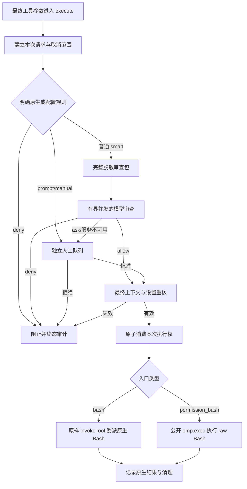

# OMP 自动审批全链审查与稳定性修复方案

日期：2026-10-11。审查基线：`main f3ff47e`，官方 OMP `18.8.6 / f068751e2f1dbdbc195977776d47a26db8697495`。
状态：用户已要求实施权限插件与普通工具环境修复，网络代理延后；实施将在独立 worktree 完成。本文件不是修复完成或部署通过记录，不修改 agent 上游。

## 结论与范围

问题需要在审批生命周期、脱敏、执行环境和测试接线四处共同解决。
继续增加命令语法例外或提高 hook 超时，不能解决当前结构问题。

本次覆盖 OMP 审批生产入口、原生委派、审查输入/传输/审计、配置来源门禁、管理器启动、身份、部署/回滚与相关测试。
不将 DSH、Pi、termcfg 等无关模块的全库审查计入本次范围，也不把旧 core/宿主补丁验收当作生产 standalone 插件证据。

保留用户已明确的要求：不修改任何 agent 上游源码；本地插件；smart 模式先模型；只有明确配置禁止/询问规则可前置；语法分析是辅助信息；送审前强制脱敏；批准只绑定本次原操作；主审与执行模型分别配置；有效 ask/deny 不继续寻找更宽松模型；人工处理服务不可用时不得覆盖硬禁止。

## 确认的问题

P1 表示本轮应优先修复的隐私、来源控制或核心可用性问题；P2 表示需一并处理的可靠性与兼容性问题。没有证据说明真实凭据已经泄漏或来源缺口已被利用。

| ID | 优先级 | 触发条件与影响 | 证据 |
| --- | --- | --- | --- |
| A01 | P1 | Cursor 同时发起 Bash 调用，每个宿主 hook 独立计时 30 秒，插件串行队列等待也计入；普通命令在执行前超时 | `standalone.ts:302,321,544`；官方 runner `toolCallTimeoutMs`；官方 Cursor 专用并发桥接；两份用户会话中的扩展超时 |
| A02 | P1 | 多行引号凭据只遮蔽第一段，剩余段进入 ready 审查包与人工标题 | `review-input.ts:10,56,63-77,100-117`；实际生产函数副本的纯离线 canary 复现，单/双引号均确认 |
| A03 | P2 | invalidate 清 pending 却保留旧 Promise 队列；不可取消的 capture/recheck 挂起时，新代请求也等旧 gate | `standalone.ts:308-335,559,564,593`；`native-bash.ts:317-330`。源码确认，尚未运行挂起宿主验收 |
| A04 | P2 | 新用户输入仅在后续检查中令审批过期，没有立即撤销 fetch/UI/队列等待；宿主 hook 超时也不能将其 signal 传入插件 | `standalone.ts:149-153,391-424,461-469`；官方 ToolCallEvent 无 signal。最终检查可阻止 stale 执行，但等待与资源清理不完整 |
| A05 | P2 | hook 批准后，下游扩展或宿主门禁阻断，execute 没有进入，ticket/capture/diagnostic 没有及时终结 | `standalone.ts:509,533-536,579-602`；官方 wrapper 的后续 block/preflight/approval 路径 |
| A06 | P2 | `nativeBash:false` 的 raw execute 没有统一的重复调用保护；raw 锁还覆盖完整 Shell 执行 | `standalone.ts:664-748`。重复调用可重新审批再执行；未观察到实际 Cursor 重放 |
| A07 | P2 | 先 response.text() 读取完整响应，再检查 64KiB，不能限制读取量和内存分配 | `standalone-reviewer.ts:249-257` |
| E01 | P2 | 受管 HOME/XDG 改写，XDG_RUNTIME_DIR 删除，非名单变量丢弃，使应用配置、Git 全局配置、shell 初始化或工具环境不可见 | `process.py:10-34`；`omp.py:804-807`。PATH 保留/机器覆盖后前置 runtime/bin，不能统称 PATH 被清空 |
| E02 | P1 | 来源检查漏掉命名 profile configRoot/.env，而官方在 import 时读取该路径 | `omp_discovery.py:253-260`；官方 env.ts:289 与 dirs.ts:119-121。合成存在性检查确认门禁接受 |
| E03 | P1 | 固定 dotenv 列表漏 `.env.development.local` 和有效 NODE_ENV 对应的 mode/mode.local | `omp_discovery.py:14,195-200`；官方 env.ts:110-112,161-165。集合遗漏确认；官方 compiled 宿主实际 autoload 另行验收 |
| T01 | P2 | pytest core 只选择包内 tests/*.test.ts，生产 standalone 两套测试在包根；fakeHost 不经过官方 Cursor/wrapper 生命周期 | `tests/test_omp_permission_control.py:199-204`；`standalone.test.ts:40-124`。未发现这组 pytest 的 standalone 接线；不推断外部 CI 完全没有单独执行 |
| T02 | P2 | 默认 fixture 空 HOME/环境、单条假执行，漏用户 Git/rc/XDG、并发、长 UI 等待和命令内部失败 | `tests/conftest.py:54-85`；`test_omp_runtime_foundation.py:263-305`。大量解析场景不能代替这些集成场景 |

当前 strict JSON、重复 JSON key 检查、1024 token 输出预算、有效决定终止 fallback、原执行参数不改写等仍有价值，应保留。
没有证据把本次剩余所有 JSON_INVALID 归因于输出截断，不能靠放宽解析或提取回答中的 JSON 片段掩盖故障。

## 参考实现与可借鉴边界

### Codex Approve for me

[官方 Auto-review 文档](https://learn.chatgpt.com/docs/sandboxing/auto-review)明确：自动审查适用于需要审批的边界请求，沙箱内已经允许的操作不会额外审查；沙箱权限边界保持不变。因此其较少弹窗不能直接与本项目每条 smart Shell 都送审的要求比较。

[中央审批路由](https://github.com/openai/codex/blob/main/codex-rs/core/src/tools/approvals.rs)把动作、执行环境、cwd、权限及 cancellation 放入结构化请求。
[decision 实现](https://github.com/openai/codex/blob/main/codex-rs/core/src/guardian/decision.rs)合并外部取消与历史重置，并在扩展回调之后再次检查取消。
[review session 实现](https://github.com/openai/codex/blob/main/codex-rs/core/src/guardian/review_session.rs)把具体动作、父上下文、授权、取消和 deadline 绑定到一次审查，并有独立 reviewer session 管理。
[policy template](https://github.com/openai/codex/blob/main/codex-rs/prompts/templates/guardian/policy_template.md)分别判断固有风险、用户授权和策略结果，工具/助手内容不能自行授予权限。

以上核对的是抓取时的公开 main，不证明它与本机 Codex 二进制版本逐字相同。旧文档指向的 core/src/guardian/policy.md 已不可获取，使用当前 prompts/templates 路径，不照抄失效链接。

借鉴动作与上下文绑定、统一取消、明确策略层和独立审批服务。保留本项目审查前脱敏和现有低风险自动批准边界；不照搬 Codex 沙箱内免审或中风险默认允许，也不把 OMP 应用内审批说成 OS 沙箱。

### Pi / pi-jev-auto-mode

[Pi 官方扩展文档](https://github.com/earendil-works/pi/blob/main/packages/coding-agent/docs/extensions.md)说明 tool_call 阻断、同一消息工具并发和活动回合 signal。这些是 Pi 自己的 API 语义，不能证明 OMP hook 没有 30 秒期限。

本次 Jev 参考限定为 [jomatsu/pi-jev-auto-mode](https://github.com/jomatsu/pi-jev-auto-mode)，不等同所有同名 Jev。按其 [design](https://github.com/jomatsu/pi-jev-auto-mode/blob/main/docs/design.md) 与 README 文档描述，设计将规则、条件模型判断、代码侧归并及用户意图分开，意图授权只来自用户消息。这只能证明文档所述设计，不能确认未取回源码的实际行为。

文档描述的默认只读检查与项目内未保护写入快速放行、截断 Bash 命令后送审，不符合本项目完整命令先模型要求。[calibration](https://github.com/jomatsu/pi-jev-auto-mode/blob/main/docs/calibration.md)的小样本不能证明阈值适用于当前 Kimi/GLM。
[发布页](https://github.com/jomatsu/pi-jev-auto-mode/releases)的 v0.4.1（短 SHA 06a5604）称 unclear 默认放行，抓取的 main 文档记为拒绝；main HEAD 未核实，不能把 main 文档默认值说成当前发布行为。
具体 extension/response/intent 源文件未能经本次浏览/下载取回，因此不能声明已经核实它的队列、取消和 UI 实现。外部参考不构成本项目修复通过证据。

## 推荐架构：在实际工具 execute 内拥有整个审批请求

沿用当前插件与命令名，将原生 bash 与 raw permission_bash 的审批共享为一个服务。
tool_call 仅执行快速、无长期等待的协议检查与观察；取上下文、模型、人工等待、最终重核和委派均由 registered execute 负责。

公开 same-name registerTool 与 ctx.invokeTool 已存在；invokeTool 调用未包装的 native execute，保留 interceptor、worktree rewrite、signal 与进度回调。
它不再执行第二次宿主审批，也不发第二套同名工具事件。因此原生 deny/prompt 捕获和重核仍由本插件明确保留，不能删掉之后声称 native delegate 自动保证下限。

### 请求、队列和取消

每个请求拥有独立 ID、原参数、本地原操作、脱敏包、session、generation、用户授权版本、cwd、执行模型、设置指纹、阶段与控制器。记录在入口建立，终态由同一个幂等 finalizer 完成。

- 模型请求使用有限并发，初版建议两个槽位；不让模型服务承受无上限批量，也不让人工等待占模型槽位。
- 人工 UI 单独串行，等待用户时不占模型槽位或执行锁。排队状态可见，取消立即移除等待项。
- 模型总预算继续覆盖主审与一次备用；排队、capture、UI、执行分别有自己的生命周期。宿主短 hook 期限不再承载它们。
- capture/recheck 等无法底层中止的 Promise 必须用可取消/有界等待接管；迟到结果丢弃，不取得执行权、不写新代状态、不调用备用。
- generation 切换撤销未执行请求，并启用新代队列；旧代 finally 只能释放旧代资源。
- 在每个异步边界之后，以及消费执行权之前，再检查 session、授权/待输入、generation、参数与 settings。
- 即使 Cursor 没有传入 execute signal，也使用插件自己的取消范围和期限；公开用户输入事件只覆盖部分宿主路径，不能虚构一个全覆盖通知。继续保留 hasPendingMessages 与最终授权校验。
- 模式切换撤销待审与批准未执行操作，不自动终止已经开始的命令。显式工具取消、宿主退出的处理遵循官方 signal/生命周期，不自动 kill 活动 OMP 实例。

审批取消与运行取消必须拆开：消费执行权时解除 generation/model-review deadline 对运行 signal 的连接，仍保留 caller/host 的显式取消。否则模式切换会通过合并 signal 杀死已经开始的命令。必需验证消费后切模式仍继续、caller abort 则取消，不能只测消费前取消。

### 一次执行与原生委派

native 和 raw 都在入口建立不可复用执行账目。相同 session/toolCallId 重入必须阻止；审批通过不能重复消费。
批准后原子消费，再释放审批资源并调用 native/raw 执行；审批资源不覆盖完整 Shell 执行时长。
未执行 pending/ticket 有期限和明确终态；已经消费的 ID 按会话保留，不以随意淘汰的缓存换取重放机会。若确需容量上限，满时显式拒绝新操作。

最终参数取 registered execute 实际收到的 effectiveParams，避免此前 hook 参数与后续扩展改参不一致。任何执行前新参数都必须重新审查；实际 delegate 仍逐字/逐字段保留原参数。
配置/文件可能在检查和运行之间改变，公开接口不提供整个 Shell 副作用的原子冻结；保留这项真实能力限制。

### 脱敏与模型策略

优先修复完整多行字面量的跨度识别，覆盖单/双引号、拼接、真实换行与续行区别。
不得盲目遮蔽整个动态凭据表达式而隐藏其中的命令替换副作用；保留执行结构和被遮蔽事实，不展开秘密引用或执行脚本。不能形成安全审查包时按明确隐私规则阻止发送。

审查传输继续只接受已验证的冻结包，主审/备用使用相同包；人审显示复用同一脱敏职责。响应按流累计 byte，在超限时取消读取。

风险、授权、故障与能力不足分别表示。完整且合法的 ask/deny 是审批结果；TIMEOUT、HTTP_NON_OK、JSON_INVALID 是服务结果；不能绑定 native route 是集成能力结果。
保持当前主审选择及备用条件，不将有效 deny 交给更宽松备用复审。概率阈值或 Codex 的默认风险政策不成为这次修复依赖。

复杂文件状态调查属于独立能力设计；本轮不为审批引入能任意运行命令或读取密钥的模型工具。

### 审计与状态

每个 admitted 请求有一次本插件终态；入口已被其他扩展阻断的请求只能依据公开可观察事件记录，不承诺观察所有宿主内部分支。
记录固定阶段码、阶段耗时、请求关联、模型尝试类别、规则来源、取消/超时位置和委派结果；不保存原命令、用户文本、模型正文、异常 message/stack 或秘密值。

status 区分注册状态、能力覆盖、审查服务健康、排队/审查/UI/执行中数量。explain 指向具体请求或最后完成请求，不用全局上一条成功解释当前失败。
区分“模型批准”“调用 native”“native 返回”“业务目标完成”；Shell 内部失败被 || true/管道隐藏、后台 job 尚未完成等不能由 isError=false 自动证明业务成功。
审计接收与持久化也分别陈述；日志故障应可见，不能宣称证据完整。

## 管理器环境与状态路径分离

工具 HOME 与 OMP 的物理 state-home/config-root/agent-dir 分开建模。
本机候选使用真实 HOME + 管理器生成的 PI_CONFIG_DIR + 原 native profile，保持原 .omp 与 agent 绝对路径。机器和调用者不能任意替换身份变量。
普通工具 XDG/运行目录与必要非秘密环境变量有显式策略；不盲目继承全部环境或向模型采集环境秘密。交互函数不能保证自然出现在非交互工具中，必须用合成 rc/shell 场景验证，并记录真实使用的嵌入式执行后端。

现有 native-bash.ts:262-288 会将 Bash startup、继承函数或未知 snapshot 状态标为非标准上下文。恢复真实 HOME 后，常见 .bashrc 可能触发该边界，不能仅环境测试通过就宣布普通 Bash 智能审批可用。
实施时必须分开“请求/设置/执行路线无法绑定”与“正常初始化来源使效果存在未知项”：前者属于集成失败，后者需如实作为模型证据，并结合来源契约和最终重核评估支持。不能把模型 allow 当作缺失绑定证明，也不能承诺自动继承全部交互函数；公开接口不足的具体路线仍列为未支持。此项是环境迁移的验收门槛。

按官方有效路径选择计算 auth、session、history、blob/cache 与 base-level session owners，不能只看 agent_dir。
初版遇到已有真实 XDG OMP 根导致存储/租约重定向时，明确拒绝该布局或要求独立迁移；不悄悄切换账号和会话。
官方会尝试读取 HOME/.env，没有公开关闭开关。来源门禁必须覆盖 HOME、base root、active profile config root、agent root、project 与有效 Bun mode/mode.local；使用存在性/链接检查，不读取正文，并在 spawn 前重检。
这仍不是 OS 级不可读取保证；有实际 dotenv 且用户禁止读取时，公开接口不能同时满足真实 HOME 与绝不读取，应报告能力限制。

### 部署与恢复取舍

当前 owner 使用精确身份 equality，且生命周期锁在部署 pending 恢复之前获得。贸然将 NativeIdentity 改为 layout v2，会先被旧 owner 拒绝，无法进入 apply/rollback。
最小方案优先保持物理 NativeIdentity/owner/state-home 不变，新增版本化 execution-environment binding；当前序列化 home 仍代表物理 state-home，在诊断中明确区分。
如果必须修改物理 owner/layout，需单独设计同时验证旧/新绑定的迁移事务，不能直接更新预期值。

复用已有 physical instance、deployment state、runtime leases；环境契约仅变化也应进入 plan 与 previous。保留原账号和会话文件原位，不将正文放进候选、日志、摘要或回滚快照。
检验崩溃前/后 pending 恢复和环境-only rollback。运行包源码/锁变化与环境契约变化分批验收，以便定位故障；部署前检查活动实例并制作允许范围的管理状态备份。

## 验收标准与顺序

1. **隐私与来源先行**：真实换行 canary、动态表达式结构、profile-root 与 mode.local dotenv 缺口复现固定预期；出口/备用/UI/audit 无假秘密；来源失败发生在 spawn 前且不读正文。
2. **生命周期单测**：所有阶段取消、永不 resolve 的 capture/recheck、代际切换、迟到 allow、同 ID 重入、未进入 execute 的清理；原生/raw 副作用计数最多一次，后继请求可推进。
3. **官方 adapter 集成**：官方 registered-tool/wrapper 加假 Cursor 并行驱动，至少 10 条混合请求；模型慢、人工等待超过旧 30 秒、设置变化、其他扩展改参/阻断、宿主拒绝、progress/abort、原生 deny/prompt/interceptor/worktree。无需真实账户和模型。
4. **工具环境契约**：临时用户 HOME、假 Git 全局配置/用户 bin/rc 函数、真实式 XDG appconfig/socket、非秘密变量与秘密哨兵；Bash/read/glob 解析一致，账号/session/leases 路径保持。
5. **冻结历史集合**：继续使用已有场景/期望，验证每条有效普通命令先模型，明确规则与空/无效请求的边界。每条 case 明确证明范围，不能把路由核对计为命令执行成功。
6. **测试入口接线**：默认命令确实选择生产 standalone、reviewer、review-input/native-bash 与官方 adapter 场景；不把 legacy/core tests 当主验收。历史通过报告保留，开放问题链接到新记录。
7. **隔离宿主与真实 reviewer**：先本地假模型官方宿主的并发/等待与环境验收；通过稳定差量审查后再按用户授权做有限真实模型请求。隐私修复前不拿真实秘密送审。
8. **部署**：worktree 内实现、稳定 diff review、合入、准备官方运行包、管理状态备份、plan/apply/doctor；活动会话不能自动终止。所有未知/环境不足结果单列，不计为通过。

完成标准不是所有命令静默通过：普通命令模型允许后执行一次；模型 ask 与服务故障的人工路径解释正确；明确 deny 不能执行；取消/过期/隐私失败零副作用；批量请求不会因审批 hook 排队而超时；工具环境符合声明；真实能力边界可见。

## 本轮验证记录

- 实际 redaction/packet/display 函数副本：单/双引号多行假凭据后段均泄漏，确认 A02；未调用真实模型或宿主。
- 来源集合与环境白名单合成检查：确认 E02/E03 集合遗漏，以及非秘密兼容键丢失。
- 相关 Python suites：正常目录所有权视图、可信临时 HOME 下 `110 passed`；当前 sandbox 的 nobody 根目录映射及仓库上层可写属性曾使路径检查失败，失败记录保留，没有弱化检查。
- 这 110 项通过不覆盖已发现问题，也不构成新版架构通过。
- 未运行本轮官方宿主、真实 reviewer、用户 rc/Git 配置查询或新架构并发验收；未读取账号数据库与密钥文件。
- 复现、失败与测试输出位于忽略的 `.cache/omp-review-20261011/`，不纳入 Git。
