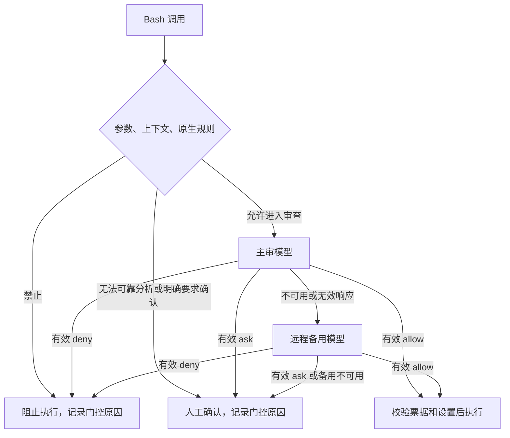

# OMP 权限审批诊断与验收

产品可用性标准正在按用户反馈重审，见 [产品验收重审草案](omp-permission-acceptance.md)。本文记录诊断流程与有限验证证据；既有安全回退和宿主 smoke 通过不等于普通任务体验已达标。

2026-10-11 已按模型优先标准复用全部冻结场景重测，见 [新标准路由基线](omp-model-first-baseline-20261011.md)。三条路径的有效命令到达模型率均为 87.85%，该项验收未通过。

智能审批的验收目标是每次调用都有可以解释、可以验证的路径：普通且已获授权的命令进入模型审查，明确禁止的动作被阻止，需要用户决定的动作保留人工确认。人工确认次数为零不能证明安全或正确。

集成使用官方 OMP、公开扩展 API 与本仓库插件；不修改上游源码或二进制。默认验证只使用仓库和临时 HOME、假模型与假执行器。真实宿主 smoke 需要单独授权。

## 如何逐次排查

每个分支都需通过诊断记录验证。不能用“工具成功”推断模型批准，因为人工批准也会成功；不能用最后一次 `health` 推断整个会话的每次请求状态。

在弹窗结束后使用 `/permission-control explain` 查看最近完成的调用，使用 `/permission-control status` 检查模式、覆盖范围、模型健康与审计状态。审计记录写入 OMP 会话的自定义条目 `permission-control.audit.v1`。调用正在审核时尚未形成终态，应等本次审批结束后再对账。

审计数据保留以下内容：

- 调用序号、符合严格格式的调用 ID、用于关联宿主调用的 ID 摘要，以及调用开始时所属会话的 ID 摘要；这些摘要只针对标识符，不针对命令或用户文本。
- 入口、模式、配置代次、原生 shell 和执行上下文的固定分类。
- 审查前的门控原因，以及最终来源、结果和原因码。
- 主审和远程备用的逐次结果：是否发起请求、模型身份、有效决策或固定失败码、合法 HTTP 状态与白名单传输错误码。
- 可选 `timing`：`budgetMs`、开始时的 `remainingTotalMs`、`elapsedMs`、`lastStage`、各阶段耗时、`requestBytes` 及 `timeoutSource`。仅记录数字和固定枚举，不记录或哈希正文。
- 可选 `usage`：`inputTokens`、`outputTokens`、`cacheReadTokens`、`cacheWriteTokens`、`reasoningTokens`。每个主审/备用 attempt 独立记录，截断与无效决定仍可有用量；服务未报告或计数非法时省略，不能按零消耗统计。

`inputTokens` 表示总输入：OpenAI 使用 `prompt_tokens`（已包含缓存输入），Anthropic 将
`input_tokens` 与已报告的缓存读取/创建输入相加。缓存字段是输入子集，reasoning 字段是
已报告的输出子集，统计总量时不能重复相加。不同模型的价格及缓存折扣需独立计算；
仅凭请求字节数不能计算实际 token 或费用。响应未成功解析的请求可能没有用量，
不可因此认定未计费。`status` 的 primary/remote 展示各层最近一次的用量，累计消耗应
对会话审计中的每个 attempt 求和，并单独计数缺少用量的请求。

新增审计不保存命令、参数、工作目录、用户消息、提示词、请求头、URL、密钥、模型原始响应、异常消息或堆栈。宿主本身已有的普通会话条目不属于这一新增审计格式；处理历史会话仍须先脱敏。

`accepted` 表示公开 `appendEntry` 调用被接受，并不证明底层文件已经 fsync。`failed` 计数和健康状态必须可观察。持久化是否真正发生，需要官方宿主验收读取退出后的合成会话确认。审计失败不能改变原有审批或执行决定。公开追加接口面向当前会话；切换会话后完成的旧调用可能记在新会话文件中，须使用原会话 ID 摘要关联，不能仅以存储文件推断调用来源。

## 模型失败要分别判断

| 诊断 | 能确认的含义 | 后续检查 |
| --- | --- | --- |
| `TARGET_UNAVAILABLE` / `API_UNSUPPORTED` | 目标无法解析，或传输不受当前审查器支持 | 检查主审和远程备用的独立选择 |
| `KEY_UNAVAILABLE` | 公开模型注册表未提供可用凭据 | 使用管理器或官方登录流程，不输出密钥 |
| `HTTP_NON_OK` 与 HTTP 状态 | 服务已返回非成功状态 | 区分认证、请求兼容、限流、服务故障；状态本身不证明具体账户原因 |
| `FETCH_FAILED` / `RESPONSE_READ_FAILED` | 请求或读取响应失败 | 检查固定传输错误码；不保存异常正文 |
| `RESPONSE_JSON_INVALID` / `RESPONSE_SHAPE_INVALID` | 响应不符合传输格式 | 检查协议适配及合成兼容测试 |
| `REVIEW_JSON_INVALID` / `REVIEW_SCHEMA_INVALID` | 决策文本不符合严格协议 | 检查输出截断、结构要求和模型适用性 |
| `TIMEOUT` | 插件本地审查预算耗尽 | 对照 timing 的阶段、耗时与预算来源；不能据此证明远程服务自身超时，不得误报为用户取消 |
| `CANCELLED` | 调用者取消或会话失效 | 校验撤销和后续不得执行 |
| 有效 `ask` / `deny` | 模型确实要求确认或拒绝 | 保留决策、风险、授权与原因码；不得换模型直到得到 allow |

执行模型和审查模型分别配置。Cursor 执行模型不等于 Cursor 可充当审查模型；当前独立审查器支持标准 API-key 的 Anthropic Messages 和 OpenAI Chat Completions。主审失败时只在既有预算内尝试配置的远程备用。调用已取消或总预算耗尽后，不继续解析备用目标、查询备用凭据或发起请求。不能凭模型名称或最后健康状态判断 TF 服务的历史失败原因。

2026-10-12 起默认主审与备用各 30000 ms，总计 60000 ms；之前为主审 15000 ms、主备共用
30000 ms。公开 `review_timeouts` 三项可配置，备用开始时获得自己的计时窗口，仍受总上限约束。
每次 attempt 的阶段为 `resolve-target`、`key-lookup`、`response-headers`、`response-body`、
`response-parse`、`decision-parse`；预算来源为 `primary-budget`、`remote-budget`、`total-budget`。
阶段表示最后到达的处理位置，不能定位远程服务器内部瓶颈。只有序列化后的脱敏请求正文
字节数进入统计，认证头不计入。旧审计条目没有 timing 也保持兼容。

公共配置 `[agent_options.permission_control]` 可设置 `review_max_output_tokens = 2048`，
允许范围 256–8192，省略时为 1024；当前 `omp-kernel` 显式为 2048。主审与备用共用
此生成上限，`/permission-control status` 的 `reviewMaxOutputTokens` 展示生效值。
该值改变会进入策略身份，严格决定正文仍限 4 KiB、响应仍限 64 KiB，不增加重试。

人工确认标题会说明主审和备用是有效 ask、传输/格式故障还是某项预算耗尽，并显示已知的
耗时与阶段。主审有效 ask/deny 不启动备用；用户取消与会话失效继续阻止执行，迟到 allow
不能覆盖新的决定。单调时钟在解析目标、认证返回、发起请求和接受决定的边界检查期限，
防止同步阻塞推迟计时器回调后仍发出超期请求。

## 测试要覆盖三层

1. **固定场景与独立预期。** 原有 11,473 条合成场景、原标签和旧语法差量保持冻结。新支持范围使用固定 ID、原行摘要和独立 Python oracle 表达，不用生产解析器重写全部预期。除正例外，检查相邻的动态执行、引号/转义、重定向、原生 deny/prompt 和隐私负例。
2. **插件接线与故障矩阵。** 用假模型和假原生委派验证批准、拒绝、ask、HTTP 认证/限流/服务器失败、传输失败、无效 JSON、无效 schema、超时、取消、重复调用、设置变化和并发完成顺序。每次终态应有自己的诊断，不能借用另一调用的来源。
3. **官方宿主与使用观察。** 经授权后在临时 HOME、私有网络命名空间和本地假服务中验证公开 hook、原生委派与真实审计持久化。真实服务的质量与可用性另行验证，不能由假模型测试代替。

当前模型优先验收指标为：所有有效命令在没有明确前置权限规则时进入审查；语法分析结果不是准入条件；明确 deny/prompt 不被覆盖；假执行器没有意外调用；取消/过期决策不执行；终态可关联；审查内容与审计不泄露 canary；原命令和历史标签冻结。真实服务请求的有效率、主动 ask 比例、失败原因及延迟分别统计，不混成“人工率”。

## 已核实的语法边界

本节记录的是静态分析器能力及旧版本行为。2026-10-11 的模型优先实现允许全部有效命令先经过脱敏审查；静态 `unsupported`、未识别方言、动态结构本身均不触发人工。下面关于旧静态门控转人工的描述只保留为历史证据，不能用于当前产品预期。

新终态增加关闭字段 `analysis`（状态与规则 ID）和 `reviewInput`（脱敏/省略观察）。它们不是前置 gate，也不包含原命令、路径、秘密值或模型原始文本。对已识别的具体禁止目标未核清时，模型 allow 后仍会阻止并记录 `RULE_TARGET_UNVERIFIED`；未绑定原生上下文记录 `UNSUPPORTED_EXECUTION_CONTEXT`，不能把这些限制说成语法危险。

- 已知 POSIX 风格 shell 中，`echo` / `printf` 输出数字退出码 `$?` 可以静态识别为参数；保留未展开位置，精确原生参数规则存在潜在交集时仍要求确认。此支持不直接批准命令，只让它进入模型审查。fish、PowerShell、cmd 与未知 shell 不凭这一新规则进入审查，raw 入口使用固定 Bash 执行。
- `$!`、后台 `&`、`nohup`、动态变量、脚本控制结构及嵌套执行包装器仍受既有人工边界约束。支持后台任务需要另外验证进程生命周期、取消、输出与 native/interceptor 路由，不能通过删除检查完成。
- `alias NAME` 在 POSIX 风格 shell 中是查询，但其他 shell 的语义不同。当前通用解析器不凭这一写法跨 shell 放行。
- Git `@{u}` 等引用可将完整参数加引号，例如 `git log --oneline '@{u}..HEAD'`。不因此开放任意未引用的大括号扩展。

当前本地 tiny 备用仍显示不可用；新增诊断不为它虚构一次审查或批准。远程备用全部失效时按既有人工边界处理。

最近两天的日志缺少逐次审批和请求错误事件，历史服务失败无法完整还原。新诊断用于消除后续证据缺口；它不把未验证的过去改写为已验证结果。

## 2026-10-10 官方宿主隔离验收

代码提交 `7f65ede` 在未修改的官方 OMP v18.8.6 上完成三项显式授权验收。
使用临时 HOME、私有网络命名空间和本地假模型服务；没有真实账号或付费模型请求。
测试命令为 `pwd; echo "exit=$?"`，三个场景的宿主均正常退出。

| 场景 | 主审请求 | 备用请求 | 原生委派 | 退出后会话审计 |
| --- | ---: | ---: | ---: | --- |
| 主审批准 | 1 | 0 | 1 | `primary` / `executed`，一条记录 |
| 原生 deny | 0 | 0 | 0 | `native` / `blocked` / `NATIVE_DENY`，一条记录 |
| 主审 HTTP 429 后备用批准 | 1 | 1 | 1 | `remote` / `executed`；主审记录 `HTTP_NON_OK`、429，一条记录 |

每条审计均通过命令、目录、模型响应正文、原工具 ID 和测试密钥的 canary 检查；
调用及原会话摘要均为独立的 64 位十六进制摘要。独立复核未发现 P1/P2。
正式二进制、上游 source/tag 未变化，严格锁回读核对 197 项资源。

首次沙箱尝试因 UID 映射触发临时配置属主校验，在启动宿主前停止，未记为通过；
使用真实 UID 后完成上述验收，没有放宽安全校验。记录在宿主退出后的会话文件中可见，
这一观察不证明磁盘 fsync，也不代替真实 TF 服务可用性验证。
