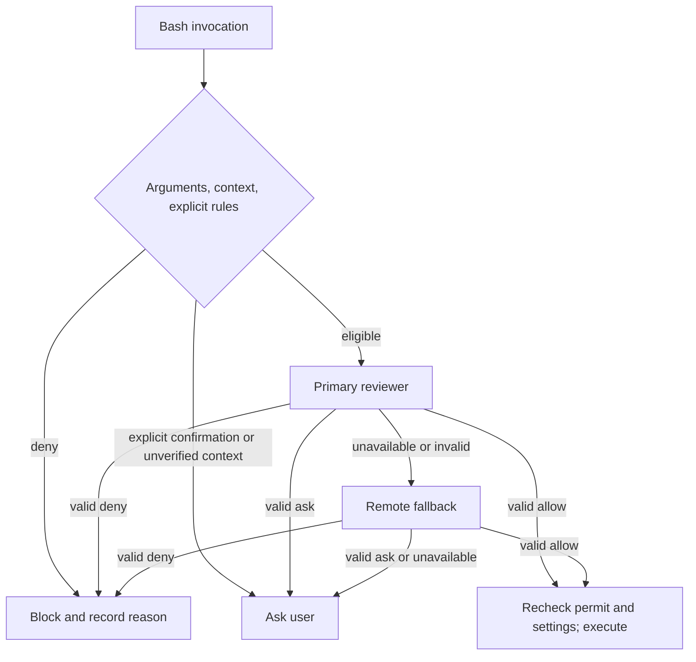

# OMP approval diagnostics

Smart approval should provide an explainable result for every invocation: an authorized ordinary command reaches model review, explicit prohibitions block execution, and decisions requiring user judgment retain confirmation. Zero prompts alone proves neither correctness nor safety. Integration uses official OMP and public extension APIs with the repository-owned plugin.

Product acceptance remains under review. The frozen model-first routing baseline reached review for 87.85% of valid commands across three paths and failed that acceptance criterion. See [known issues](known-issues.md), [testing](testing.md), and [approval design](design/approvals.md) for the current evidence and remaining work.

## Inspect a completed invocation

After approval completes, `/permission-control explain` shows the latest completed invocation. `/permission-control status` reports mode, coverage, model health, budgets, and audit status. An in-flight call has no terminal audit result yet. Successful tool output does not establish model approval because human approval can also execute a tool. The latest health snapshot does not describe every earlier request.

Audits are OMP custom session entries named `permission-control.audit.v1`. They contain:

- Invocation sequence, strictly formatted invocation ID, host-call ID digest, and original session ID digest. Only identifiers are hashed, not command/user text.
- Entry path, mode, configuration generation, native shell, and fixed execution-context categories.
- Pre-review gate reason, final source, outcome, and reason code.
- Separate primary/remote attempts: request started, model identity, valid decision or fixed failure code, valid HTTP status, and allowlisted transport error code.
- Optional numeric/fixed-enum `timing`: `budgetMs`, initial `remainingTotalMs`, `elapsedMs`, `lastStage`, per-stage durations, `requestBytes`, and `timeoutSource`.
- Optional per-attempt `usage`: `inputTokens`, `outputTokens`, `cacheReadTokens`, `cacheWriteTokens`, and `reasoningTokens`.

Missing or invalid usage is omitted, not counted as zero. Truncated/invalid decisions may still report billable usage. OpenAI `prompt_tokens` already includes cached input; Anthropic total input adds reported input and cache-read/cache-creation counts. Cache counts are input subsets and reported reasoning is an output subset; do not add them twice. Sum each attempt independently and count requests lacking usage separately. Prices/cache discounts depend on the model. Request bytes cannot establish tokens or cost, and a missing usage record does not establish no charge. Status shows each layer's most recent usage, not a session total.

The added audit format excludes command text, arguments, cwd, user messages, prompts, headers, URLs, keys, raw responses, exceptions, and stacks. Normal upstream session entries have their own contents and require redaction before sharing.

Audit `accepted` means the public `appendEntry` call was accepted, not that the file was fsynced. Audit failures and counts remain observable but never change approval/execution decisions. Persistence requires post-exit host evidence. Public append targets the current session: a call started in an older session may complete into a newer file, so correlate its original-session digest rather than inferring origin from the storage file.

## Distinguish reviewer failures

| Diagnostic | What it establishes | Next check |
| --- | --- | --- |
| `TARGET_UNAVAILABLE` / `API_UNSUPPORTED` | Target cannot resolve or transport is unsupported | Independent primary/remote selections |
| `KEY_UNAVAILABLE` | Public model registry supplied no usable credentials | Manager/official login flow; never print keys |
| `HTTP_NON_OK` with status | Service returned a non-success response | Authentication, compatibility, rate limit, or service failure; status alone does not identify an account cause |
| `FETCH_FAILED` / `RESPONSE_READ_FAILED` | Request or body read failed | Fixed transport code; do not save exception bodies |
| `RESPONSE_JSON_INVALID` / `RESPONSE_SHAPE_INVALID` | Invalid transport response | Protocol adapter and synthetic compatibility cases |
| `REVIEW_JSON_INVALID` / `REVIEW_SCHEMA_INVALID` | Decision violates strict protocol | Truncation, structure, and model suitability |
| `TIMEOUT` | Local plugin budget expired | Timing stage and deadline source; do not relabel it user cancellation |
| `CANCELLED` | Caller cancellation or invalidated session | Revocation and prevention of later execution |
| Valid `ask` / `deny` | Reviewer requested confirmation or refusal | Keep decision/risk/authorization/reason; do not retry until allow |

Execution and review models are independent. Cursor execution support does not make Cursor a supported review transport. The standalone reviewer supports standard API-key Anthropic Messages and OpenAI Chat Completions. It does not run command-based credential resolvers. A configured remote target is tried only within the remaining budgets after primary failure. Cancellation or total expiry prevents further target resolution, credential lookup, or requests. Local tiny fallback remains unavailable and receives no fabricated attempt or approval.

Default budgets are primary 30000 ms, remote 30000 ms, total 60000 ms. Public `review_timeouts` can change them; see [recipe configuration](omp-kernel.md#permission-plugin-and-review-models). Attempt stages are `resolve-target`, `key-lookup`, `response-headers`, `response-body`, `response-parse`, and `decision-parse`. Deadline sources are `primary-budget`, `remote-budget`, and `total-budget`. A stage identifies the last local processing position, not a remote server bottleneck. `requestBytes` counts serialized redacted body bytes and excludes authentication headers. Older entries without timing remain readable.

`review_max_output_tokens` accepts 256–8192, defaults to 1024, and is explicitly 2048 in `omp-kernel`. `/permission-control status` exposes `reviewMaxOutputTokens`. The setting participates in policy identity and applies to both reviewers. Strict decisions remain limited to 4 KiB, transport responses to 64 KiB, and retries do not increase.

Confirmation titles distinguish valid ask, transport/format failure, and exhausted budgets, including known duration/stage. Valid primary ask/deny does not start fallback. Cancellation/session invalidation blocks execution; a late allow cannot override it. Monotonic deadline checks at target, credential, request, and decision boundaries prevent delayed timer callbacks from allowing expired requests.

## Analysis and execution boundaries

The model-first implementation sends valid commands to redacted review without using static syntax support as admission. Unsupported static analysis, unknown dialects, or dynamic structures alone do not mean dangerous syntax or require a prompt. Audits include closed `analysis` state/rule IDs and `reviewInput` redaction/omission observations without commands, paths, secrets, or raw model text.

Explicit native deny/prompt still applies. An identified prohibited target that cannot be verified blocks even after model allow with `RULE_TARGET_UNVERIFIED`. An unbound execution context reports `UNSUPPORTED_EXECUTION_CONTEXT`. These are distinct from static parser limitations. Historical descriptions of dynamic/background constructs being routed to manual confirmation describe old gates and must not define current product expectations. Background execution still requires correct lifecycle, cancellation, output, and native/interceptor integration; removing a parser check does not establish those capabilities.

## Validation layers

1. Frozen scenarios and independent expectations: preserve the original 11,473 synthetic commands, labels, and syntax deltas. New support uses stable IDs, original-row digests, and an independent Python oracle rather than regenerating expected values with production parsing. Include nearby dynamic execution, quoting/escaping, redirects, native rules, and privacy negatives.
2. Plugin wiring and failures: fake reviewers/delegates cover allow/deny/ask, authentication/rate/server failures, transport errors, malformed responses, deadlines, cancellation, duplicates, configuration changes, and concurrent completion. Every terminal result must have its own correlated diagnostics.
3. Official host and observation: separately authorized temporary-HOME/private-network tests establish public hook behavior, native delegation, and post-exit audit persistence. Real-service quality/availability needs separate evidence.

Acceptance requires valid commands without explicit prior rules to reach review; explicit deny/prompt to remain effective; no unexpected executor calls; cancelled/expired decisions never to execute; correlated terminal results; no canary leaks; and frozen original commands/labels. Measure real-service valid-decision rate, deliberate ask, failures, and latency separately rather than treating all prompts as one rate.

Historical official-v18.8.6 isolated host checks covered primary allow, native deny, and primary HTTP 429 followed by remote allow. They used synthetic keys and local fake services, checked audit privacy after exit, and did not establish real-service availability or fsync. Detailed retained evidence and outstanding checks are summarized in [testing](testing.md).
