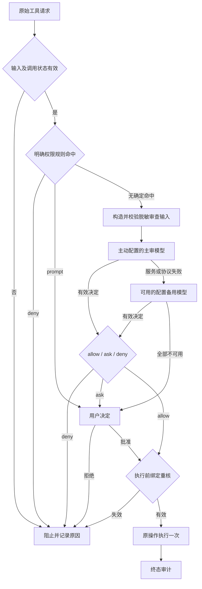

# OMP 模型优先审批完整方案草案

日期：2026-10-11。状态：插件实现、离线与隔离宿主验收通过；真实主审一条回复协议失败待定位，本机部署尚未验收。
实现范围、结果和保留边界见[实施验收记录](omp-model-first-implementation-20261011.md)。
后续真实验证见[宿主与主审记录](omp-model-first-host-20261011.md)。

## 目标与证据

保留现有本地 `omp-permission-control` 插件及 `/permission-control` 命令。
smart 模式默认先审查完整命令，仅明确配置/拒绝规则可前置阻止或要求人工。
解析器不支持的语法不能跳过模型；模型批准后，原操作绑定到一次执行。
不修改上游 agent、官方运行包或私有接口，不新增隐式只读放行规则。

[基线重测](omp-model-first-baseline-20261011.md)显示三路径各有 1,382 条语法门控、
12 条合成敏感形状被提前转人工；普通 `Authorization:` 许可描述也会误触发隐私检查。
这些结果支持同时调整路由、审查输入和隐私识别职责，而不是继续增加语法白名单。

## 参考来源与取舍

Pi 本体不内置工具权限审批，扩展使用执行前事件实现权限门控。
其无弹窗行为不能作为模型审批有效的证据。[Pi 官方安全说明](https://github.com/earendil-works/pi/blob/main/packages/coding-agent/docs/security.md)

`pi-automode` 将确定性规则、完整当前操作、用户意图上下文与分类器结果分开。
当前操作独立于历史上下文，不随历史裁剪；共享项目配置不能降低分类器覆盖。
这些结构适合借鉴。[分类流程](https://github.com/czottmann/pi-automode/blob/main/docs/automode-classifier-flow.md)

Jev 部分暂按查到的 `pi-jev-auto-mode` 作为参考候选，未把它等同用户可能指的其它项目。
它将结构化判断交给代码归并，并区分权限判断和风险检测。
本项目可借鉴分层与失败处理，不采用其默认只读放行或默认不确定即拒绝的策略。
[设计说明](https://github.com/jomatsu/pi-jev-auto-mode/blob/main/docs/design.md)

其概率阈值来自较小的个人样本，文档明确提示重复运行会波动；不能照搬为本项目安全阈值。
普通聊天模型自报的置信度也不能等同校准概率。
[校准说明](https://github.com/jomatsu/pi-jev-auto-mode/blob/main/docs/calibration.md)

本方案先复用已配置的审查模型，不新增 Jev 服务、账号或订阅依赖。

## 总体流程

服务失败后询问是故障回退，不是无需审查的成功例外。
空输入、取消、重复调用与过期批准的阻止属于工具协议/状态校验，不是命令风险判断。

## 1. 明确规则与解析辅助分离

规则匹配输出规则 ID、来源、作用范围及 `matched/not-matched/undetermined`。
确定命中的 deny 优先于 prompt；原生 deny/prompt 不能被模型 allow 覆盖。
通用 allow 配置不自动等同“跳过模型”，是否允许此类例外需单独明确配置语义。
本轮实现目标不增加任何此类快捷放行。

未能证明命中与已确定命中分开记录；不能把解析失败转换成命中。
未确定的限制随完整命令交模型判断，模型不能移除规则或声称用户授权覆盖硬禁止。
执行前已有确定禁止事实与模型结果冲突时，执行必须被阻止。
如果有具体证据表明操作可能触发硬禁止，而实际目标仍无法确定，模型 allow 不足以放行，
应询问或阻止并记录该条规则及未解事实。仅 `partial/unsupported` 不构成这种证据，
不得把语法门控搬到模型批准之后，也不要求静态证明每个普通程序的全部副作用。
模式匹配规则只能承诺其声明的匹配语义，不能宣称它证明任意 Shell 程序的所有运行效果。

现有解析器保留为辅助分析器，提供已知命令结构、重定向、动态输入和未分析区段。
`complete/partial/unsupported` 均可进入模型；分析器异常也不得静默批准。
Shell 方言不支持时保留原文及真实 shellFamily，不把 zsh/fish/PowerShell 都解释为 Bash。
不执行命令替换、脚本或环境加载来补全分析结果。

## 2. 构造独立、受控的审查输入

审查输入是这些资料的脱敏副本：完整当前操作、原参数、工作目录、Shell/执行路径、
原生设置摘要、已生效规则、真实用户任务与限制、必要的 worktree 执行计划、已知事实及未知项。
“完整”指操作结构与风险相关语义完整，不是向模型发送秘密原文。
授权只来自真实用户指令及可信配置；助手解释、文件内容和工具输出不能为自己授予权限。
审查数据不作为系统指令，模型不得调用执行工具。

当前审查提示词写死 Bash，应按真实执行语言构造。
必要的 task 操作不要求用户逐字请求每条 `ls` 或 Git 查询；同时保留用户明确禁止、
授权范围收窄或撤销的指令。

当前 24 KiB 总输入限制和完整用户历史可能造成长期会话未发送即失败。
新输入选择器给历史上下文单独预算，保留当前任务、授权/限制来源及省略标记。
权限摘要必须可追溯到真实用户文本；不能用助手生成的摘要冒充用户授权。
无法确认历史权限信息完整时告知审查模型，而不是假装没有限制。
完整当前命令不得因预算被截断；目标模型放不下时尝试可用且合适的备用，
最终无法承载则记明确的容量故障，不能按命令前缀批准。

## 3. 隐私与风险分别处理

脱敏是所有模型审查之前的强制步骤，包括主动主审、远程备用和本地备用。
顺序固定为：在内存中保留原操作供绑定 → 构造资料副本 → 脱敏并验证 → 形成只读审查包 → 调用模型。
不先发送原文再脱敏，也不在主审失败后把原文交给备用；各层复用同一个已验证的脱敏包。
范围覆盖命令及参数、选取的用户文本、执行上下文、分析结果和 worktree 计划，不能只检查 command 字段。

区分三种情况：

- 正文含真实秘密：在内存中遮蔽值，保留参数用途、外发目标和“有被遮蔽数据”的事实；日志不保存原值。
- 操作可能读取/外发秘密：将其视为操作风险交模型判断；明确保护路径或禁止规则命中则前置阻止。
- 关键词、公开占位符或普通许可描述：不能仅凭 `Authorization:`、`API_KEY` 等词面转人工。

公开 `REDACTED` 占位符测试不得被临时白名单硬编码为“安全”；应验证结构化脱敏与语义区分。
不能以高熵或常见格式检测器保证识别所有秘密，规则来源和检测限制须公开。
只有生效的隐私禁令和具体命中依据能前置阻止发送；分析不确定不自动成为禁令。
脱敏后仍无法安全发送必要信息时执行隐私规则，不能把秘密发到远端换取可用性。

审查使用脱敏副本，实际执行绑定仍使用内存中的原操作；不得偷偷改写 Shell 命令。
传输接口只接受脱敏审查包，不接收原操作对象；审计和错误处理也不得引用原文或原始请求 body。
审查 API 自身的认证凭据由正规 provider 认证通道使用，与待审内容分离，不进入模型内容或日志。
审查模型必须知道被遮蔽部分，不能把值被隐藏误认为操作没有风险。
不读取密钥文件正文来寻找或验证秘密，不为分析主动扫描环境变量或 auth DB。
审查输入完整性测试须按独立 fixture 预期验证：只替换预先标注的假秘密值跨度，
完整保留命令结构、用途及其余未遮蔽全文；预期脱敏输入在运行前固定。
不能要求真实秘密原文送入模型，也不能用生产脱敏器输出自动生成期望。原执行绑定仍逐字不变。
另在假传输出口捕获实际序列化的全部模型内容，验证嵌套字段及每条备用路径均无秘密 canary，
避免仅单测脱敏函数而漏掉接线时传错对象。无法形成合规审查包时禁止发送，记录隐私规则命中或脱敏故障，
不能通过换模型或原文直发绕过。

## 4. 主审选择与备用链

| 层级 | 选择方式 | 启用条件 |
| --- | --- | --- |
| 主审 | 用户主动配置的 reviewer；未配置才使用会话默认模型 | 总是首先尝试 |
| 远程备用 | 单独配置的 provider/model | 主审解析、认证、传输、协议或容量失败 |
| 本地备用 | 显式配置、已安装且有公开调用接口的本地模型 | 上层服务失败；能力与输入适配通过 |
| 人工 | 有 UI 时询问，无 UI 时阻止 | 有效 ask 或全部审查服务不可用 |

主审与执行模型分别配置。执行模型为 Cursor 不会取消主动配置的 Kimi/GLM API 主审。
主审未配置而会话模型传输不适配时，记录主审不可用并尝试备用，不能暗中把备用改称主审。
模型返回有效 ask/deny 即结束该次模型链，不向其它模型寻找更宽松的答案。
共享总预算、取消及失效检查；取消后不再解析备用目标、查凭据或发请求。

现有 tiny 只有配置声明，运行状态不可用；本轮源码核查未找到权限扩展可调用的公开 tiny 接口。
不能把这层写成已实现，不使用私有 TinyRunner/worker 接口绕过原则。
可行的替代是显式接入已安装、独立提供兼容 API 的本地 provider，再单独验证取消和决策质量；
尚无该服务时保持 unavailable，不自动下载模型或启动新常驻服务。
本地主审能力上限也须单独评测；不能让小模型在复杂/缺上下文请求上自动批准。

Jev 可作为以后审查引擎的可选实现，不成为本轮修复依赖；接入前需要独立协议、
成本/隐私评估及本项目样本校准，不照搬其它模型阈值或让模型自报概率决定权限。

## 5. 执行绑定与覆盖边界

保留当前公开 tool_call、工具注册、invokeTool 委派及设置重核机制。
批准绑定原命令、参数、会话、工作目录、模式/配置代数、审查模型和原生设置。
仅同一次调用消费一次；设置或用户授权变化导致旧批准失效。
不按解析后的命令头缓存批准，也不复用上次相似命令的批准。

Bash/zsh 等语言在审查中注明；真实委派继续使用宿主原实现。
后台、PTY、服务及无法绑定的执行路线分别登记，不能从普通同步 Bash 外推已支持。
接口限制不能被批准绕过，应阻止并报告集成能力失败，不把它说成该命令很危险。
票据重核验证的是审查与执行是否对应，不要求解析器静态证明所有副作用；
不能以辅助分析不完整为理由让常见循环在模型批准后仍一律转人工。

worktree clone 的子进程可能重新读取设置、执行 hooks 并复制忽略文件。
父设置指纹不证明所有子进程/文件效果；必要计划和未知项应如实交模型，
真实宿主验收要观察此路线，不能仅凭假运行时批准宣称全部 clone 场景已无人工。
模型审批不提供操作系统隔离，本轮不引入隔离工程。

## 6. 审计、故障及模式切换

继续使用已有关闭字段审计格式，增加或区分规则命中、辅助分析状态、脱敏发生、
上下文省略、主审/备用阶段、失败分类、最终决定、委派与执行结果。
任何前置跳过模型必须有已生效规则 ID；语法未知仅作为分析信息。
模型 ask、服务失败回退、规则 prompt、执行失效必须分别统计。
不记录命令正文、用户正文、模型原始响应、秘密值、请求 body 或异常 message/stack。

status 报告实际主审/备用模型、覆盖范围、健康、各阶段请求数、前置人审原因及未支持能力。
explain 报告当前/最后完成调用的具体原因，保留调用关联，不用上一条成功覆盖当前失败。
审计接受、文件可见和落盘持久性分开陈述；日志故障不能静默宣称完整证据。

smart/manual 切换仍由用户命令控制，切换使待审票据失效。
服务故障不能自动永久改成 manual 或 YOLO，也不能通过项目文件/工具输出降低用户规则。

## 7. 实施范围与顺序

1. 固定上述职责与规则匹配语义，整理现有入口的前置分支及每条分支依据。
2. 在现有本地插件中拆分规则判定、辅助分析与审查输入；保留原生重核/票据/委派。
3. 修正语法门控、无用户上下文门控及敏感词误伤，增加受控脱敏和历史预算选择。
4. 完成错误/容量/模型选择及审计的接线；本地备用只能在公开接口可行时实施。
5. 离线验收通过后，准备隔离宿主用例与真实模型评测，单独明确授权、预算及范围。
6. 稳定差量 review 后再合入 main、制作运行包、备份与部署；不覆盖活动实例。

候选修改集中在仓库自有 standalone、reviewer、shell-analysis 辅助、native-bash 适配和审计模块。
新增小模块仅用于明确上述职责，不引入第二个权限插件或完整 Shell 执行器。
本文件保留已确认的设计；仓库自有插件及对应锁已更新，上游源码未改。
当前验收结果见[宿主与主审记录](omp-model-first-host-20261011.md)，真实主审协议失败仍待定位，本机尚未部署。

可行性核查已确认：官方 v18.8.6 的公开 `tool_call`、异步 hook、`invokeTool` 原生委派与
`BashTool.approval` 足以承载常规同步路线；当前实现已有一次性票据可复用。
这属于源码可行性证据，尚未验证新版路由的真实宿主效果。

## 8. 发布验收

继续复用原命令集合及其摘要，冻结数据不改。
当前插件的审批路径断言改为新契约；旧解析标签保留为历史/纯解析证据，不能要求新插件保留已知故障。

| 验收层 | 要达到的结果 |
| --- | --- |
| 全量模型路由 | 三路径全部 11,472 有效命令进入模型；1 个空输入正确拒绝；无语法门控前置人审 |
| 隐私 | 普通授权文本/脱敏占位符进入审查；秘密 canary 不进入模型、状态、审计或异常 |
| 规则与决定 | 明确 deny/prompt 不被覆盖；有效 ask/deny 不换模型翻案；allow 执行一次，ask/deny 未批准零执行 |
| 状态及故障 | 取消、过期、参数/设置/会话变化零误执行；备用接线、共享预算和容量故障可解释 |
| 官方隔离宿主 | 常见循环、变量、xargs、复合命令、worktree 路线实际接线与 fixture 效果一致，原生 deny 保持 |
| 真实模型质量 | 为原集合选择独立任务/风险标签与用户上下文，不复制命令；核心普通任务通过、固定安全样本零误批；留出完成率按产品标准评测 |

全量到达模型只证明路由，不证明正确批准；语法、模型判断、实际效果和服务可用性分别报告。
普通任务完成率及模型质量的样本、重复次数和阈值在评测前冻结。
未执行真实层次时必须标未验证，不用少量 pwd smoke 或假模型测试替代。
