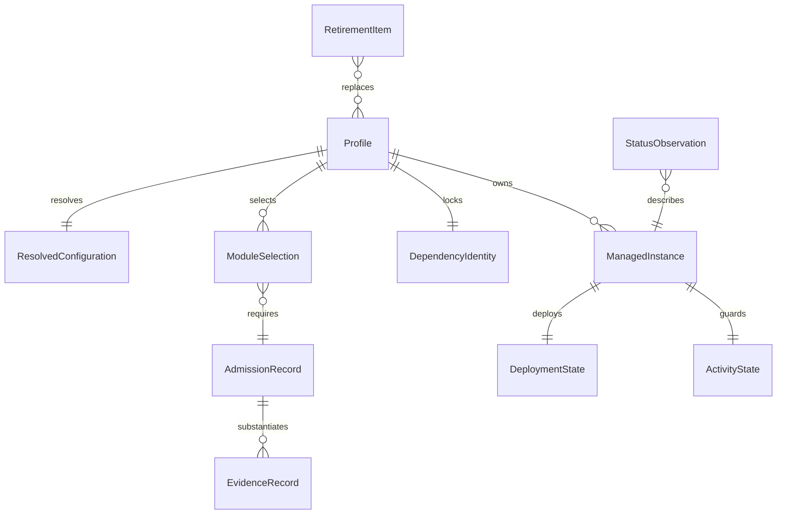

# Phase 1 Data Model: 公共治理与 Pi 配方

状态：待实现的数据与验证契约，不是已落盘的新 schema。适用 [spec](spec.md) 与
[公共管理契约](contracts/common-management.md)。继续使用 TOML 来源、原生 JSON 和文件状态，
不新增任务数据库、事件总线或监督服务。

## 1. 实体及关系



关系描述逻辑约束，不要求独立文件一一对应。公共身份与原生文件所有权沿用现有模型。

## 2. Profile / ResolvedConfiguration

| 字段 | 含义与约束 |
| --- | --- |
| schema_version、id、agent | 沿用公共 profile 格式；新 id 为 pi-base/pi-pro，agent 为 pi |
| providers/models/roles | 沿用稳定 ID 引用；模型和服务具体值由非秘密机器覆盖提供 |
| rules/skills/plugins/mcp | 有序、唯一 ID 数组；对象递归覆盖、数组整体替换，[] 表示清空 |
| agent_options | 仅接受新 Pi adapter 的已声明字段；未知字段失败，不接受任意原生对象 |
| resource_selection | 内部解析结果，含类型、固定来源、相对入口、内容身份、加载顺序和所有者 |
| module_selection_digest | 内部身份，绑定选中模块与其依赖；不是新公共 TOML 字段 |
| host_identity | 官方包/版本/完整性与运行前提，不能由机器覆盖换成未准入宿主 |

Base/Pro 共用同一配置生成实现和公共资源来源，profile 只表达差异，不复制规则正文。
未准入模块即使资源已下载也不得进入有效 resource_selection。Pro 初始不选委派器；
其协作能力报告为 not_ready，不因有 profile 文件而视为可用。

UI 偏好使用明确的初始化字段策略；持续受管字段逐项声明 selector。
不能借“初始化一次”绕过非空目标所有权：仅在新目标或字段确实缺失且无冲突时设置；
后续偏好变更由原生用户或显式非秘密采纳提案处理。

## 3. DependencyIdentity

| 字段 | 含义与约束 |
| --- | --- |
| backend_kind | dsh package / omp asset / pi npm 等原生后端类别，不强制统一锁格式 |
| tool、profile | 锁所属消费者；共享不可变下载内容不等于共享可变实例状态 |
| host | 包名、精确版本、tarball/source URI、integrity、许可证与工具链条件 |
| modules | 实际选择的模块身份、入口、许可、peer 与依赖归属 |
| recipe_digest | 沿用既有名称的内部锁生成身份，不新增公共配置键；仅绑定规范化的实际依赖解析输入：固定宿主/模块声明、当前 profile 的依赖选择投影、被选资源的清单/内容身份、必要构建与工具链条件 |
| closure_digest | 完整锁及资源清单的确定性身份，包含必要传递/原生依赖 |
| source_commit | 可缺失，但须诚实记录 null；此时发布物 integrity 必须存在，不能猜提交 |
| build_inputs | 若存在安装脚本或构建，列出原始输入、工具链、平台及核验步骤 |
| manifest_digest | 暂存产物清单身份，用于与入口、正文、链接边界交叉核对 |

校验顺序：来源/锁合法 → 完整依赖身份 → 暂存安装 → 形状与内容/许可/入口核验 → 激活。
任一步失败不更新有效安装身份，不触碰账号 home；激活是运行包维护，不是配置 rollback。
recipe_digest 不包含自身、由其生成的完整锁或 closure_digest，避免循环定义；
完整闭包仍由完整锁、closure_digest 与 integrity 独立证明。摘要不绑定全体
`src/agentcfg/*.py`、其他 profile 或退役资源；不相关旧链删除不得使新锁失效。
候选源码身份仍进入验收证据；后端语义变化即使未改变摘要，也必须审查并重验受影响行为。
实际依赖输入变化、package-lock 或模块选择不匹配返回锁错误（exit 2），要求显式重锁；
render/apply/run 不得隐式重锁。安装内容缺失或损坏返回依赖错误。

## 4. ManagedInstance / DeploymentState

沿用公共实例路径解析，不在新配方中固定私人绝对路径。

| 实体 | 必要信息 | 不包含 |
| --- | --- | --- |
| ManagedInstance | tool/profile、稳定原生 home/session root、配置与依赖位置、所有权身份 | 公共资料中的真实主机元数据 |
| DesiredProjection | 受管文件/selector、期望值、来源身份、初始化或持续受管策略 | auth/session/history 正文 |
| DeploymentState | 已部署身份、受管基线、上一版配置、pending journal | 软件降级或任务执行回滚 |
| OwnershipConflict | 目标、selector、冲突类别与脱敏摘要 | 秘密原值或全量原生导出 |

三方规则与备份语义见公共契约。多文件写入使用现有 journal，不引入第二种 Pi 事务协议。
同一输入产生同一 desired；读取当前原生状态只用于部署比较及启动安全检查，不反向构造期望整文件。
字段项可保存既有journal含义的`created_parents`来源：仅包含该selector的严格祖先，
记录首次写入时由管理器创建的对象。跨代保留；退出时只剪已空的自建祖先，
原生预存的空对象或新增字段均保留。旧状态无此字段时不猜测容器归属。

```text
clean --有变化部署--> pending --提交成功--> clean(新基线，上一版)
pending --中断/失败--> recovery_required --显式恢复及复查--> clean 或 conflict
clean --无变化部署--> clean(不重写，不轮换)
clean --有效上一版回滚--> clean(消费备份，保留非受管新增)
```

这是逻辑状态机；复用已有 journal 的持久化字段和顺序，不能按示意图另造不兼容格式。

## 5. ActivityState：仅实例运行与维护准入

| 字段/维度 | 含义 |
| --- | --- |
| instance_identity | 稳定实例与资源归属 |
| run_owners | 同配方多主会话的独立运行集合；每项含唯一运行身份、会话关联、进程归属和 PID 复用核对信息，不进入公共报告 |
| admission_mode | run 或 maintenance，相互排他条件由共用中性准入实现保证 |
| liveness | 每项运行有 active / idle_confirmed / unknown；实例只有全部相关运行与后代确认空闲才为 idle_confirmed，活动与未知项均保留 |
| affected_resources | 正在使用或无法确认释放的实例资源范围 |
| observation | 证据类别、观察时间与可确认限制；不是任务事件流 |

```text
单次运行：新运行 --获得准入且独立登记--> active
单次运行：active --该运行与其后代释放证据完整--> idle_confirmed
单次运行：active --父退出但后代/归属无法确认--> unknown
单次运行：unknown --受保护的显式核实，确认该运行相关资源空闲--> idle_confirmed
实例：任一相关运行/后代 active 或 unknown --申请共享资源维护--> 拒绝(exit 4)
实例：全部相关运行/后代 idle_confirmed --排他维护准入且阻止新运行竞争--> 允许维护
```

没有自动“超时即空闲”，不靠父退出或锁描述符状态单独清除记录。核实空闲是维护操作，
同配方已有其他已知活动运行不妨碍新的合法主会话登记；未知 owner 按归属风险阻止不安全准入。
单次退出不能将实例整体改为空闲，登记、退出和维护须经同一公共准入边界串行核对，
不引入任务调度数据库或新的自有执行平台。
不得杀进程或自动接管未知 owner。具体平台不能可靠核实时保守拒绝；不得静默降级。

Linux生产观察使用管理器在spawn前建立的child subreaper覆盖。前提为当前完整进程身份、
没有既有子进程、单线程和默认SIGCHLD行为；退出时非阻塞收割后仅ECHILD可确认本次
全部后代已退出。子收割者涵盖孤儿double-fork/setsid后代；不覆盖外部服务或任意同用户进程。
本次active记录的完整证明在物理SH和元数据EX下只释放本次运行；旧unknown仍须维护EX核实。
平台不支持、管理器异常、观察失效或后代仍活跃均保持unknown/活动保护。
提取公共原语须兼容 DSH/OMP 既有布局与标记；旧格式与新格式的映射必须有冲突测试。
不持久化调查任务的预算、重试队列或逐工具授权；这是对旧执行账本的明确切断。

## 6. AdmissionRecord / ModuleSelection

| 字段 | 含义与约束 |
| --- | --- |
| module_id、category | 稳定模块名及能力类别，类别在单组合中只允许一个所有者 |
| candidate_identity | canonical、精确版本/发布物、内容身份、许可 |
| decision | candidate / held / admitted / withdrawn |
| reason | 已核对能力、收益、重叠、维护成本与未满足项 |
| settings_contract | 原生/扩展/环境/独立文件的真实读取位置与严格字段定义 |
| data_boundary | 账号来源、外发内容、费用路线、缓存/进程/日志归属与删除界限 |
| required_evidence | 静态、隔离、原生及账号场景的具体要求 |
| evidence_refs | 各层级通过/失败/未执行，不能单个布尔值代替全部就绪 |

admitted 针对精确组合和范围，不代表所有平台/账号就绪。运行实例还须满足它所选模块的
实际前提。升级失效相关证据并重新准入。未选模块不加载，也不能被 dependency discovery 自动选中。

当前决议：Powerline 0.20.2 为 held；mjakl 3.1.0 为 held；静态主题为已选实现候选，
须完成锁和渲染验收；其他模块为 candidate，默认 selection=false。

## 7. 调查结果与 StatusObservation

调查任务仅使用准入委派器的公开任务与结果能力。下列是消费者需要的观察语义，
不是需要新建的任务存储或自有协议服务器。

| 维度 | 值与约束 |
| --- | --- |
| task_ref | 当前任务引用，不能拿历史输出作为本次结果 |
| parent_run_ref | 调查所属的唯一主运行，关联 run_owners；并发计数和结果归属均按该主会话隔离 |
| model_request / model_observed | 请求与实际可确认模型分列，后者可 unknown |
| execution | queued / running / succeeded / failed / unknown |
| cancellation | not_requested / requested / acknowledged，不替代进程退出证据 |
| process | active / exited_confirmed / unknown |
| effects | none_confirmed / observed / unknown；调查也须验证没有可达写工具 |
| result | 完整/截断/空/缺失及其来源，不把非空文本直接当成功 |

成功至少要求本次任务身份匹配、声明的成功回执、必要结果完整；进程/副作用未知不能被成功摘要掩盖。
主会话仍对结果判断与写入负责，不自动重放未知任务。
每个主会话最多两个活动/退出未确认的调查，取消请求不提前释放名额；
两个主会话可以各运行两个调查，不共用全配方合计两个的计数器，也不能相互借用名额。
这些是准入与观察语义，不要求新建跨会话任务调度器。

状态栏观察含字段含义、value 或 unknown/unavailable、统计范围、来源、更新时间和有效性。
usage 累计与当前 context 是两个量；未上报费用不转换为 0，权限未知不显示“已保护”。
完整十类映射见[协作与状态](contracts/collaboration-and-status.md)。

## 8. RetirementItem / EvidenceRecord

RetirementItem 字段：资源相对路径/类别、旧用途、已知消费者、状态所有者、处置决定、
替代入口、阻断条件、验证引用。处置为 replace/rebuild/remove/archive/unresolved；
archive 只适用于历史证据或用户状态处置，不允许以归档名继续分发旧运行平台。

EvidenceRecord 字段：候选身份、目标 main、锁/组合身份、场景、平台类别、实际 argv、
退出码、结果、脱敏证据和未覆盖范围。模型字段只能记录获授权且可确认的事实。
任务管理状态与验证结果分离：

- 任务：已完成、进行中、失败待决策、环境不足未验证。
- 验证：passed、failed、not_run；可另标阶段不适用及理由，不把缺账号改成未选择。

正式文档不能记录私人主机属性、凭据、认证链接或会话正文；不读取这些文件来验证公开清理。
