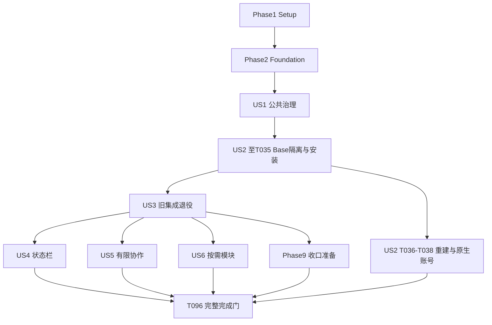

# Tasks: 公共治理对齐与 Pi Base/Pro 重建

**Input**: `specs/005-rebuild-pi-toolkit/` 的 [spec](spec.md)、[plan](plan.md)、[research](research.md)、[data-model](data-model.md)、[contracts](contracts/) 和 [quickstart](quickstart.md)。

**Branch**: `design/pi-toolkit-reboot`。日期：2026-10-18。状态：实施进行中；完成项以产物和验证记录为依据勾选。

**Prerequisites**: 规格质量检查已通过；两项澄清已生效：同配方多个主会话，每主会话独立最多两个只读调查。

**Tests**: spec FR-033 与各故事明确要求隔离/失败路径验证，因此包含必要测试。默认仅临时 HOME/XDG、阻网、假进程与虚构模型，不启动第三方宿主；原生、账号与模型场景分别有授权门。

**Organization**: 按用户故事组织。代码已满足某项时，以对应检查证明并记录复用，不为勾选任务制造无必要改动。共享文件单一写入者，事务/锁/恢复顺序由主代理决定。

## Format: `[ID] [P?] [Story] Description`

任务行均为 `- [ ] Tnnn [P?] [USn?] 描述及路径`。[P] 仅表示完成明确前置项后，可与同组不同文件任务并行；不豁免依赖。
每项完成须有实际产物和对应验证记录，执行步骤见各 Phase 和依赖段。新增文件路径是实施目标，不表示当前已经存在。

## Path Conventions

所有路径相对于仓库根；任务内 `specs/005-rebuild-pi-toolkit/` 简记仍使用完整相对路径。
公共实现留在 `src/agentcfg/`，Pi 资料在 `agents/pi/`，两档在 `profiles/` 与 `locks/pi/`。
不新增通用模块 DSL、任务数据库、监督器、跨会话任务调度器或宿主 fork。

**阻断与完成规则**：

- 准入审阅任务可以以有证据的 held 结论完成；依赖合格候选的集成/能力验收任务必须保持未完成。
- Powerline 0.20.2 与 mjakl 3.1.0 当前不能作为已准入组合。原生回退、假进程通过或 Pro 正确拒绝启动均不能抵扣 US4/US5 的交付门。
- 遇到阻断，只停止依赖它的任务并在实施记录登记；继续无关 Base、公共框架、退役或文档工作。
- 授权门任务未获得对应授权时不执行，不把“未执行”改成通过或未选择。本清单不授予登录、模型调用、真实服务、发布或远端更新授权。
- 数据模型中未定义的持久化类型不自行发明新协议；优先沿用公共类型/原生契约，影响正确性的缺项升级主代理。

2026-10-19用户明确决定“继续只用社区插件，Pro等上游完善”。T064–T071保留未完成、
等待上游状态，不实施自有调查执行插件，也不降低原并发/只读/递归/后台要求。
共享默认模型和SecretRef可用于新隔离实例，密钥不得进入模型；实际局部验收与尚缺范围见
[补充验收](remaining-native-acceptance.md)及[候选复核](pro-candidate-refresh.md)。

## Phase 1: Setup (Shared Infrastructure)

**Purpose**: 固定范围、消费者、公共差异与来源，建立可核查的实施记录。

- [X] T001 在 `specs/005-rebuild-pi-toolkit/implementation-status.md` 建立实施记录，绑定当前候选与目标 main、读取宪章九项门禁，保留用户/其他代理编辑，区分“已完成、进行中、失败待决策、环境不足未验证”，并将未执行与环境确实不足分开；完成条件为每个后续任务可登记实际 argv/退出码/证据，不读取真实账号会话。（FR-032/033；Constitution V/VII/VIII）
- [X] T002 [P] 在 `specs/005-rebuild-pi-toolkit/retirement-inventory.md` 逐项盘点 `src/agentcfg/pi.py`、旧 Pi 执行/委托链、`agents/pi/`、四旧配方、锁、测试和文档的静态/动态消费者与状态所有者；约束原文：“处置为 replace/rebuild/remove/archive/unresolved”；“archive 只适用于历史证据或用户状态处置，不允许以归档名继续分发旧运行平台”；覆盖来源/路径/用途/消费者/替代/阻断/验证，未知项不可删除。（FR-001/017/018；SC-001）
- [X] T003 [P] 在 `specs/005-rebuild-pi-toolkit/common-alignment.md` 对照 `src/agentcfg/backends.py`、`src/agentcfg/deployment.py`、`src/agentcfg/lifecycle.py`、`src/agentcfg/omp_identity.py` 和各 adapter，形成配置/覆盖、完整依赖、部署冲突、恢复、回滚、活动保护七类矩阵，标出真正共用、原生差异、当前缺口及各自回归入口，不强制同锁格式/目录。（FR-002/003；SC-002）
- [X] T004 [P] 在 `specs/005-rebuild-pi-toolkit/module-admission.md` 固定研究输入：官方 Pi 1.3.0、Node≥22.19.0、静态主题0.1.6及真实ID、Pro/Powerline held理由、各按需候选；记录精确发布物/许可/公开接口/核对日期，Pi npm gitHead缺失如实记null，禁止将热门或旧版本问题当当前组合通过。（FR-005/016/030/031；Constitution VI/IX）

**Checkpoint**: T001完成后T002/T003/T004可并行；四项完成后才能进入基础实现。完整清单不是删除批准或运行通过证据。

## Phase 2: Foundational (Blocking Prerequisites)

**Purpose**: 所有故事共用的隔离、虚构资料与证据基础，不能提前构建旧宿主。

- [X] T005 检查并按需补齐 `tests/conftest.py` 的临时 HOME/DSH_HOME/XDG/Pi发现路径、阻网与假进程边界，保证新增测试不能启动 DSH/Pi/Codex；复用已有fixture，不取消保护以制造通过。（FR-033；Constitution V）
- [X] T006 在 `tests/fixtures/pi-reboot/` 创建合成配置/原生资源/锁/进程身份/秘密哨兵和两主会话样例，分别含项目包漂移、后代存活、PID复用、空/截断结果和usage缺失；不用真实auth/session，样例脚本不执行。（FR-008/010/014/021/025）
- [X] T007 在 `specs/005-rebuild-pi-toolkit/acceptance.md` 定义证据目录和来源映射，逐项采用数据模型原文“候选身份、目标 main、锁/组合身份、场景、平台类别、实际 argv、退出码、结果、脱敏证据和未覆盖范围”；验证值为“passed、failed、not_run”，升级后能识别失效证据，原生/账号层级分开。（FR-032/033；SC-009）
- [X] T008 运行 `specs/005-rebuild-pi-toolkit/quickstart.md` 所列九个现存隔离测试文件并在 `specs/005-rebuild-pi-toolkit/implementation-status.md` 记录基线、失败和环境限制；确认新profile尚未存在时不会用旧pi-default冒充；测试失败先判范围，不能默默关闭保护或把文件存在写成通过。（FR-033；Constitution V）

**Checkpoint**: 四项基础任务完成后，故事测试才能使用新fixture。基线有相关已知失败时交主代理处理；无关文档可继续。

## Phase 3: User Story 1 - 用一致的管理方式维护三种工具 (Priority: P1) 🎯 MVP

**Goal**: 公共模块真正共用，配置/依赖/部署与多主会话维护准入保持相同可解释语义。

**Independent Test**: 三个adapter的临时实例覆盖七类公共场景；同配方至少两主运行，单个退出不清其他归属，active/unknown与维护竞争均阻止不安全写入。此故事无需任何 Pi 增强模块。

### Tests for User Story 1

先将缺失行为表达为可失败的测试；已覆盖场景复用原测试，不复制实现断言。

- [X] T009 [P] [US1] 扩展 `tests/test_config_schema.py` 与 `tests/test_config_resolution.py` 的三adapter公共契约样例，覆盖未知字段、稳定引用、空数组/false与非受管原生字段，保持原生namespace开放与框架严格校验的区别。（FR-008/009；US1/AC1；SC-002）
- [X] T010 [P] [US1] 在 `tests/test_deployment.py` 补齐三方冲突、单侧漂移、重叠selector、pending中断再恢复、无变化不轮换及rollback保留新增状态的差分场景，禁止软件/任务数据回滚。（FR-012/013；US1/AC2–3；SC-008）
- [X] T011 [P] [US1] 在 `tests/test_dependency_backend_contract.py` 新增假backend契约测试，验证完整锁身份、暂存核验/激活、失败不换包不改home、原生锁格式差异及来源失配exit2/依赖缺损exit5。（FR-003/015/016；US1/AC3–4）
- [X] T012 [P] [US1] 在 `tests/test_instance_admission.py` 新增多运行身份、单个退出、后代活动/unknown、PID复用、并发登记/退出/排他维护及其他实例哨兵测试；不得以父退出或锁释放判全部空闲。（FR-011/014；US1/AC5；SC-008）

### Implementation for User Story 1

- [X] T013 [US1] 对齐 `src/agentcfg/config.py`、`src/agentcfg/merge.py`、`src/agentcfg/render.py` 与 `src/agentcfg/adapter.py` 的共用校验/渲染接缝，消除Pi分叉而保留原生投影；约束原文：“有序、唯一 ID 数组；对象递归覆盖、数组整体替换，[] 表示清空”；“沿用稳定 ID 引用；模型和服务具体值由非秘密机器覆盖提供”；已满足部分直接复用。（FR-002/003/008；依赖T009）
- [X] T014 [US1] 在 `src/agentcfg/deployment.py`、`src/agentcfg/native_projection.py`、`src/agentcfg/storage.py` 复用同一三方和journal路径，按T010修补差异；DesiredProjection为“受管文件/selector、期望值、来源身份、初始化或持续受管策略”，DeploymentState为“已部署身份、受管基线、上一版配置、pending journal”，OwnershipConflict为“目标、selector、冲突类别与脱敏摘要”；不得含auth/session/history正文、秘密原值/全量原生导出，保留既有提交顺序。（FR-012/013；依赖T010/T013）
- [X] T015 [US1] 在 `src/agentcfg/backends.py`、`src/agentcfg/dependencies.py`、`src/agentcfg/omp_dependencies.py` 与 `src/agentcfg/storage.py` 提取真正相同的身份检查/暂存发布原语并保持backend签名；约束原文：“dsh package / omp asset / pi npm 等原生后端类别，不强制统一锁格式”；“锁所属消费者；共享不可变下载内容不等于共享可变实例状态”；不得引入旧Pi任务账本。（FR-002/003/016；依赖T011/T014）
- [X] T016 [US1] 在 `src/agentcfg/lifecycle.py`、`src/agentcfg/storage.py` 与 `src/agentcfg/run_owners.py` 实现中性实例准入和独立run_owners记录，约束原文：“同配方多主会话的独立运行集合；每项含唯一运行身份、会话关联、进程归属和 PID 复用核对信息，不进入公共报告”；admission_mode为“run 或 maintenance，相互排他条件由共用中性准入实现保证”；affected_resources为“正在使用或无法确认释放的实例资源范围”，observation为“证据类别、观察时间与可确认限制；不是任务事件流”。（FR-011/014；依赖T012/T015）
- [X] T017 [US1] 在 `src/agentcfg/dsh.py`、`src/agentcfg/omp.py`、`src/agentcfg/omp_identity.py` 接入上述中性原语，保留DSH/OMP已有marker、目录及并发策略；ManagedInstance保留“tool/profile、稳定原生 home/session root、配置与依赖位置、所有权身份”，不得因对齐迁移账号或降低保护。（FR-002/003/011；依赖T016）
- [X] T018 [US1] 在 `src/agentcfg/runtime.py`、`src/agentcfg/commands.py` 与 `src/agentcfg/pi_lifecycle.py` 接通多主运行登记/单次退出/共享资源维护门禁，liveness约束原文：“每项运行有 active / idle_confirmed / unknown；实例只有全部相关运行与后代确认空闲才为 idle_confirmed，活动与未知项均保留”；原子核对登记与维护竞争，unknown不得自动超时清除、kill或重放任务。（FR-014/015；依赖T016/T017）
- [X] T019 [US1] 在 `src/agentcfg/secrets.py`、`src/agentcfg/secret_files.py`、`src/agentcfg/local.py` 和 `src/agentcfg/commands.py` 复核并补齐离线命令不读秘密正文、按部署引用注入、capture仅非秘密allowlist提案及0600/0700/链接边界，用哨兵验证预览/日志/异常/备份无值；不全量读取真实auth。（FR-009–011/015；依赖T013/T014/T018）
- [X] T020 [US1] 在 `src/agentcfg/presentation.py` 与 `src/agentcfg/commands.py` 统一非秘密就绪/冲突结果，区分声明/准备/部署/加载/待账号/运行/失败/未执行及阻塞；保持管理器0/2/3/4/5/6语义与原生启动后退出码，不能用单个installed布尔值代替证据。（FR-032；SC-009；依赖T018/T019）
- [X] T021 [US1] 运行T009–T012及受影响 `tests/test_isolation.py`、DSH/OMP依赖/部署回归，把七类场景、各实例哨兵与多主会话竞争结果写入 `specs/005-rebuild-pi-toolkit/acceptance.md`；只有受影响契约通过且未丢用户状态才完成US1。（SC-002/008/009；依赖T013–T020）

**Checkpoint**: US1是公共治理MVP；此时可以证明共享契约改进，不宣称新 Pi Base 已可运行。

## Phase 4: User Story 2 - 独立构建并日常使用 Base (Priority: P1)

**Goal**: 两档共享来源的全新薄适配、官方CLI与独立Base，不依赖旧home/缓存/SDK主循环。

**Independent Test**: 默认假CLI证明配置/锁/发现/会话/命令边界；显式依赖准备后双路径重建一致。原生六类用户场景另经授权验收，Pro及外部模块缺失不阻塞独立Base。

### Tests for User Story 2

- [X] T022 [P] [US2] 在 `tests/test_pi_reboot_configuration.py` 新增新schema/资源选择/原生字段投影测试，覆盖未知旧task_keeper/model_delegate/permissions拒绝、初始化UI不覆盖用户偏好、两档独立与非秘密机器绑定；用全catalog加载证明四旧profile退出后新Base可解析、旧ID明确不支持、默认/绑定/registry引用有效，DSH/OMP及公共模型来源不受影响，不能只测手工裁剪的新profile样例。（FR-004/007–011/017/018）
- [X] T023 [P] [US2] 在 `tests/test_pi_reboot_dependencies.py` 新增假npm完整闭包/安装脚本/形状与内容校验/peer/激活中断/未选包不入锁测试；验证recipe_digest仅绑定实际依赖输入、不循环引用生成锁，不相关旧链删除不作废新锁，实际依赖输入变化必须报锁失配且不隐式重锁；缺gitHead允许null但必须有integrity，不运行npm或宿主。（FR-015/016）
- [X] T024 [P] [US2] 在 `tests/test_pi_reboot_runtime.py` 用假官方CLI验证固定agent/session目录、项目/父目录哨兵、packages漂移拒绝、显式资源/builtin、--no-approve及继承环境防覆盖，run不lock/sync/apply。（FR-005/008/011/015）

### Implementation for User Story 2

- [X] T025 [US2] 按T002清单在同一来源切换批次中，先移除 `profiles/pi-default.toml`、`profiles/pi-managed.toml`、`profiles/pi-cursor.toml`、`profiles/pi-codex.toml` 的有效注册，解除 `agents/pi/agent.toml` 的旧默认选择与 `agents/pi/bindings.toml` 的旧owner，将 `agents/pi/plugins.toml`、`agents/pi/content.toml` 同步替换为无旧执行引用的最小有效集合；再重建 `agents/pi/schemas/options.schema.json`、上述agent/bindings与 `src/agentcfg/pi.py` 的严格薄适配边界，声明runtime/resources/discovery/ui/settings/collaboration。约束原文：“仅接受新 Pi adapter 的已声明字段；未知字段失败，不接受任意原生对象”；不继承旧执行/权限对象，不保留旧schema豁免或静默路由。同步在 `docs/pi-migration.md` 写明旧ID不支持及状态保留，保留/重验 `shared/defaults/models.toml` 与DSH/OMP来源；只退出仓库来源，不删除实例/home/活动归属或运行状态。完成时全catalog可加载，T026新增profile不再等待US3清理。（FR-005/008/009/017/018；依赖T002/T021/T022）
- [X] T026 [US2] 新增 `profiles/pi-base.toml` 与 `profiles/pi-pro.toml`，约束原文：“沿用公共 profile 格式；新 id 为 pi-base/pi-pro，agent 为 pi”；共用规则/资源生成与宿主来源、独立完整锁/实例，Pro初始collaboration=false并报告not_ready，不因profile存在称Pro可用。（FR-004/007/026；依赖T025）
- [X] T027 [US2] 在T025最小有效集合上完整重建 `agents/pi/content.toml`、`agents/pi/plugins.toml`、`agents/pi/prompts/`、`agents/pi/themes/` 与共用 `shared/rules/`、`shared/skills/` 的来源选择，同批更新 `profiles/pi-base.toml`、`profiles/pi-pro.toml` 的资源引用并验证全catalog；保留完整Skill支持文件/权限/引用/许可且不执行。resource_selection约束原文：“内部解析结果，含类型、固定来源、相对入口、内容身份、加载顺序和所有者”；module_selection_digest为“内部身份，绑定选中模块与其依赖；不是新公共 TOML 字段”；host_identity为“官方包/版本/完整性与运行前提，不能由机器覆盖换成未准入宿主”。（FR-007/008/016；依赖T026）
- [X] T028 [US2] 在 `src/agentcfg/pi_dependencies.py` 与 `agents/pi/dependencies.json` 重建官方npm backend的锁解析/校验，将受支持profile键重建为pi-base/pi-pro，不残留四旧ID；逐项采用data-model §3的host/modules/recipe_digest/closure_digest/source_commit定义。recipe_digest只绑定规范化的固定宿主/模块声明、当前profile依赖选择投影、被选资源清单/内容身份和必要构建/工具链条件，不含自身、生成锁/closure_digest、全体管理器代码、其他profile或退役资源；实际输入变化报锁失配，后端语义变化仍需审查/重验，不能以摘要不变省略。（FR-016；依赖T023/T027）
- [X] T029 [US2] 在 `src/agentcfg/pi.py`、`src/agentcfg/render.py` 与 `agents/pi/templates/` 生成已选择资源和原生settings/MCP/模型目录投影，使用结构化序列化与公共selector所有权；区分原生设置、模块namespace、机器绑定、项目上下文/可执行资源和原生状态，不透传任意未知原生字段。（FR-008–010/012；依赖T025/T027/T028）
- [X] T030 [US2] 在 `src/agentcfg/pi.py`、`src/agentcfg/runtime.py` 与 `src/agentcfg/pi_lifecycle.py` 切换到官方Node CLI LaunchSpec及只读preflight，按runtime契约生成真实公开argv：稳定session-dir、--no-approve、关闭隐式发现后显式--skill/--prompt-template/--theme/-e builtin，正确互斥--no-mcp与builtin:mcp；拒绝未准入package漂移，不修改用户内容或安装包，不进入旧SDK主循环。（FR-005/011/015；依赖T024/T028/T029）
- [X] T031 [US2] 在 `agents/pi/templates/` 与 `agents/pi/schemas/options.schema.json` 落实runtime契约§2原生基线：medium、两队列one-at-a-time、原生压缩16384/20000、有界retry3且provider重试0、按选择启用codemode on/3000、header/fullscreen/auto终端、静态catppuccin-mocha；UI仅在新目标或缺失且无冲突时初始化，机器模型/编辑器可合法覆盖，无隐式辅助模型请求。（FR-006/009/015；依赖T029/T030）
- [X] T032 [US2] 在 `locks/pi/pi-base/package-lock.json`、`locks/pi/pi-pro/package-lock.json` 及 `locks/pi/manifest.json` 显式生成并审阅新两档完整闭包，固定官方1.3.0和主题0.1.6、传递/原生依赖、许可、脚本与选择摘要；记录recipe_digest的规范化输入集合，不沿用旧四配方锁、不锁入held包，模块或其他实际依赖输入变化时显式重锁。T048在旧链清理后复核锁仍有效，必要的重锁须重审重验，不由运行自动完成。（FR-004/016/031；依赖T028/T031；依赖维护步骤，不启动宿主）
- [X] T033 [US2] 在 `src/agentcfg/pi_dependencies.py` 与 `src/agentcfg/storage.py` 完成按锁暂存安装/核验/激活，build_inputs约束原文：“若存在安装脚本或构建，列出原始输入、工具链、平台及核验步骤”；manifest_digest为“暂存产物清单身份，用于与入口、正文、链接边界交叉核对”；未知脚本阻止激活，确需脚本只在受控暂存阶段，失败不换包不改账号home。（FR-015/016；依赖T015/T023/T032）
- [X] T034 [US2] 新增 `examples/pi-base.local.toml` 与 `examples/pi-pro.local.toml` 虚构绑定，更新 `docs/pi.md` 的最小准备/验证/部署说明；provider/model/编辑器/服务留机器覆盖，账号自行原生登录，不复制其他实例认证；Base简单任务不强制计划/Todo/worktree/子代理。（FR-006/007/010/011；依赖T026/T030）
- [X] T035 [US2] 运行T022–T024及新共享管线集成测试，将缺锁/缺包/缺凭据、假CLI退出码、发现闭包、多主会话与未启用模块互不影响结果写入 `specs/005-rebuild-pi-toolkit/acceptance.md`，明确只证明管理器边界。（FR-032/033；依赖T031/T033/T034）
- [X] T036 [US2] 按 `specs/005-rebuild-pi-toolkit/quickstart.md` 在两个不同用户/仓库路径的全新临时环境消费同候选同完整锁，显式sync/apply并比较语义、资源与身份，重复apply不轮换备份；不提供旧home/缓存，生成文件手改次数0，记录实际维护命令及各平台范围。（SC-003/008；依赖T035；依赖准备不得启动宿主）
- [X] T037 [US2] 在取得独立真实宿主授权后按 `specs/005-rebuild-pi-toolkit/quickstart.md` 验收官方资源清单、静态主题/编辑器、会话归属、SSH/tmux/中文交互、多终端主运行与后代维护保护，在 `specs/005-rebuild-pi-toolkit/acceptance.md` 记录平台和锁；未获授权或未通过时此任务保持开放，不运行旧宿主替代。（FR-005/011/014/033；依赖T036；授权门：原生）

  本地证据补记：Linux A/B/C无账号原生限定范围partial，SSH/macOS、其余原生与账号门未闭合；见[原生验收](native-acceptance.md)。
- [X] T038 [US2] 在另获账号/模型调用授权后，用实际绑定完成读写检索、命令、模型切换、继续/分支/压缩六类场景及简单任务无额外流程，写入 `specs/005-rebuild-pi-toolkit/acceptance.md`；请求/选择/实际模型分列，虚构端点不能用于调用，未执行不勾SC-004。（FR-006/033；SC-004/009；依赖T037；授权门：账号/模型）

**Checkpoint**: T035为Base隔离检查，T036为可重建证明，T037/T038为独立原生/账号证据。Base阶段交付不表示整个feature完成。

## Phase 5: User Story 3 - 可审阅地退出旧 Pi 集成 (Priority: P1)

**Goal**: 按文件消费者切断旧Pi专属运行/分发/发现链，保护公共消费者与用户历史状态。

**Independent Test**: 旧链缺席的临时环境仍可重建新Base；假旧实例/用户定制/公共消费者/中断与回滚样例无数据丢失。删除可随消费者解除推进，不等旧功能复刻。

### Tests for User Story 3

- [X] T039 [P] [US3] 在 `tests/test_pi_retirement.py` 新增旧链缺席、静态/动态注册无残留、旧home与认证/会话/任务库哨兵、公共消费者和旧活动owner冲突场景；复用配置恢复测试证明回滚不碰原生历史。（FR-017/018；SC-001/008）
- [X] T040 [P] [US3] 在 `docs/pi-migration.md` 写明旧ID到新Base/Pro的行为变化、独立账号home、切换预览/冲突/恢复、原位历史数据和人工归档边界；不保留旧平台作为recover前提，不自动停进程或读真实会话做盘点。（US3/AC3–4；FR-018）

### Implementation for User Story 3

- [X] T041 [US3] 按T002清单解除并删除 `src/agentcfg/pi_host.py`、`src/agentcfg/pi_supervisor.py`、`src/agentcfg/pi_control.py` 等旧SDK/监督/控制入口及对应runtime构建配方；以新 `src/agentcfg/pi.py` 官方CLI路径替代，逐项登记消费者归零，禁止按pi_前缀批量删除。（FR-005/017；依赖T035/T039/T040）
- [X] T042 [US3] 按清单退役 `src/agentcfg/model_delegate.py`、`src/agentcfg/model_delegate_cli.py`、`src/agentcfg/model_delegate_batch.py` 及其专属后端/工具/角色/Skill引用，旧Pi/Codex双后端不进入新Pro；保留其他宿主用途时先迁至明确中性消费者，不能从新配置回退查找旧执行器。（FR-001/017/018；依赖T041）
- [X] T043 [US3] 从 `agents/pi/plugins.toml`、`agents/pi/content.toml` 和 `agents/pi/packages/`、`agents/pi/runtime/` 分批移除Task Keeper、旧subagent衍生包、permissions/session-yolo、Todo、loop guard、自定义压缩/MCP/网页桥及旧补丁构建；保留需承接的公共资源来源与许可，每批检查引用及受影响回归。（FR-001/005/007/017；依赖T042）
- [X] T044 [US3] 在所有消费者解除后退役 `src/agentcfg/activity.py`、`src/agentcfg/workspace_leases.py`、`src/agentcfg/process_tracking.py`、`src/agentcfg/pi_recovery.py` 的旧专属执行/租约协议；先核对commands/presentation与平台辅助消费者，再整组移除；不得以公共模块名继续发布任务账本，真实旧状态原位保留。（FR-014/017/018；依赖T043/T018）
- [X] T045 [US3] 在 `specs/005-rebuild-pi-toolkit/retirement-inventory.md` 复核T025已完成的四旧profile及默认/绑定引用退出，确认旧ID明确不支持而非静默路由；清理旧锁、示例和不再分发的vendor，保留新pi-base/pi-pro及各自闭包。旧profile退出不是本任务才开始的步骤，不删除旧实例/home/活动记录等用户运行状态。（FR-004/017/018；依赖T032/T044）
- [X] T046 [US3] 重审 `src/agentcfg/pi_validation.py`、`src/agentcfg/pi_scope.py`、`agents/pi/schemas/validation-run.schema.json` 及 `tests/` 中T002列明的旧Pi专属selector/ID/fixture，删除旧平台功能假设并迁移仍适用公共保护到新测试，剩余CLI旧ID入口交T047同步清除；历史规格 `specs/001-unify-pi-capabilities/spec.md` 的完成状态与验收限制不改写为新组合通过。（FR-017/033；依赖T045）
- [X] T047 [US3] 在 `src/agentcfg/commands.py`、`src/agentcfg/presentation.py`、`src/agentcfg/cli.py` 和 `shared/`/`agents/pi/prompts/` 清除旧recover、workspace lease展示与失效工具指令，核对动态入口/资源发现/发布清单，保留公共配置pending/rollback路径和脱敏历史恢复说明。（FR-007/017/018；依赖T046）
- [X] T048 [US3] 清理后先核对新两档recipe_digest输入集合和锁身份：不相关旧链删除不得使锁失效；实际依赖输入变化时显式重锁、重审完整闭包并重验受影响准备流程。随后运行 `tests/test_pi_retirement.py`、新Base及受影响DSH/OMP隔离回归，验证旧链缺席仍可重建，将实际命令/锁身份/消费者扫描/哨兵/失败结果写入 `specs/005-rebuild-pi-toolkit/acceptance.md`，未验证不抵扣。（FR-016/033；SC-001/008；依赖T047）
- [X] T049 [US3] 在 `specs/005-rebuild-pi-toolkit/retirement-inventory.md` 逐项关闭已验证处置，核对新运行/发现/分发对退役机制的依赖为0、未决公共消费者为0；未决项保持unresolved，`specs/005-rebuild-pi-toolkit/implementation-status.md` 中不把数据保留解释为旧平台可继续发布。（SC-001/008；依赖T048）

**Checkpoint**: US3可在Base隔离路径具备后推进，不必等待账号验收或Pro；涉及运行包删除/维护时仍受实例活动门禁约束。

## Phase 6: User Story 4 - 从状态栏理解当前执行与用量 (Priority: P2)

**Goal**: 保留十类旧栏信息目标，以可确认公开数据完成显示；当前Powerline继续held。

**Independent Test**: 默认隔离证明held包不加载和未知数据不伪造；合格精确候选出现后再验证十类口径、60/90/130列与交互。原生回退不能单独完成本故事。

### Tests for User Story 4

- [X] T050 [P] [US4] 在 `tests/test_pi_status_admission.py` 新增Powerline0.20.2被排除于选择/锁/发现和原生回退缺口报告测试，候选held不影响Base，不通过关闭段/fastRender接受私有接口；默认不导入或执行第三方扩展。（FR-019/022）

### Implementation for User Story 4

- [X] T051 [US4] 在 `docs/pi-status.md` 承接十类信息/原来源/刷新/优先级/缺口矩阵，StatusObservation约束原文：“字段含义、value 或 unknown/unavailable、统计范围、来源、更新时间和有效性”；usage累计与context分开，缺费用不填0，不保留200000窗口猜测或私有权限Symbol。（FR-019/021；SC-005；依赖T004）
- [X] T052 [US4] 在 `src/agentcfg/pi.py` 与 `agents/pi/plugins.toml`、`agents/pi/schemas/options.schema.json` 实现UI候选准入拒绝和原生回退，确保held包不入新锁/实际资源；缺口清楚报告，不将回退标为信息对齐完成。（FR-022；依赖T035/T050/T051）
- [X] T053 [US4] 在 `specs/005-rebuild-pi-toolkit/module-admission.md` 重新核对拟选精确UI发行物及所有Editor/queue/bash/hooks读取路径，记录公开接口证据、许可、配置真实读取位置及成本；审阅仍得held可完成本审阅任务，但不能勾后续准入/交付任务。（FR-005/022/030；依赖T052）
- [X] T054 [US4] 在 `specs/005-rebuild-pi-toolkit/module-admission.md` 完成状态栏候选的公开接口准入门，只有全部不允许的私有访问/方法替换路径解除才准入；没有合格候选则此任务及T055–T059保持开放，登记held，继续无关任务，不fork/patch或默认建设完整自有footer。（FR-005/022；依赖T053；已知外部阻断）
- [X] T055 [US4] 仅在T054通过后，在 `agents/pi/schemas/options.schema.json`、`agents/pi/templates/` 与 `agents/pi/plugins.toml` 编码该精确版本真实UI配置和资源入口，以公开namespace/文件/env读取位置为准，按选择更新两档完整锁；单一UI所有者、偏好初始化/持续受管分开，不发明footer-only或禁用键。（FR-009/016/022；依赖T054）
- [X] T056 [US4] 在 `tests/test_pi_status_contract.py` 以合成公开usage/事件/显示样例验证分支继续/压缩/模型切换/多主与子任务无双算、cacheRead分母input+cacheRead+cacheWrite、费用/window/权限未知、速度算法标签；禁止读取真实会话和把累计token当context。（FR-019/021；依赖T055）
- [X] T057 [US4] 在 `tests/test_pi_status_contract.py` 加入60/90/130列中文/长模型名/长分支的输出约束，最高优先保留model/provider/effort、活动与上下文风险，统计可收拢；用假渲染资料检查配置意图，不把它作为真实TUI行为通过。（FR-020；依赖T056）
- [X] T058 [US4] 在独立原生授权后验证选中UI的中文/窄屏/resize/SSH/tmux/粘贴/取消/reload/退出及hooks清理，usage实际账号场景另有授权才执行，将结果与范围写入 `specs/005-rebuild-pi-toolkit/acceptance.md`；未执行/失败不抵扣。（FR-020/021/033；依赖T057；授权门：原生，账号另授权）

  当前证据补记：本地三宽度、回环SSH、真实多轮/取消/恢复/压缩统计通过；用户明确接受权限说明、分支均速和窄屏详情差异。T037/T038/T058/T059的精确范围见[本轮交付验收](current-delivery-acceptance.md)，真实账单保持unknown，其他平台不外推。
- [X] T059 [US4] 在 `docs/pi-status.md` 与 `specs/005-rebuild-pi-toolkit/acceptance.md` 完成信息对齐交付门：十类100%有处置且承诺信息通过，任何未覆盖差异须有用户明确接受记录，否则保持本任务开放；原生回退和静态准入均不能单独勾SC-005。（FR-019/022；SC-005/009；依赖T058）

**Checkpoint**: T050–T053可证明正确held与形成证据；T054–T059未满足时US4未完成。

## Phase 7: User Story 5 - 通过 Pro 获取有边界的调查协作 (Priority: P2)

**Goal**: 每主会话最多两个只读调查，多个主会话各自计数；无递归/后台/写入执行及自有任务平台。

**Independent Test**: 未准入组合明确not_ready且Base可用；候选准入后覆盖六类场景、第三请求、两主各二、名额/结果不串用、取消/未知不释放名额及维护保护。假执行者通过不等于真实候选达标。

### Tests for User Story 5

- [X] T060 [P] [US5] 在 `tests/test_pi_collaboration_admission.py` 新增未准入协作启用失败、委派器不加载、Pro not_ready与另一个Base独立的契约测试，不通过恢复旧model-delegate/放宽版本或私有接口补足。（FR-023/026）
- [X] T061 [P] [US5] 在 `tests/test_pi_collaboration_contract.py` 用假执行者定义每主2/两主4、所属主第三个、禁递归/写/后台、资源与模型/结果回执、取消/后代unknown场景；parent_run_ref约束原文：“调查所属的唯一主运行，关联 run_owners；并发计数和结果归属均按该主会话隔离”。（FR-023–025；SC-006）

### Implementation for User Story 5

- [X] T062 [US5] 在 `src/agentcfg/pi.py`、`agents/pi/schemas/options.schema.json`、`profiles/pi-pro.toml` 实现严格协作准入拒绝：初始enabled=false，选择不满足边界的候选明确exit2/not_ready且不加载；不把普通Base功能称为Pro完成。（FR-026；依赖T035/T060）
- [X] T063 [US5] 在 `specs/005-rebuild-pi-toolkit/module-admission.md` 审查mjakl3.1.0及已列备选精确包，逐项核对每主强制2、实际只读闭包、MCP/Codemode/恢复会话、发现/账号、禁递归、取消与模型回执；当前常量4/批量8不能冒充公开并发2配置，审阅held可记录完成。（FR-023–025/030；依赖T061/T062）
- [ ] T064 [US5] 在 `specs/005-rebuild-pi-toolkit/module-admission.md` 通过完整协作准入门：必须有可实施的公开配置及验证路径满足所有首轮限制；没有合格候选此任务与T065–T071保持开放，不新增调度器/执行库、不修改插件或宿主，不以角色提示或工具可见性充作强制边界。（FR-023/024/026；依赖T063；已知外部阻断）
- [ ] T065 [US5] 仅在T064通过后，在 `agents/pi/roles/`、`agents/pi/prompts/`、`agents/pi/content.toml` 与 `agents/pi/schemas/options.schema.json` 部署固定角色/单项方法资源，按该包真实格式绑定模型和只读工具；不授予任意shell、命令桥或可写外部服务，子资源无隐式安装/未准入发现。（FR-007/023/024；依赖T064）
- [ ] T066 [US5] 在 `agents/pi/plugins.toml`、`agents/pi/dependencies.json`、新两档锁及 `src/agentcfg/pi.py` 接入未修改的准入委派器，仅配置公开接口/必要薄投影；强制每主2且两主可4、不借名额、无递归/后台；不接管主loop或创建跨会话任务调度器。（FR-016/023/024；依赖T065）
- [ ] T067 [US5] 在 `src/agentcfg/presentation.py` 与最薄 `src/agentcfg/pi.py` 观察投影中消费候选公开结果，逐字采用数据模型约束：task_ref“当前任务引用，不能拿历史输出作为本次结果”；model_request/model_observed“请求与实际可确认模型分列，后者可 unknown”；execution“queued / running / succeeded / failed / unknown”；cancellation“not_requested / requested / acknowledged，不替代进程退出证据”；process“active / exited_confirmed / unknown”；effects“none_confirmed / observed / unknown；调查也须验证没有可达写工具”；result“完整/截断/空/缺失及其来源，不把非空文本直接当成功”。（FR-025；依赖T066）
- [ ] T068 [US5] 运行并补齐 `tests/test_pi_collaboration_contract.py` 的归属与并发竞争集成，验证取消/退出未知继续占所属主名额、单主第三项拒绝、两主各二结果互不串用及所有后代影响维护；不持久化预算/重试队列或逐工具授权。（FR-014/023/025；SC-006/008；依赖T067）
- [ ] T069 [US5] 在 `tests/test_pi_collaboration_contract.py` 验证空/截断/错模型/过期回执/工具失败与父退出状态，确认无完整回执不冒充成功、副作用未知不自动重试、主会话判断与写入仍归主会话，将隔离证据写入 `specs/005-rebuild-pi-toolkit/acceptance.md` 并注明不证明第三方真实遵守。（FR-025/033；依赖T068）
- [ ] T070 [US5] 获得独立原生与相应模型/账号授权后，执行真实候选单调查/双调查/两主各二/越界递归/失败取消/父退出与后代场景，核实工具资源闭包、深度传播、模型及结果归属，记录到 `specs/005-rebuild-pi-toolkit/acceptance.md`；不把fake或提示约定当真实约束证据。（FR-023–025/033；SC-006/009；依赖T069；授权门：原生及账号/模型）
- [ ] T071 [US5] 对 `profiles/pi-pro.toml`、`specs/005-rebuild-pi-toolkit/module-admission.md` 与 `specs/005-rebuild-pi-toolkit/acceptance.md` 完成Pro交付门，只有每主2/两主4、实际只读与禁递归/后台、取消/结果/后代全部有对应通过才标ready；否则本任务开放、Pro not_ready且feature未完成，Base阶段状态独立。（FR-026；SC-006/009；依赖T070）

**Checkpoint**: T060–T063可完成fail-closed和研究；T064–T071不能因候选held而勾选或自动移出范围。

## Phase 8: User Story 6 - 按需选择模块并维护升级 (Priority: P3)

**Goal**: 用户显式选择模块，每类一个所有者，来源共用、状态独立，未选能力没有加载或连接成本。

**Independent Test**: 一个模块即可独立验证启用/正常/缺前提/失败/禁用/退出六场景；默认用假服务，实际所选组合另授权。模块未选择须有明确选择记录，不能将缺账号或失败改称未选择。

### Tests for User Story 6

- [X] T072 [P] [US6] 在 `tests/test_pi_optional_modules.py` 新增同类所有者冲突、未选扩展/服务/后台数0、已启用缺前提如实失败、禁止静默provider fallback及跨实例cache/auth哨兵测试，默认假服务不启动真实MCP。（FR-027/028；SC-007）

### Implementation for User Story 6

- [X] T073 [US6] 在 `agents/pi/plugins.toml`、`agents/pi/content.toml` 与 `specs/005-rebuild-pi-toolkit/module-admission.md` 固化模块选择/准入资料，逐字采用约束：module_id/category“稳定模块名及能力类别，类别在单组合中只允许一个所有者”；candidate_identity“canonical、精确版本/发布物、内容身份、许可”；decision“candidate / held / admitted / withdrawn”；reason“已核对能力、收益、重叠、维护成本与未满足项”；默认candidate未选、held禁止进入有效资源。（FR-027/030；依赖T035/T072）
- [X] T074 [US6] 在 `agents/pi/schemas/options.schema.json`、`src/agentcfg/pi.py` 与模块记录逐项声明settings_contract“原生/扩展/环境/独立文件的真实读取位置与严格字段定义”、data_boundary“账号来源、外发内容、费用路线、缓存/进程/日志归属与删除界限”、required_evidence“静态、隔离、原生及账号场景的具体要求”、evidence_refs“各层级通过/失败/未执行，不能单个布尔值代替全部就绪”；不新增任意namespace透传或通用模块DSL。（FR-009/028/032；依赖T073）
- [X] T075 [US6] 在 `src/agentcfg/pi_dependencies.py`、`src/agentcfg/pi.py` 与 `agents/pi/dependencies.json` 接通按启动前选择生成的完整锁/显式资源/MCP配置，升级失效相关证据并重验，不承诺任意热加载；MCP由原生单一所有者承担，stdio只用已安装精确argv，延迟工具暴露不冒充服务懒启动。（FR-015/016/027/031；依赖T074）
- [X] T076 [US6] 在 `agents/pi/content.toml`、`agents/pi/templates/`、`examples/pi-services.toml` 定义文档模块的静态候选配方和虚构机器绑定，以Context7原生MCP为比较起点，固定工具/账号/查询版本与失败路径；只有明确选中且准入的组合进入锁与连接，其余保持candidate未选。（FR-027/028/030；依赖T075）
- [X] T077 [US6] 在 `agents/pi/templates/` 与 `examples/pi-services.toml` 定义搜索模块的单provider选择、数据发送和费用边界，以Brave为首个比较对象，Exa/Tavily只作显式替代；不静默fallback、不默认将内部名称/代码/日志送外部检索。（FR-027/028；依赖T076）
- [X] T078 [US6] 在 `agents/pi/content.toml`、`shared/skills/` 与 `examples/pi-services.toml` 定义浏览器CLI+完整Skill的候选接入、专用profile/session、依赖与退出，优先比较Playwright，MCP/agent-browser为替代；不接管个人浏览器或复制登录，执行脚本仅在用户明确调用时发生。（FR-007/027/028；依赖T077）
- [X] T079 [US6] 在 `specs/005-rebuild-pi-toolkit/module-admission.md` 对两种web-access以同样普通页/动态页/PDF/失败/大响应样例做资料与静态能力比较，并在 `agents/pi/plugins.toml`/模板中仅加入通过准入的入口；scoped0.2.1不继承unscoped的PDF/video/Git能力，记录provider/fallback/cache边界，不因统一接口引入重复所有者。（FR-027/028/030；依赖T078）
- [X] T080 [US6] 在 `agents/pi/plugins.toml`、`agents/pi/schemas/options.schema.json` 与 `examples/pi-services.toml` 定义两档共用可选Cursor1.4.39来源及显式启用，采用真实环境键 `PI_CURSOR_SYSTEM_CREDENTIALS=0`，说明非官方桥、上下文外发、journal副本/保留/清理、entitlement与模型/费用未知；未经准入或选择不加载，不读取真实系统凭据做验证。（FR-010/027/028；依赖T079）
- [X] T081 [US6] 在 `agents/pi/plugins.toml`、`agents/pi/dependencies.json` 与严格选项中分别定义cache-hit-monitor0.1.1/pi-tool0.3.2按需启动候选，核对pi-tui-kit传递依赖、hooks/轮询及卸载；隐藏widget不等于禁用或零成本，不为诊断新增公开产品档位。（FR-016/027/028；依赖T080）
- [X] T082 [US6] 在 `shared/skills/`、`agents/pi/content.toml` 与模块记录比较ast-grep CLI+Skill/扩展及项目clangd/编译器路径，优先有界搜索/预览；0.3.1来源对应未闭合不入锁，AST不冒充C++类型/模板语义，不默认常驻全库语义服务器。（FR-007/027/030；依赖T081）
- [X] T083 [US6] 在 `docs/pi.md`、`agents/pi/plugins.toml` 与模块记录定义长命令tmux/项目日志交接和processes0.13.2会话内候选，PTY需求另选单一所有者；停止请求/退出/副作用/后代存活分列，session/PTY/内存注册表不承诺跨重启恢复，不新增任务数据库。（FR-025/027/029；依赖T082）
- [X] T084 [US6] 运行并补齐 `tests/test_pi_optional_modules.py` 的六场景/单所有者/选择与完整锁一致/无隐式安装/禁用无连接/原生状态保留测试，证明未选加载/连接/后台数0并保留已选缺账号的真实状态；将模块×场景矩阵写入 `specs/005-rebuild-pi-toolkit/acceptance.md`。（FR-027–029/033；SC-007；依赖T076–T083）
- [X] T085 [US6] 对已明确选择交付的模块分别取得所需原生/服务/账号授权后执行六场景及所选组合，在 `specs/005-rebuild-pi-toolkit/acceptance.md` 绑定版本、provider、费用路线和平台；未选模块注明选择依据，已选缺账号/失败必须保持未验证/失败，本任务不因缺授权而自动完成。（FR-028/032/033；SC-007/009；依赖T084；授权门：按所选模块）
- [X] T086 [US6] 对US6明确选中交付的按需模块，在获对应运行授权且条件一致时测量原生基线与所选模块的冷/热启动、额外进程、初始上下文/用量和资源占用，将条件、差异及无收益退出决定写入 `specs/005-rebuild-pi-toolkit/module-admission.md`。若无选中交付模块，记录阶段不适用、选择依据及“不作性能主张”后可完成本任务，不要求为此单独运行原生基线，但T084未选零副作用验证仍必需；若有选中模块但缺授权/测量条件，保持not_run及任务开放，阻断T087/T096，不能改记未选。没有数据不声称更快/省token，原生覆盖后评估移除重叠模块。（FR-030/031；依赖T085；授权门：原生，模型测量另授权）
- [X] T087 [US6] 在 `docs/pi-support.md` 与 `specs/005-rebuild-pi-toolkit/module-admission.md` 收口逐类选择/准入/退出矩阵，说明禁用只停止后续加载、缓存/账号/进程清理另有所有权，升级需重锁重验；只有所选交付模块满足六场景且T086完成适用测量才完成US6，无选中模块时以明确选择记录、T084未选零副作用证据及T086不适用理由收口；不能隐藏已选失败或缺授权。（FR-027–032；SC-007/009；依赖T086）

**Checkpoint**: 静态候选配方不是当前运行选择；每项可独立准入。T076–T083共享目录/注册表单一写入者顺序执行，不标[P]；按需模块不成为Base启动前提。

## Phase 9: Polish & Cross-Cutting Concerns

**Purpose**: 正式证据、文档、临时材料退出与稳定最终审查。收口准备可先做，完整完成门不能绕过held或授权缺口。

- [X] T088 在 `specs/005-rebuild-pi-toolkit/acceptance.md` 建立并核对34条FR、10项SC、26个验收场景到具体任务/实际证据的覆盖，保留Base/退役/状态/Pro/模块的独立结果；每条支持声明必须绑定当前候选、锁和层级，文档/退出0不冒充能力通过。（FR-032/033；SC-009；依赖T021/T035/T049，可在US4/US5/US6阻断时先记录未完成）
- [X] T089 更新 `docs/architecture.md`、`docs/adapters.md`、`docs/getting-started.md`、`docs/pi.md` 和仓库README的正式入口，说明公共共用边界、两档/完整依赖/多主会话/每主两调查/命令副作用与恢复，引用精确证据并清楚标held，不顺带改其他工具功能。（FR-002/004/011/023/032；依赖T088）
- [X] T090 将 `docs/design/pi-toolkit-v2/` 八份临时材料的有效内容/必要来源/署名/限制承接到正式文档和本feature产物，随后移除临时文件并修复 `specs/005-rebuild-pi-toolkit/spec.md` 等所有失效链接；历史验收保留历史含义，检查最终树临时文件/失效引用数0。（FR-034；SC-010；依赖T089）
- [X] T091 在 `specs/005-rebuild-pi-toolkit/acceptance.md` 记录对稳定候选的公开内容、来源/许可、原生未修改、完整锁/vendor与实际发行闭包一致性审查；扫描不读真实密钥/认证/会话，命中仅脱敏类别位置，不能以有限扫描证明历史从未含凭据。（FR-005/010/016；Constitution VI/VII/VIII；依赖T090）
- [X] T092 在 `docs/pi-support.md` 发布按精确组合/平台/架构分层的支持矩阵，首轮Linux x86_64、macOS候选和其他未验证分开；每个宣称重建通过的平台须双路径证据，任何纳入范围的原生/账号缺口保持未执行，不沿用旧四配方通过。（FR-032/033；SC-003/009；依赖T088/T091）
- [X] T093 对写入完成后的稳定候选运行影响范围内的公共/DSH/OMP/新Pi隔离测试和源码/资源发现/旧链零依赖检查，将实际argv/退出码/失败写入 `specs/005-rebuild-pi-toolkit/acceptance.md`；后续修改只重跑受影响检查，不关闭保护或无新证据重复全量审查。（FR-017/033；SC-001/002/008/009；依赖T091/T092）
- [X] T094 在 `specs/005-rebuild-pi-toolkit/implementation-status.md` 完成稳定最终差异、目标main变化、文件所有权和将引入历史/隐私/来源门禁记录；仅当另有提交授权时核对本地批准身份及作者/提交者/环境覆盖，并在提交前移除宪章临时Sync Impact Report；本任务不授权提交/合并/推送或丢弃用户工作。（Constitution VII/VIII；依赖T093）
- [X] T095 按 `specs/005-rebuild-pi-toolkit/quickstart.md` 逐项核对最终可运行命令/测试名、双路径重建、错误与恢复指引、证据层级和真实未执行项，更新正式使用说明及本feature必要历史记录；不执行未授权原生步骤，不把旧“24场景”的生成记录当当前26场景结果。（FR-032/034；SC-003/009/010；依赖T094）
- [ ] T096 在 `specs/005-rebuild-pi-toolkit/implementation-status.md` 执行完整feature完成门：US1–US6所需验收、状态栏承诺覆盖/明确差异接受、Pro六类真实边界、已选模块、平台和临时材料退出全部闭合才完成；T054/T059/T064/T071或任何必需授权/证据仍开放时本任务保持未完成，记录具体阻断并继续无关工作，不归档或宣称全量完成。（SC-001–SC-010；依赖T037/T038/T049/T054/T059/T064/T071/T087/T095）

## Dependencies & Execution Order

### Phase Dependencies

Phase1 → Phase2 → US1 → US2的隔离/安装部分（T035）→ US3；US4、US5、US6的实现以T035为起点。
例外的前置退役已归T025：严格schema生效前退出四旧profile及默认/绑定引用并建立最小有效Pi registry，不能依赖T045解除全catalog加载阻断；T026/T027依次增加两档与完整资源。T045只复核来源退出并清理剩余旧发行物，T048复核清理后的新锁有效性。
US3删除后的共同入口调整须先由单一写入者整合，再允许US4/US5/US6修改对应注册表、schema与薄适配。
US2原生/账号门、US4/US5外部准入门不阻塞其他已满足前提的研究/隔离/退役任务。

图中的US3后置边约束共享文件整合，US4/US5独立测试与候选审阅可提前准备。
每项任务显式依赖与阶段前提同时成立才可开工；跨故事触及同一文件的任务不能因图可并行就同时写。

### User Story Dependencies

| 故事 | 实现前提 | 独立验收出口 |
| --- | --- | --- |
| US1 | Phase2 | T021：七类公共场景与多主维护竞争 |
| US2 | US1；三项新测试可在基础完成后先写 | T035隔离、T036重建、T037原生、T038账号分层 |
| US3 | T035与消费者清单；不等T037/T038 | T049：旧链缺席、公共消费者归零、用户状态保留 |
| US4 | T035；共享注册表修改需避开US3/US5/US6 | T059：十类信息与三种宽度，缺口有明确接受 |
| US5 | T035；公共多主运行模型已完成 | T071：每主2/两主4与真实只读/取消后代边界 |
| US6 | T035；公共模块选择/schema与共享写入整合 | T087：所选模块六场景及升级/退出证据 |

### Within Each User Story

先测试契约/失败路径，再模型/公共行为，再薄适配/资源，最后集成与层级验收。
默认pytest只验证管理器及假执行者；包审阅、真实原生与账号层级不能互相替代。
新测试写出目标行为的失败后再实现；已存在覆盖可以复用并记录，不机械新增镜像测试。

### Parallel Opportunities

在各自前提完成后，明确可并行组为：T002/T003/T004；T009/T010/T011/T012；
T022/T023/T024；T039/T040；T060/T061。
T050和T072各为独立测试文件，也可分别与US5测试及另一故事的只读证据工作并行。
生产共享文件（尤其pi.py/options.schema.json/plugins.toml/content.toml/locks）始终单一写入者，
由主代理按影响范围安排批次。默认最多两个子任务，一个实现、另一个独立证据；复杂锁/恢复升级主代理。

## Parallel Examples per User Story

以下是任务包分工示例，不是要执行的shell命令；每组最多两个子任务且无同文件写入。

| 故事 | 可并行例子 | 前提/归属 |
| --- | --- | --- |
| US1 | T009配置测试 与 T012生命周期测试 | Phase2完成；只写各自测试文件 |
| US2 | T022设置测试 与 T023依赖测试 | Phase2完成，随后等待US1公共实现 |
| US3 | T039退役测试 与 T040迁移说明 | T035及清单就绪，删除由单一写入者后续执行 |
| US4 | T050拒绝测试 与 T051信息矩阵 | T004可读，两者不同路径；T052待T035及两者完成 |
| US5 | T060准入测试 与 T061并发/观察测试 | Phase2完成，不执行真实候选 |
| US6 | T072模块测试 与 T004已完成来源的只读复核 | T035前可准备测试，注册表实现统一写入 |

## Implementation Strategy

### MVP First

最小公共治理MVP为Phase1–3（T001–T021），先验收公共契约与多主维护保护。
面向用户可用的Pi MVP再完成US2至T038，Base独立交付；US3继续退出旧体系，不能因Base可用停止整体退役。
Base阶段交付时明确Pro/状态栏仍未完成，不将它们自动移出本feature。

### Incremental Delivery

1. 完成清单/基线与公共共用，先证明DSH/OMP无受影响回归。
2. 官方CLI薄适配、两档完整锁、Base隔离与双路径重建，然后独立授权原生/账号场景。
3. 按消费者解除分批退役旧Pi；单个删除批次不要求先复刻旧功能。
4. 状态栏和Pro先完成正确held与证据，再通过外部条件门集成；门未过保持后续任务开放。
5. 按需模块逐个选择、准入、验证；未选不加载，已选失败不能改记未选。
6. 正式文档/来源/支持矩阵/临时材料清理和稳定最终审查，最后T096判断整个feature是否完成。

### Parallel Team Strategy

任务包明确目标、输入、可写文件、既定不变量、验收命令和升级条件；执行者不再派生代理。
共享模块/schema/锁只交一个写入者，另一子任务搜集独立证据或写不同测试。
两种有效尝试仍失败、方案前提被推翻或事务/锁/日志顺序不明时，由主代理重新决策。
不要求用户反复发“继续”来完成一个已授权任务包。

## Traceability & Completion Gates

### Functional Requirements

| 要求 | 主要任务 |
| --- | --- |
| FR-001 | T002、T025、T039–T049 |
| FR-002 | T003、T013–T018、T021 |
| FR-003 | T009–T018、T021 |
| FR-004 | T025–T028、T032、T062、T071 |
| FR-005 | T004、T025、T030、T041–T043、T053–T055、T063–T066、T091 |
| FR-006 | T031、T034–T038 |
| FR-007 | T027、T034、T043、T047、T065、T078 |
| FR-008 | T009、T013、T022、T024–T030 |
| FR-009 | T013、T014、T019、T022、T029、T031、T055、T074 |
| FR-010 | T005–T006、T019、T034、T039、T080、T091 |
| FR-011 | T012、T016–T019、T026、T030、T037 |
| FR-012 | T010、T014、T029、T036 |
| FR-013 | T010、T014、T039、T040、T048 |
| FR-014 | T012、T016–T018、T037、T039、T044、T068 |
| FR-015 | T011、T018–T019、T023–T024、T028、T030、T032–T033、T075 |
| FR-016 | T004、T011、T015、T023、T027–T028、T032–T033、T055、T066、T075、T081、T091 |
| FR-017 | T002、T022、T025、T039、T041–T049、T093 |
| FR-018 | T002、T022、T025、T039–T049 |
| FR-019 | T050–T051、T056、T059 |
| FR-020 | T057–T059 |
| FR-021 | T051、T056–T058 |
| FR-022 | T050–T055、T059 |
| FR-023 | T060–T071 |
| FR-024 | T061、T063–T066、T070–T071 |
| FR-025 | T061、T063、T067–T070、T083 |
| FR-026 | T026、T060、T062–T064、T071 |
| FR-027 | T072–T087 |
| FR-028 | T072、T074、T076–T085、T087 |
| FR-029 | T040、T083–T084 |
| FR-030 | T004、T053、T063、T073、T076、T079、T082、T086 |
| FR-031 | T004、T032、T075、T086–T087 |
| FR-032 | T001、T007、T020、T038、T059、T067、T071、T074、T085、T087–T089、T092、T095 |
| FR-033 | T005、T007–T012、T021–T024、T035–T039、T048、T058、T069–T070、T084–T085、T088、T092–T093 |
| FR-034 | T089–T090、T095 |

### Success Criteria and Acceptance Scenarios

| 来源 | 任务与验收 |
| --- | --- |
| SC-001 | T002、T022、T025、T039–T049、T093：100%处置及零旧依赖 |
| SC-002 | T003、T009–T021：七类公共场景及差分证据 |
| SC-003 | T032–T038、T092、T095：每声明平台双路径干净重建 |
| SC-004 | T034–T038：六类Base用户场景 |
| SC-005 | T051、T054–T059：十类信息、三种宽度、未知及差异接受 |
| SC-006 | T061、T064–T071：六类协作、每主2/两主4与禁止越界 |
| SC-007 | T072–T087：所选模块六场景与未选零加载/连接/后台 |
| SC-008 | T010–T021、T036–T040、T044、T048、T068：状态保护、恢复、幂等及多主维护 |
| SC-009 | T007、T020、T038、T058–T059、T067–T071、T085、T088、T091–T096：声明可追溯 |
| SC-010 | T089–T090、T095–T096：临时材料及失效引用归零 |
| US1/AC1 | T009、T013、T021 |
| US1/AC2 | T010、T014、T021 |
| US1/AC3 | T010–T012、T015–T018、T021 |
| US1/AC4 | T011–T012、T017–T021 |
| US1/AC5 | T012、T016–T018、T021、T037 |
| US2/AC1 | T025–T036 |
| US2/AC2 | T027、T031、T034、T038 |
| US2/AC3 | T024、T030、T037–T038 |
| US2/AC4 | T026、T035、T060–T062、T072 |
| US3/AC1 | T002–T003、T022、T025、T039、T041–T049 |
| US3/AC2 | T041–T049 |
| US3/AC3 | T039–T040、T044、T048 |
| US3/AC4 | T010、T014、T039–T040、T048 |
| US4/AC1 | T051、T055、T057–T059 |
| US4/AC2 | T051、T056、T058–T059 |
| US4/AC3 | T056、T058–T059 |
| US4/AC4 | T050–T054、T059 |
| US5/AC1 | T061、T064–T070 |
| US5/AC2 | T061、T065–T068、T070 |
| US5/AC3 | T067–T070 |
| US5/AC4 | T060、T062–T064、T071 |
| US5/AC5 | T061、T066–T070 |
| US6/AC1 | T004、T073–T083、T086 |
| US6/AC2 | T072、T075、T084 |
| US6/AC3 | T074、T076–T085 |
| US6/AC4 | T075、T086–T087、T092 |

## Notes

- 实施状态由T001记录，checkbox不是运行证据；held门、缺授权和失败保持真实开放状态。
- 任务生成阶段仅产出清单，未执行测试/安装/宿主/模型/部署/删除/提交；后续实施状态以checkbox及[实施记录](implementation-status.md)为准。
- 完整feature收口依赖T096，不能用“做完所有当前能做的任务”替代全部目标达成。
- 未来 `$speckit-converge` 必须在本清单经过 `$speckit-implement` 后运行，仅追加有证据的剩余任务。
