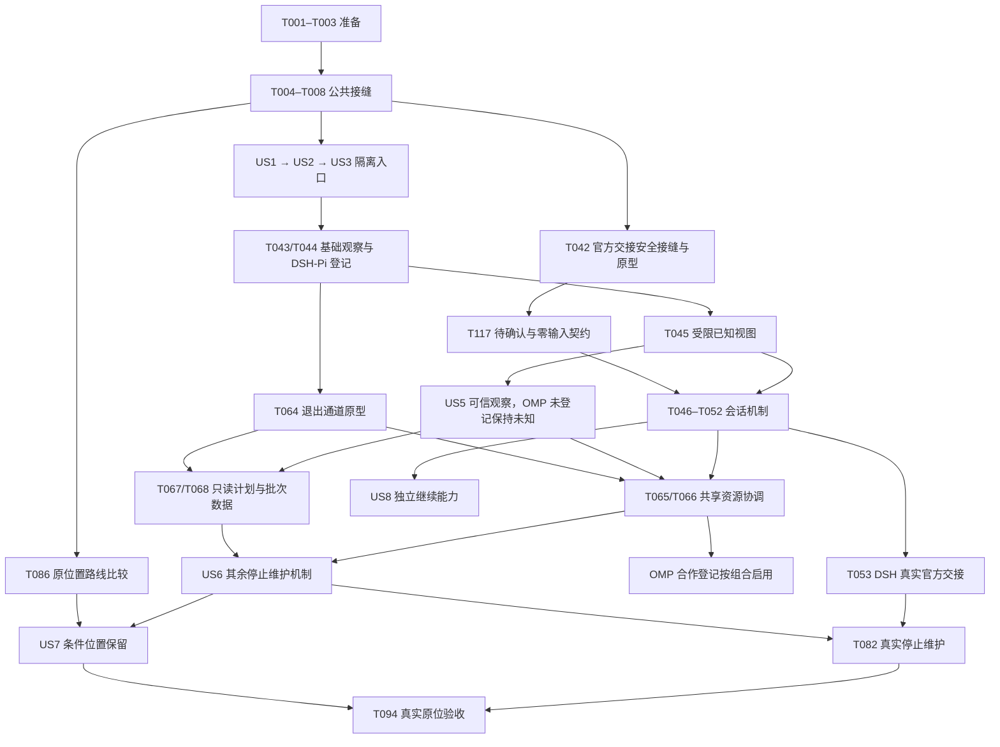

**2026-10-26 分支复审**：发现 Pi 打印/非 TTY 模式下 helper 失败不能可靠阻止后续提示词；该项仍未解决，当前不满足合入条件。其余修正、验证和范围见[分支复审](branch-review.md)。

# Tasks: Rotom 命令与会话体验

**Input**: `specs/008-rotom-command-experience/` 的设计产物。日期：2026-10-23。

**Branch**: `feat/tool-maintenance-workflows-20261026`；逻辑功能标识为 `008-rotom-command-experience`。

**Status**: 实施中。已完成项按实际隔离验证勾选；尚未执行或环境不足的原生验收与未实现能力保留未完成。阶段证据与单一写入责任记录于忽略的私人任务记录。

**当前候选（2026-10-26）**：按工具的分阶段维护以 T118–T125 为当前方案，替代旧跨工具 Domain 许可前提。基线 main `45953f0`，实现和分组验收已完成；T118–T124 已勾选，当前 93/125。T125 的 main 人工整合仍待批准，候选没有切换日常入口。详见 [验收记录](tool-workflow-validation.md)。

**历史范围修订（2026-10-24）**：按用户决定，官方恢复交接与严格加载确认/继续分开；缺回执时待确认、零自动输入、不自动重试。T042 不再等待上游新增接口，T117 已验证该边界；T046–T052 候选机制及 CLI 接线已完成隔离验收，T096/T101/T102 的人工分支已通过，T073 共用 setup 核心、T065/T066 新资源协调及普通 OMP 接线已独立验收，当前 86/117。T053 已完成 Linux 固定组合真实交接验收，T054 精确组合的默认入口、缺参菜单与普通 CLI 原生复验亦已完成。全新 Linux OMP setup/apply/run 和只读查询已有候选验证，T062/T063 完整维护集成仍未收口；不能把这些阶段证据误报为自动停止维护可用。

**Prerequisites**: [plan.md](plan.md)、[spec.md](spec.md)、[research.md](research.md)、
[data-model.md](data-model.md)、[CLI 契约](contracts/cli.md)、
[入口部署契约](contracts/entry-deployment.md)、[生命周期契约](contracts/lifecycle.md)；
以 [宪章](../../.specify/memory/constitution.md) 为治理边界，验证场景见 [quickstart.md](quickstart.md)。

**历史基线增量（2026-10-26）**：按用户的统一启动与版本标识方向，展示已有 RunRecord v2 的配置/部署摘要和运行包身份；旧记录保留 unknown。DSH v2 精确 stop_only 披露未知外部覆盖，但不再单独因此阻断；setup 仍受完整覆盖及未选引用门槛约束。该设计问题已决，不再等待用户回复。用户已授权锁定官方 DSH 的隔离实际启动/停止验证；下载失败后已从标准登记部署取得符合锁的包副本，并通过一次真实零输入启动/精确单次 SIGTERM/后代与原锁释放/终端恢复验收。该初轮未创建 session，只计启动/停止证据；后续 T053 交接验收见下一段，完整停止维护仍待完成。

**历史同日原生补充**：随后使用本地模拟模型生成历史，受控 Rotom resume 已实际核对精确目标、新 run、原 cwd/历史、unknown/not_sent 与零终端输入；缺失目标在派发前拒绝。恢复的额外本地请求已由公开 hook 定位为 TUI 自动回顾；修正零请求假设后正例通过；最终活动 TUI 占用拒绝、原实例不变及释放后恢复均通过，T053 收口。旧失败证据保留。独立外部 writer 拒绝及释放后重取也已通过；各轮失败、分项事实与最终复核见 [main-review.md](main-review.md)，不能将其合计为全功能通过。随后 T054 仅开放精确 Linux/managed DSH/完整锁/观察插件 none/当前终端组合，默认 CLI 独立原生复验通过；严格加载确认、自动继续与封口仍未开放，见第 61 节。

**历史同日精确停止准入**：默认普通启动与恢复入口已为新的 Linux managed DSH 固定锁运行登记原 host 控制端点；`instances stop` 已接通精确计划批准、快照先行、单次原 pidfd 停止、有限等待和 `maintenance status/cancel`。官方运行包三实例选二原生验证通过：未选第三项记录/进程不变且无请求，仍阻断共享 EX；第三项随后以独立计划停止，全部退出/原锁释放/终端恢复，零输入。此证据只准入 `stop_only`，不覆盖 setup、批量 restore、原 pane、force 或其它 agent。T069–T072/T077–T083 按下方完整范围继续未完成，仍为 86/117；最新 main 的整合验收另见[第 65 节](main-review.md#65-最新-main-的整合候选)。见 [第 62 节](main-review.md#62-dsh-默认入口的精确停止验收)。

**Tests**: 规格的 User Scenarios/Independent Test、SC-001–012 及宪章 V 明确要求相关风险的隔离验证，
因此本清单包含有意义的契约/并发/故障测试；不为无风险文档改动编写镜像测试。
各故事的测试先编写并确认因缺少目标行为而失败，再实现；运行结果不得预填通过。

**Organization**: Phase 1 为准备，Phase 2 为所有故事的公共前置；
Phase 3–10 严格对应规格 US1–US8 和 P1→P5 优先级，最后为横切收口。
故事依赖如实声明；“独立验收”表示在声明的前置内可单独验证，不承诺无技术依赖。

## Format: `[ID] [P?] [Story] Description`

- 每项采用 `- [ ] Tnnn [P?] [USn?] 描述与文件路径`；编号连续且唯一，故事阶段必须有 US 标签。
- `[P]` 只表示在列明前置已完成后，能与所列不相交文件任务并行；依赖和单一写入责任优先。
- 每项结尾列出直接依赖和 FR/SC；未选的条件能力保持未完成，不自动跳过并勾选。
- 本清单不授权真实宿主、zsh/Herdr、信号、PTY、终端输入、真实账号/模型调用或日常配置部署。
  对应原生任务须另获范围明确的授权；未授权/未实现与“环境不足未验证”分别记录。

## Path Conventions

所有路径相对实施 worktree 根目录；`src/rotom/`、`schemas/rotom/`、`rotom`、
`test_rotom_*.py`、`tests/fixtures/rotom/`、`tests/benchmarks/` 及新的能力文档属于待创建目标，
随对应任务逐步创建。保留现有 agentcfg/termcfg/work 包、配置与账号/会话路径。

默认测试沿用临时 HOME/DSH_HOME/XDG、网络阻断、假子进程、虚构数据和文件哨兵；
所有 pytest 命令使用准备 venv、`PYTEST_DISABLE_PLUGIN_AUTOLOAD=1` 与 `-p no:cacheprovider`。
真实日志保存在仓库外私人存储；`.cache/task-records/` 仅存受保护、忽略于公开 Git 的任务状态与脱敏引用。

通用持久对象均有整数 `schema_version`，逐字约束为：
“拒绝重复键、未知字段、非法类型及非有限数值”“私人目录 `0700`、文件 `0600`”。
所有新增 reader/schema 的任务均适用；静态 launcher/补全的明确 mode 例外见 T035。
路径沿用已有安全原语；损坏、越界引用、权限不符或未知版本拒绝控制并保留证据，不转为空状态。

---

## Phase 1: Setup（共享准备）

**Purpose / Goal**: 固定实施候选、工作树和验证环境；沿用现有 Python 3.11+、准备 venv 与依赖，不创建新项目或自动安装。

**Independent Test**: 基线与文件所有权有私人记录；现有离线回归有实际结果；新入口骨架不改变旧入口。

- [X] T001 在 `.cache/task-records/rotom-command-experience-implementation.json` 记录本轮选择的交付包/能力范围、最新 main 快照、候选 HEAD、状态、未跟踪文件、锁摘要和单一写入责任；按 `docs/worktrees.md` 评估承接基线及宪章 3.0.0 治理状态，保留本分支设计和用户工作，不自动合并、提交或清理。（依赖：无；覆盖：FR-043、FR-044）

- [X] T002 [P] 按 `specs/008-rotom-command-experience/quickstart.md` 的“现有离线回归”运行确实存在的入口、交互、work、runtime 与租约套件，使用准备 venv、`PYTEST_DISABLE_PLUGIN_AUTOLOAD=1` 和 `-p no:cacheprovider`；结果写入 `.cache/task-records/rotom-command-experience-implementation.json`，不下载依赖、不启动宿主。（依赖：T001；覆盖：FR-002、FR-043、FR-044）

- [X] T003 [P] 创建仓库 `rotom`、`src/rotom/__init__.py` 与门面模块骨架，核对 `pyproject.toml` 的已有包发现；入口直接交接准备好的 Python 3.11+ venv 并在业务导入前禁写 bytecode，不使用 `uv run`、系统解释器回退或新依赖。（依赖：T001；覆盖：FR-001、FR-015）

**Checkpoint**: 只对本阶段实际已验证范围记录完成；未授权原生任务单列未执行，未完成能力不声明可用。

---

## Phase 2: Foundational（全部故事的公共前置）

**Purpose / Goal**: 抽取可复用 parser、类型化调用和上下文接缝；既有业务执行器、配置路径及原生尾部归属保持原契约。

**Independent Test**: 双向 parser leaf 清单与类型约束通过；旧入口省略上下文时保持 legacy；静态帮助与未开放能力分支可隔离测试。

- [X] T004 在 `tests/test_rotom_cli.py` 编写公共契约失败用例：root/agent/term/work/config 路由、未知或重复选择器、`run --` 原样尾部、OMP `agent usage` 全尾部含 `--help`、原退出码和旧入口省略上下文；先确认新行为缺失导致失败，不能以已有错误测试作为基线。（依赖：T002、T003；覆盖：FR-001、FR-002、FR-006）

- [X] T005 在 `src/rotom/context.py` 定义仅内存的 InvocationContext、Scope、InputPolicy、InputGateway 与 TypedInvocation：字段为 command_path、display_prefix、explicit_fields、input_policy、output_mode、Scope、InputGateway；Scope 带 machine/local、agent、profile、component 及选择来源。逐字约束：“不携带秘密值”“显式条件是硬约束”“legacy、auto、interactive、no_input”“native_tail 独立且不透明，绝不从菜单显示文本反向解析”；校验 command_path 已注册，不增加持久数据库。（依赖：T004；覆盖：FR-003、FR-006、FR-008、FR-043）

- [X] T006 在 `src/agentcfg/cli.py`、`src/termcfg/cli.py`、`src/termcfg/work.py` 抽取可复用 parser 构建/分发接缝并接受可选调用上下文；省略时保留 legacy 默认、无参行为、输出与路径，递归分发保留显式上下文，不复制命令业务。（依赖：T005；覆盖：FR-001、FR-002、FR-009）

- [X] T007 在 `src/rotom/cli.py` 注册 `contracts/cli.md` 清单的全部公开叶子及 `_complete`，每项含 parser leaf、scope_rule、参数位置和 E/T/D/A/N、candidate_source、noninteractive_approval、effects、help/示例；注册表与实际 parser leaf 双向比较，包含未来受门禁叶子的真实语法，漏项和过期项均失败。（依赖：T006；覆盖：FR-001、FR-007、FR-014、FR-016）

- [X] T008 在仓库 `rotom` 与 `src/rotom/cli.py` 接入类型化路由及 0/2/3/4/5/6/130 退出语义；静态 help 先于业务读取，阶段一 resume 完整目标返回能力未开放 5、缺项/歧义返回 2；运行 `tests/test_rotom_cli.py` 和旧入口回归并记录结果，不能将 stub 计为 US4 完成。（依赖：T007；覆盖：FR-002、FR-006、FR-015、FR-027、FR-044）

**Checkpoint**: 只对本阶段实际已验证范围记录完成；未授权原生任务单列未执行，未完成能力不声明可用。

---

## Phase 3: User Story 1 — 用统一短命令启动 Agent（P1，MVP）

**Purpose / Goal**: 三工具短启动、显式偏好及覆盖规则，复用保存部署与兼容入口。

**Independent Test**: 假部署分别验证 `run dsh/pi/omp`；保存偏好与显式覆盖命中确切目标；待更新仍用有效旧部署；原生 argv/退出与固定 work binding 保持正确，无隐式准备。

- [X] T009 [P] [US1] 在 `tests/test_rotom_cli.py` 扩充三工具短启动、显式 machine/local/profile、profile 推断工具、环境名称转发、`--` 及 usage 尾部、未部署/绑定不兼容/缺部署包/待更新旧包四类结果与旧入口兼容用例；全部用 fake 捕获 argv/env/cwd。（依赖：T008；覆盖：FR-001、FR-002、FR-005、FR-006、SC-001）

- [X] T010 [P] [US1] 在 `tests/test_rotom_defaults.py` 编写偏好严格校验、各管理面优先级、显式失效不回落、会话归属/work 固定 binding 不被覆盖、并发编辑/链接/权限/写入失败保留旧值及 show 不创建文件的用例。（依赖：T008；覆盖：FR-003、FR-004、FR-020、SC-001）

- [X] T011 [US1] 在 `schemas/rotom/preferences.schema.json`、`src/rotom/preferences.py` 实现 Preferences v1；限定 `schema_version = 1`、`defaults.agent_machine/term_machine/work_machine`、`run_profiles.dsh/pi/omp`，分别校验机器/工具引用；逐字采用公共约束“拒绝重复键、未知字段、非法类型及非有限数值”“私人目录 `0700`、文件 `0600`”。（依赖：T009、T010；覆盖：FR-003、FR-020、FR-043）

- [X] T012 [US1] 在 `src/rotom/preferences.py` 与 `src/rotom/cli.py` 接入 config show/set/unset；路径遵守 `${XDG_CONFIG_HOME:-$HOME/.config}/rotom/config.toml` 的字面绝对路径规则；逐字约束“set/unset 在短文件锁内复核原文件身份与字节，原子替换；拒绝外部并发编辑、符号链接与不安全权限”“正常 run 和菜单选择不写偏好；show/help 不创建文件”。（依赖：T011；覆盖：FR-020、FR-043）

- [X] T013 [US1] 在 `src/rotom/context.py`、`src/rotom/cli.py` 实现 CLI 默认矩阵：显式优先，根 run 用按工具 profile，普通 agent 用管理默认，term/work 各自机器默认；instances 无显式 profile 不过滤；scope-free help/profiles/presets/独立 usage/OMP lock 不加载机器，work 固定 binding 与已知 session 归属不被偏好覆盖。（依赖：T012；覆盖：FR-003、FR-004、FR-020、FR-028）

- [X] T014 [US1] 在 `src/rotom/cli.py`、`src/agentcfg/commands.py` 接通根 run，复用 `src/agentcfg/runtime.py` 的部署、环境、秘密、租约及运行流程；明确区分未部署、绑定不兼容、已部署包不可用与仅待更新；旧部署有效时继续运行并提供同 scope 的显式 plan/apply 建议，不自动 setup/sync/apply/login 或换 profile。（依赖：T013；覆盖：FR-001、FR-005、SC-001）

- [X] T015 [US1] 在 `src/rotom/context.py`、`src/rotom/cli.py` 保留显式参数/原生尾部与原结果，按 TypedInvocation 生成范围完整的静态建议，不从显示文本构造命令；用 `tests/test_rotom_cli.py` 验证 native help/退出不被门面截获、work focus 不重启/改目录/输入。（依赖：T014；覆盖：FR-002、FR-004、FR-006、FR-013）

- [X] T016 [US1] 运行 `tests/test_rotom_cli.py`、`tests/test_rotom_defaults.py` 及 quickstart 的相关旧入口/runtime/work 回归，把实际 argv、通过/失败/跳过和限制写入 `.cache/task-records/rotom-command-experience-implementation.json`；确认三工具均达 SC-001 后才能标入口 MVP 完成。（依赖：T015；覆盖：SC-001、FR-044）

**Checkpoint**: 只对本阶段实际已验证范围记录完成；未授权原生任务单列未执行，未完成能力不声明可用。

---

## Phase 4: User Story 2 — 缺参选择与完整命令直达（P1）

**Purpose / Goal**: 根与每级导航、全部 leaf 输入门控、编号兜底、批准与取消、结构化输出。

**Independent Test**: 逐叶遍历三流 8 种 TTY 组合 × auto/no-input/interactive，覆盖缺参/确认/隐藏输入/递归/失败后续；禁止路径输入读取与当前未接受动作副作用均为零，先前已确认结果仍可辨别。

- [X] T017 [P] [US2] 在 `tests/test_rotom_interaction.py` 按注册表逐叶参数化 E/T/D/A/N 缺项、完整/未知参数、三流 8 组合与 auto/no-input/interactive、单候选仍不替代批准、无 fzf 编号选择；输入/打开 tty/子进程和副作用均设 fake 哨兵。（依赖：T016；覆盖：FR-007、FR-008、FR-011、FR-012、SC-002、SC-003）

- [X] T018 [P] [US2] 在 `tests/test_cli_presentation.py`、`tests/test_cli_environment_interaction.py`、`tests/test_work_cli.py` 增加递归上下文、隐藏秘密、接管/保存批准、取消及 stdout 原 schema 用例，覆盖失败后的下一动作，并断言完整 machine/local/profile/component 建议。（依赖：T016；覆盖：FR-009、FR-010、FR-013、SC-003）

- [X] T019 [US2] 在 `src/rotom/context.py` 实现统一 InputGateway 的枚举、编号、文本、隐藏输入和批准读取；只有三流均 TTY 且未禁用输入才 auto，显式 interactive 不满足返回 2，不开 `/dev/tty`；空输入不接受首项，取消/EOF/中断在当前接受前返回 130。（依赖：T017、T018；覆盖：FR-008、FR-010、FR-011、SC-003）

- [X] T020 [US2] 在 `src/rotom/cli.py` 由注册元数据生成根和每级非叶子导航；仅补实际缺项，强制交互只重选未显式字段，枚举候选限当前 scope，文本按声明规则校验，完整有效命令直达，未知/重复参数先报 2 不开纠错菜单。（依赖：T019；覆盖：FR-007、FR-011、SC-002）

- [X] T021 [US2] 在 `src/agentcfg/cli.py`、`src/agentcfg/commands.py`、`src/agentcfg/model_wizard.py`、`src/agentcfg/model_keys.py`、`src/agentcfg/model_urls.py` 将模型新增/启用/隐藏值、init-local 保存、接管与确认全部接入可选 InputGateway；无输入缺等价批准或秘密输入路径先报 2，不新增 argv 密钥。（依赖：T020；覆盖：FR-009、FR-012、FR-043、SC-003）

- [X] T022 [US2] 在 `src/termcfg/cli.py`、`src/termcfg/work_edit.py`、`src/termcfg/work_ui.py` 接入终端 init-local/组件/plan/apply/adopt/zshenv/migrate/rollback 与配置编辑输入门控；保留既有批准 token，fzf 缺失/失败时使用同 ID 编号兜底，不把选择当批准。（依赖：T021；覆盖：FR-007、FR-009、FR-011、FR-012）

- [X] T023 [US2] 在 `src/termcfg/work.py`、`src/termcfg/work_projects.py`、`src/termcfg/work_ui.py`、`src/termcfg/work_shell.py` 传递上下文至 work 项目/命名/source/type/worktree、enter/rebind 递归与 close 确认；固定 binding、单工作区 scope token、既有 deadline 不变，focus 零重启/改目录/文本输入。（依赖：T022；覆盖：FR-004、FR-007、FR-009、FR-012、SC-003）

- [X] T024 [US2] 在 `src/rotom/context.py`、`src/agentcfg/interaction_diagnostics.py`、`src/agentcfg/commands.py` 统一失败后续动作和 stderr 提示；未部署后的 plan/setup 是另一项明确接受动作，保留原批准且准备后不自动启动；无输入只给同 scope 静态建议，取消不抹掉先前已接受事实。（依赖：T023；覆盖：FR-009、FR-010、FR-013、SC-003）

- [X] T025 [US2] 运行 `tests/test_rotom_interaction.py` 逐叶双向覆盖及已有 agent/term/work 交互回归，分别解析原有 JSON schema，验证菜单/范围/进度只到 stderr；在 `.cache/task-records/rotom-command-experience-implementation.json` 记录 SC-002/003 实测与未覆盖项。（依赖：T024；覆盖：FR-007、FR-013、SC-002、SC-003）

**Checkpoint**: 只对本阶段实际已验证范围记录完成；未授权原生任务单列未执行，未完成能力不声明可用。

---

## Phase 5: User Story 3 — help、补全与受管 zsh 入口（P1）

**Purpose / Goal**: 完整静态帮助、受限候选与受管入口部署，保护已有绑定和中断恢复。

**Independent Test**: 所有层级 help 在缺失/损坏业务配置时零业务读取；补全来源/输出受限；临时 HOME 中验证跨 worktree 保持、显式换绑、每写入窗口故障与旧 journal 恢复。实际 zsh/终端另行授权验收。

- [X] T026 [P] [US3] 在 `tests/test_rotom_help_completion.py` 编写每层 help、原生尾部例外、允许/禁止候选源、NUL/空输出、链接/权限/损坏配置与零秘密/网络/宿主/写缓存/pycache 用例，调用环境与文件访问全部有哨兵。（依赖：T025；覆盖：FR-014、FR-015、FR-016、SC-004）

- [X] T027 [P] [US3] 在 `tests/test_rotom_entry_deployment.py` 编写 P-ENTRY 合成故障矩阵：首次/跨工作树/换绑、源和目标变化、漂移/链接、不安全祖先、payload/journal/write/rename/fsync 中断、绑定已激活未收尾、v1/v2/v3 恢复与源丢失；不执行生成脚本或真实 zsh。（依赖：T025；覆盖：FR-017、FR-018、SC-005）

- [X] T028 [US3] 在 `src/rotom/cli.py`、`src/agentcfg/cli.py`、`src/termcfg/cli_help.py` 补全每层用途/synopsis/参数位置/必填互斥重复/默认优先级/交互条件/最短和显式示例/副作用；静态 help 导入路径不读偏好、机器、秘密或会话，不写 bytecode，保留原生 help 归属。（依赖：T026；覆盖：FR-014、FR-015、FR-006、SC-004）

- [X] T029 [US3] 在 `src/rotom/completion.py`、`src/rotom/cli.py` 实现 `_complete` 严格查询和来源白名单：公开目录、仅文件名机器、显式 scope 的 provider ID/work 非秘密 ID、已准入同 scope 会话索引；仅 UTF-8 合法 CLI ID+NUL，缺数据 0+空、非法/读失败非零+空，禁 URL/path/SecretRef/原生正文/建索引及 `--` 后补全。（依赖：T028；覆盖：FR-016、FR-022、SC-004）

- [X] T030 [US3] 在 `src/rotom/entry.py`、`terminals/zsh/rotom` 实现固定静态 launcher：从自身经核实普通安装文件的固定布局定位绑定，不以调用者 HOME/XDG/cwd 选绑定；`python3 -I -S -B` 只做隔离标准库 JSON 定位、保持 stdin，按 token exec 已准备 venv；链接/未知布局/损坏/缺解释器明确失败，不扫描其它 checkout。（依赖：T027、T029；覆盖：FR-015、FR-017、FR-019）

- [X] T031 [US3] 在 `schemas/rotom/entry-binding.schema.json`、`schemas/termcfg/catalog.schema.json`、`src/termcfg/catalog.py` 增加受限 GeneratedArtifact/catalog v2；逐字校验 EntryBinding：“均为 1；未知版本拒绝，不猜其它入口”“显式可信 checkout 的绝对字面路径；不按调用者 cwd 或 main 分支推导”“可信根目录身份及入口协议来源摘要；Git HEAD 不是唯一内容证明，也不要求启动时读取 Git”“固定为该协议允许的仓库 rotom 与准备环境入口；不能配置任意命令或 shell 片段”。（依赖：T030；覆盖：FR-017、FR-018、FR-043）

- [X] T032 [US3] 在 `src/termcfg/preview.py`、`src/termcfg/cli.py` 接入仅 zsh 合法的 `--entry-repo` 与 plan 身份；GeneratedArtifact 逐字包含“kind=`rotom-entry-binding`、目标 ID、精确 UTF-8 字节、sha256、mode、generator_version、来源输入/模板摘要和写前身份”；固定序列化 key/缩进/结尾换行，保存有效 target HOME，已有绑定默认保持，首次候选和换绑必须审阅，任何相关变化使原计划失效。（依赖：T031；覆盖：FR-017、FR-018、SC-005）

- [X] T033 [US3] 在 `schemas/termcfg/state.schema.json`、`src/termcfg/state.py`、`src/termcfg/transaction.py` 实现带生成内容的 state/journal v3，保留 catalog v1/v2 和 v2 journal 严格读取/恢复；纯静态旧状态保持 v2，不升级活动 pending、不降 v3；先 durable payload/before/backup/prepared journal，再静态文件，绑定最后激活，保存写后身份及 activated/completed 事实，无变化不轮换备份。（依赖：T032；覆盖：FR-018、FR-043）

- [X] T034 [US3] 在 `src/termcfg/transaction.py`、`src/termcfg/state.py` 接通记录字节/身份驱动的 recover/rollback；逐目标先核实再逆序恢复，不按当前 checkout/template 重算；源消失仍使用已存 backup，rename 与 journal 间缺证明的窗口保留 pending/返回 4，desired 字节相同不等于所有权，首次回滚只移除已证明本次创建且未漂移目标。（依赖：T033；覆盖：FR-018、SC-005）

- [X] T035 [US3] 在 `terminals/zsh/_rotom`、`terminals/zsh/zshrc.zsh`、`terminals/catalog.json`、`terminals/SOURCES.md` 注册 launcher/绑定/补全产物和来源摘要：目标 `$HOME/.local/bin/rotom` 为 0700、`$HOME/.local/share/rotom/entry.json` 为 0600、`$HOME/.local/share/rotom/zsh/site-functions/_rotom` 为 0644；PATH 去重，fpath 先于 compinit，补全按值消费 NUL 且不 eval，部署目标取保存 HOME。（依赖：T034；覆盖：FR-017、FR-018、SC-005）

- [X] T036 [US3] 运行 `tests/test_rotom_help_completion.py`、`tests/test_rotom_entry_deployment.py` 和相关 term catalog/plan/recovery/security 回归；补齐不同 HOME/XDG/cwd 调同一安装文件、空格/Unicode、无 site/PYTHONPATH 导入、stdin/argv/退出交接的假执行证明；由主代理验收 P-ENTRY 的写入/日志顺序与所有未知窗口后才允许入口部署交付。（依赖：T035；覆盖：FR-015、FR-018、SC-004、SC-005）

- [X] T037 [US3] 在 `README.md`、`docs/README.md` 补充从已知仓库 `./rotom` 开始的首次使用、agent/term 各自 init-local、work 复用明确 machine/local 并通过 config edit 管理现有结构化配置（CLI 契约不提供 work init-local）、入口预览/部署、默认保持/显式换绑、绑定损坏修复及能力状态说明；无已装命令也能照做，不自动初始化其它管理面。（依赖：T036；覆盖：FR-014、FR-019、FR-044）

- [X] T038 [US3] 按 `specs/008-rotom-command-experience/quickstart.md` 收口 US1–3 隔离回归与完整合成机器配置兼容，并在 `.cache/task-records/rotom-command-experience-implementation.json` 保留实际结果；未解析真实密钥、未进行原生验收的项分别列明，不以文档/模拟通过声称新终端可用。（依赖：T037；覆盖：FR-002、FR-044、SC-001、SC-002、SC-003、SC-004、SC-005）

- [X] T039 [US3] 仅在获得对应明确授权后，按 `specs/008-rotom-command-experience/quickstart.md` 在专用 HOME/checkout 验证真实新 zsh 的任意目录调用/Tab、已有绑定保持、显式换绑和回滚；将 argv/版本/退出码/平台及脱敏证据引用写 `.cache/task-records/rotom-command-experience-implementation.json`，未授权保持未执行且不得标环境不足或通过。（依赖：T038；覆盖：FR-017、FR-018、SC-005）

**Checkpoint**: 只对本阶段实际已验证范围记录完成；未授权原生任务单列未执行，未完成能力不声明可用。

---

## Phase 6: User Story 4 — 确切 session ID 与日常恢复（P2）

**Purpose / Goal**: 首先完成 DSH 当前终端的官方恢复交接；缺加载回执时待确认且零自动输入。与维护无关，严格加载确认、Pi/OMP、原位置和继续分别准入，不等待上游增强。

**Independent Test**: 同 scope 多会话、跨归属同 ID、未知 ID、cwd 冲突、writer 竞争及缺回执待确认的 fake 验收均正确；随后在授权范围真实验收官方交接、原历史/目录、新 run 与零自动输入。缺机器回执不阻塞交接，静态接口或持续拒绝仍不能完成本故事。

- [X] T040 [P] [US4] 在 `tests/test_rotom_resume.py`、`tests/test_rotom_session_events.py` 先编写 scope/归属/歧义/未知 ID、同裸 ID 跨 backend/HOME、cwd 与位置分离、writer 竞争覆盖到执行、加载确认、新 run/默认无继续，以及事件代际/重复乱序/缺口/切换/封口与加载分离的 fake 用例；断言不跨 scope 搜索、不最近/空会话回落。（依赖：T038；覆盖：FR-021、FR-022、FR-023、FR-024、FR-025、FR-026、SC-006）

- [X] T041 [P] [US4] 在 `tests/test_rotom_run_records.py` 编写 RunRecord v1/v2 严格读取、旧 reader 拒绝 v2、活动 v1 不重写、未知版本/字段/权限/链接、PID 复用/manager 丢失/记账失败及 unknown 保持阻塞的用例；用合成 ReleaseObservation 而非真实进程。（依赖：T038；覆盖：FR-021、FR-029、FR-043）

- [X] T042 [US4] 在 `docs/rotom-session-capabilities.md`、`tests/fixtures/rotom/session-capabilities.json` 收口 P-SESSION 的现有官方恢复交接：分别核实锁定版本的显式 session 入口、实际配置/HOME/scope、原目录规则、缺失目标拒绝和原生 writer 覆盖，并用 fake 原型区分请求目标、启动派发、加载待确认与已确认。严格初始加载回执缺失只限制 restored/自动继续，不再要求上游新增接口或先解决 registry 复用的初始化结果；范围和 writer 防护不足仍拒绝自动派发。已有精确源码、scene 元数据及 Core writer 调用链保留；缓存 Core 的 2 case 仅证明内存注册先于初始化提交及迟到失败回滚，官方归档身份未验证，不冒充 TUI 恢复。`docs/rotom-dsh-startup-contract.md` 和本地上游草稿保留为可选研究，当前不提交 issue。生产接线归 T047，真实交接/加载观察和外部 writer 竞争归 T053，不反向要求其先完成；停止最终封口单列，不读私有接口或用延时猜测。（依赖：T008；覆盖：FR-023、FR-024、FR-027、FR-043）

- [X] T117 [US4] 在 `tests/test_rotom_resume.py`、`tests/test_rotom_session_events.py`、`tests/test_rotom_cli.py` 为用户修订增加“有安全官方恢复能力但无严格加载回执”的假后端：接受后仅一次派发、保留请求 ID 与实际观察的区分、待确认可交接、默认/不确定时零继续，迟到失败/失联/超时不重试不强杀，人工确认/退出码 0 不伪造 restored。保留错误范围/cwd/缺失目标/外部 writer 冲突拒绝及匹配实际加载才 restored 的原断言；原 T040 的建测试完成记录不冒充新契约通过，先记录更新后的 RED，再实施 T046–T048。测试仅用临时 HOME、fake 进程/后端/时间，不调用第三方宿主。（依赖：T040、T042；覆盖：FR-023、FR-026、FR-027、FR-042、SC-006、SC-011）

- [X] T043 [US4] 在 `schemas/rotom/run-record.schema.json`、`src/agentcfg/run_owners.py` 实现严格 v1/v2 reader 与 v2 字段：run_id/binding_digest“run_id 是单次随机身份；绑定到原有物理实例与部署归属”；manager/host“PID、平台 birth identity、可验证关系；host 可未知；稳定句柄仅在进程内持有，不能把 FD 数值持久化后重用”；归属“已解析归属；machine_ref 是非秘密配置引用，不携带整份配置”；cwd“分别记录来源与确认状态；原目录无效时不猜调用目录”；native_home/deployed“经过安全路径校验的存储归属及保存的运行/部署身份”。（依赖：T040、T041；覆盖：FR-021、FR-023、FR-043）

- [X] T044 [US4] 在 `src/agentcfg/run_owners.py`、`src/agentcfg/runtime.py` 收口通用 v2 观察及 DSH/Pi 基础登记；OMP 保留现有未登记兼容行为和未知能力，其生产合作登记由 T065/T066 门控，不作为本任务完成条件。逐字约束：“保持 active、unknown、idle_confirmed 三种所有权状态；展示的 stopped 不直接写成 idle_confirmed”“来源、观察时间、身份和覆盖；内核完整释放证明才可确认 idle”“SessionRef、emitter_epoch、sequence、确认级别与事件来源；可缺失/历史/已确认”“可选 TerminalRef；没有证据时位置未知”“合作准入版本、可信协调域锚点；旧/不匹配版本不获得自动控制资格”；unknown 仅走既有物理 EX 完整 ReleaseObservation 核实，不在线改活动 v1；保持原 argv/stdio/退出/租约及平台边界。该基础范围正式验收后才可完成 T044，不以本次规划修订补勾。（依赖：T043；覆盖：FR-021、FR-029、FR-043）

- [X] T045 [US4] 在 `schemas/rotom/session.schema.json`、`src/agentcfg/sessions.py` 实现 SessionRef/Observation 和受限已知视图；逐字采用“SessionRef 由 agent、backend、native_home_ref、native_ref 构成”“裸 ID 不是主键”“profile 和 machine/local 限制查询范围；已知归属不受启动默认配方重算”“记录当前 run/emitter 代际、递增序号、原生会话/目录来源和确认状态”；已知视图仅 RunRecord/受保护恢复清单/已审核元数据，不复制正文，显式未知 ID 仅用所选后端公开核验。 native_ref 逐字约束：“native_ref 可以是后端允许的 ID 或受限引用，但动态补全只输出允许的标识，不泄露路径值”。此阶段仅实现类型、已保存记录的受限视图和查询接缝；缺少已审核公开接口时字段保持缺失/历史/未知，显式未知 ID 不启动原生核验或恢复，不从启动参数/profile/native HOME 推造 SessionRef。（依赖：T044；覆盖：FR-021、FR-022、FR-023、SC-006）

- [X] T046 [US4] 在 `src/agentcfg/sessions.py`、`src/agentcfg/runtime.py` 实现准入后端 WriterEvidence 与恢复前检查，逐字约束“记录后端/来源、会话键、有效期或租约身份与覆盖范围”“证据必须覆盖实际启动/发送”；允许已核验的官方恢复事务内部取得并持有 writer，不要求父进程先争抢同一原生锁。不能把旧无-writer 布尔值或 Rotom 本地锁当外部排他；范围/冲突为相应 2/4，缺安全派发能力为 5，仅缺加载回执不拒绝官方交接。（依赖：T045、T042、T117；覆盖：FR-023、FR-024、SC-006）

- [X] T047 [US4] 仅按 T042 已核实公开 API 在 `src/agentcfg/dsh_sessions.py` 接入最小官方恢复交接，沿用 `agents/dsh/templates/launch.mjs` 的原 preset/route/setup 及已部署启动路径；派发前只读核验完整目标、原目录、实际 HOME、profile 用户层、HOME patch 与最终受管 patch/launcher，未知配置形状拒绝。无需为待确认交接强制安装观察插件；若接入公开 emitter/切换观察，再于 `agents/dsh/packages/session-observer/index.mjs` 及对应 `package.json` 实现，并同步 `locks/dsh/package.json` 及完整锁/来源。可得到的信息按真实证据保存，初始加载、缺口或最终封口无证据则保持未知，不阻塞已准入的交接；不为取得回执私有导入、抢先自建 Agent 或改宿主。安全派发前提不成立时升级主代理，加载确认不足直接走待确认分支。（依赖：T046；覆盖：FR-021、FR-023、FR-027、FR-043）

- [X] T048 [US4] 在 `src/agentcfg/sessions.py`、`src/agentcfg/runtime.py` 实现共享 resume executor，校验请求和 writer 证据，复用已部署契约/环境/秘密/租约并创建新 run。分别保存请求目标、启动派发与加载事实；已派发但无回执可交接 TUI 并显示加载待确认，仅实际 SessionRef/cwd 相符才 restored。迟到失败如实更新，失联/超时保留 unknown 且不重试、不强杀、不发送继续；位置不改原目录，人工确认和退出码 0 不提升可信度。（依赖：T047；覆盖：FR-023、FR-024、FR-025、FR-026、FR-037、SC-006）

- [X] T049 [US4] 在 `src/rotom/cli.py`、`src/rotom/completion.py` 接通 `resume` 的同 scope 列选/显式 ID 与唯一工具推断，展示可复制 ID 和范围完整命令；歧义缺参遵守输入门控，历史/未知单列，补全不建索引。展示“已发起恢复，加载待确认；请在 TUI 检查；未发送继续”，不能混淆请求 ID 与当前会话；help 说明交接、失败及退出码。候选由受控临时验收入口调用，T054 前日常保持未开放 5；不新增可伪造准入/加载确认的用户 flag。（依赖：T048；覆盖：FR-021、FR-022、FR-025、FR-027、SC-006）

- [X] T050 [US4] 在 `docs/rotom-session-capabilities.md`、`src/agentcfg/sessions.py` 建立按 tool/backend/运行包/插件/平台/位置区分的能力矩阵，拆开官方恢复交接、严格加载确认、自动继续及最终封口。DSH 可在加载确认未支持时准入经过验证的交接；Pi/OMP 各自未验证保持拒绝，不类推。缺安全交接能力给人工说明，缺回执不等待上游支持。（依赖：T049；覆盖：FR-027、FR-044）

- [X] T051 [US4] 运行 T040 和 T117 更新的 `tests/test_rotom_session_events.py` 故障注入代际/重复/乱序/缺口/切换/封口与实际加载分离；确认缺失或迟到回执不会伪报 restored、发送继续或重复启动。历史明确会话的交接不被缺停止封口一概阻断，停止前最终会话缺封口仍限制确切实例自动恢复，不污染已证明退出事实；不读取真实 session。（依赖：T050；覆盖：FR-021、FR-023、FR-029、FR-043、SC-006）

- [X] T052 [US4] 运行 `tests/test_rotom_resume.py`、`tests/test_rotom_run_records.py`、`tests/test_rotom_session_events.py` 及受影响 runtime/租约/三工具隔离回归；在 `.cache/task-records/rotom-command-experience-implementation.json` 分开记录机制通过、未开放能力与 P-SESSION 原生待验证。（依赖：T051；覆盖：SC-006、FR-043、FR-044）

- [X] T053 [US4] 按既有授权范围和 `specs/008-rotom-command-experience/quickstart.md`，在专用临时 scope/原生存储通过 T049 受控入口验证真实 `resume ... --here`：官方接收确切目标、新 run、原目录及原历史，缺失目标不新建、活动/外部 writer 冲突拒绝。运行时可保持“加载待确认”；人工观察只作该次验收证据，不补造机器回执。验证零自动输入、确认超时不终止 TUI、不重试及原生退出码保留；账号/模型调用须在授权范围。私人证据与脱敏引用分开记录；未执行不能用 fake/拒绝替代，不要求上游新增严格回执。（依赖：T052；覆盖：FR-023、FR-024、FR-026、FR-027、SC-006）

- [X] T054 [US4] 在 `docs/rotom-session-capabilities.md` 和 `src/agentcfg/sessions.py` 的能力注册中，主代理核验 T053 真实交接证据、稳定差异、公开接口/完整锁后开放对应组合的官方恢复交接。严格加载确认与自动继续仍可保持未支持，不将交接准入当作它们通过；业务/证据变化重做受影响检查。未通过实际交接验收仍保持日常未开放，不能以候选/fake 计作 US4 完成。（依赖：T053；覆盖：FR-027、FR-043、FR-044、SC-006）

**Checkpoint**: 只对本阶段实际已验证范围记录完成；未授权原生任务单列未执行，未完成能力不声明可用。

---

## Phase 7: User Story 5 — 活跃实例与可恢复性（P2）

**Purpose / Goal**: 按机器范围展示实例和每项可信度，允许按工具/显式配方过滤，保留未知。

**Independent Test**: 五类 fixture（活动、退出、缺字段、未登记占用、过期）均分别呈现进程/会话/位置及来源时间；无显式 profile 时不缩成默认配方，读取不执行控制或扫描正文/全部 argv。

- [X] T055 [P] [US5] 在 `tests/test_rotom_instances.py` 编写五类记录、全机器/工具/仅显式 profile 过滤、manager/host 区分、来源与时间、未知能力、结构化输出和只读哨兵；可在 T044 后独立开始，不等待真实 resume/停止。（依赖：T044；覆盖：FR-028、FR-029、SC-007）

- [X] T056 [US5] 在 `src/agentcfg/run_owners.py`、`src/agentcfg/workspace.py` 实现当前机器范围的只读实例视图，使用单次机器配置快照再枚举配方，复用 v1/v2 校验和保存的部署/归属，不将 default_profile 当过滤器；分离 process/session/terminal 三类事实，缺字段和过期观察保持未知。（依赖：T055；覆盖：FR-028、FR-029、SC-007）

- [X] T057 [US5] 在 `src/agentcfg/lifecycle.py`、`src/agentcfg/run_owners.py` 复用既有资源/owner 观察显示未登记物理占用与无法核实记录；不得把未登记占用当零运行，不清 owner/租约，不扫描系统全部 argv、会话正文或认证目录来补齐。（依赖：T056；覆盖：FR-029、FR-043、SC-007）

- [X] T058 [US5] 在 `src/rotom/cli.py` 接通 `agent instances list` 及 agent/显式 profile/format 过滤，与 scope 规则和全叶子输入元数据一致，不要求会话/停止能力先完成；完整选项直接执行。（依赖：T057；覆盖：FR-028、FR-007）

- [X] T059 [US5] 在 `src/rotom/cli.py` 实现实例人类/JSON 展示，包含 manager/host、start/session cwd、确切/历史/未知 session ID、位置能力及各自来源/观察时间和同 scope 下一步；无 session 证据不构造假 resume 成功，提示仍在 stderr。（依赖：T058；覆盖：FR-013、FR-021、FR-028、FR-029）

- [X] T060 [US5] 运行 `tests/test_rotom_instances.py`、`tests/test_rotom_run_records.py`、`tests/test_lifecycle_leases.py` 与受影响只读呈现回归；用文件/子进程哨兵验证零控制和零越界读取，将 SC-007 结果写 `.cache/task-records/rotom-command-experience-implementation.json`。（依赖：T059；覆盖：SC-007、FR-043）

- [X] T061 [US5] 在 `README.md`、`docs/rotom-session-capabilities.md` 说明活跃实例查询、各列可信度、默认过滤范围、旧记录与未登记活动限制；只标已经验证的观察/恢复能力，不把实例列表可用等同于可安全维护。（依赖：T060；覆盖：FR-028、FR-029、FR-044）

**Checkpoint**: 只对本阶段实际已验证范围记录完成；未授权原生任务单列未执行，未完成能力不声明可用。

---

## Phase 8: User Story 6 — 原统一 Domain 方案与已完成内部增量（历史）

当前公开编排以 Phase 12 的 T118–T125 为准；本节保留旧任务、协议及证据，不再要求 DSH/Pi 先采用统一 Domain。

**Purpose / Goal**: 普通 stop 与维护共用身份/退出执行器，setup 维护的批准、资源协调、恢复清单及对账保持一致。

**Independent Test**: 三实例只选两项：第三项不被控制；若仍阻塞资源则拒绝维护，否则按独立批准 setup。故障注入目标变化、外部启动、后代幸存、超时、部分写入/回包丢失/取消；原操作结果保留，未知不重试。自动恢复须有该工具真实恢复证据。

- [X] T112 [US6] 在 `src/agentcfg/resource_keys.py`、`tests/test_rotom_resource_keys.py` 建立独立可验收的只读物理资源键：核对已有私人目录或 0600 单链接租约文件与调用方 fd，严格 kind/device/inode/digest，路径/profile 不参与身份；不创建资源、不读取原生正文、不获得或释放调用方租约。在 `src/agentcfg/omp_dependencies.py` 的现有包锁取得后重核命名租约与 fd，覆盖目标/父目录替换及删除、跨实例共用包、继承 fd 持锁；同步使用 `tests/test_omp_resource_lease_identity.py` 及相关隔离回归验收。物理键不证明历史引用完整、域、无 writer 或维护许可；本任务可独立于停止/恢复实施，不启用 OMP v2，也不替代 T065/T066。（依赖：T044；覆盖：FR-032、FR-034、FR-043）

- [X] T113 [US6] 在 `schemas/rotom/resource-coordination.schema.json`、`src/agentcfg/resource_protocol.py` 与 `src/agentcfg/resource_coordination.py` 实现仅新 runtime 的内部协调原型：严格域/锚点 codec、物理域绑定、独立持久声明先于非空锚点不可覆盖发布、持久 reservation/intent 与短锁 revision CAS；包 EX 可取仍不能清 unknown。新增 `tests/test_rotom_resource_protocol.py`、`tests/test_rotom_resource_coordination.py`、`tests/test_omp_resource_coordination.py`、`tests/test_rotom_runtime_claims.py`，验证首次采用拒绝、跨域/租约损坏防降级/声明及父目录持久化/发布与提交故障、未知不取消和 cache-only 兼容。普通 OMP 入口遇新锚点始终拒绝直至合作协议接通；此内部原型不开放登记、停止或维护，不证明旧资源/instance/native-home 完整覆盖，也不提供 release/repair API。独立于恢复和停止实施，作为 T065 的可复用前置。（依赖：T112；覆盖：FR-032、FR-034、FR-043）

- [X] T114 [US6] 在 `src/agentcfg/resource_owners.py`、`src/agentcfg/run_owners.py` 与既有两份 schema 中实现 OMP 内部同 run ID owner 关联：持实例/状态/包 SH 后，协调锁 → 非阻塞 owner 锁；先 durable owner_pending，再不可覆盖发布 owner，复核后 owner_attached，派发前重核 scope、完整包集合、registry/instance/native-home 物理身份、所有权收据与双向摘要。新增 `tests/test_rotom_resource_owners.py` 验证跨实例共享包、替换/损坏、锁竞争及逐提交失败；pending/attached/unknown 不取消、不重试、不靠单实例空 Registry 解除保护。本任务只建立当次关联，instance/native-home 的全局域锚点、历史覆盖与释放对账仍归 T065/T066，不提供生产 hook、release/repair 或维护许可，可独立于停止/恢复验收。（依赖：T044、T113；覆盖：FR-021、FR-032、FR-034、FR-043）

- [X] T115 [US6] 在 `src/agentcfg/resource_owners.py`、`src/agentcfg/resource_coordination.py` 和协调 schema 中实现仅当前 manager 的完整退出记账：精确 ReleaseObservation 与当前出生身份匹配，持原物理 SH 后协调 EX → owner EX(NB)，先 durable release_pending/末态摘要及固定时间，再 owner idle_confirmed/fsync/重核，最后 released。`tests/test_rotom_resource_release.py` 覆盖逐提交及响应丢失、同 manager 重新观察后的 pending 对账及 released 同步确认、三实例仅清本 run、意图仍保留、单边 idle/unknown/manager 丢失拒绝。对账只补记，不执行或重试宿主；release_pending 转 unknown 时保留收据但不能通过此入口清除。此独立内部闭环消费既有有限观察，不补造旧 unknown 的 EX 证明、全局历史或 instance/native-home 域锚点，不开放生产 OMP 或维护许可。（依赖：T044、T113、T114；覆盖：FR-032、FR-034、FR-036、FR-043）

- [X] T116 [US6] 在 `src/agentcfg/resource_scopes.py`、协调 schema/codec、`resource_owners.py` 与 `omp_identity.py` 建立仅全新 OMP 实例的 instance/native-home 唯一域锚点：父容器独立声明先持久化，再不可覆盖创建实例/锁/HOME 与锚点，最后登记域；所有中断保留声明，已有目录不采用。内部 owner 必须覆盖一个 runtime 加同域 instance/native-home，启动/退出前复核完整集合；普通入口在创建前与锁内拒绝声明/锚点，不开放生产。以 `tests/test_rotom_resource_scopes.py` 验证跨域、替换/损坏防降级、逐写入失败和三资源闭环；旧历史采用与 unknown 排他对账仍属 T065/T066。（依赖：T112、T113、T114、T115；覆盖：FR-021、FR-032、FR-034、FR-043）

- [ ] T062 [P] [US6] 在 `tests/test_rotom_maintenance.py` 先写只读 stop_only/setup 计划零写入、精确集合/资源/恢复方案、计划变化重审、保存恢复清单先于假停止、独立停止/维护批准与共享阶段 deadline 的失败用例；不用真实 kill 或宿主。（依赖：T052、T060；覆盖：FR-030、FR-031、FR-033、FR-034、FR-037、SC-008）

- [ ] T063 [P] [US6] 在 `tests/test_rotom_maintenance_recovery.py` 先写 reservation/intent 竞态、跨域别名（不同 instance/state 共享 cache、A 留 unknown 而 B Registry 为空、包 EX 可取、首次采纳及 cache-only sync）、旧入口物理锁、后代幸存/unknown、dispatch/fsync/响应丢失、部分 setup、取消及三类恢复部署依据用例，断言第三实例不被自动纳入、未知不重试或清保护。（依赖：T052、T060；覆盖：FR-032、FR-034、FR-035、FR-036、SC-008、SC-009）

- [X] T064 [US6] 在 `docs/rotom-stop-capabilities.md`、`tests/fixtures/rotom/exit-capabilities.json` 完成 P-EXIT 的公开停止通道/稳定句柄/manager 保留/后代和资源释放观察的 fake 原型，明确平台与工具边界，复用 main 已有 Pi Linux DescendantScope 和有限完整释放证据，缺覆盖/后代幸存/manager 丢失仍保持 unknown；不将旧退出验收当成本功能停止通道已准入；可在 T044 后提前取证，真实通道验证归 T082，无证明不能开放对应自动停止维护。（依赖：T044；覆盖：FR-031、FR-032、FR-043、FR-044）

- [X] T065 [US6] 在 `schemas/rotom/maintenance.schema.json`、`src/agentcfg/lifecycle.py` 复用 T112 的物理 ResourceKey，并补齐归属代际、LaunchReservation、ResourceIntent；每个共享物理资源有唯一可信协调域锚点与完整 owner/reservation 引用，machine/profile 或路径字符串不能替代物理归属。逐字字段约束：“kind、经核实的物理资源归属与摘要；覆盖 instance、runtime、native-home，别名不能分成两把独立锁”“run/op、资源集合、域、代际、阶段；启动前登记；可能已启动时不能按时限直接清除”“batch/代际、规范资源集合、意图状态；冲突检查与登记在一个短协调锁内完成”；根固定已验证 state_root/lifecycle 及实例锚点；已有资源首次采纳或跨域共享不能证明完整范围时拒绝自动维护，不隐式扫描其它机器配置。此任务提供后续 OMP 启用前提，不反向阻塞 T044 基础观察。（依赖：T112、T113、T114、T115、T116、T064；T063 的资源协调竞态子集须独立通过，完整维护编排不作为本原语前置；覆盖：FR-030、FR-032、FR-034）

- [X] T066 [US6] 在 `src/agentcfg/lifecycle.py`、`src/agentcfg/runtime.py`、`src/agentcfg/omp_dependencies.py` 接入合作准入：短协调锁登记 reservation 后释放，再按既有顺序取物理/状态/包 SH，持 SH 时协调锁重核后进 owner 锁；影响控制事实的变化推进资源代际。T063 的共享 cache/跨域/旧 unknown 用例通过、物理资源锚点与完整引用可证明后才启用 OMP v2 合作登记；同步覆盖普通 OMP sync 首个修复/激活门禁，保留不创建实例的 cache-only 契约，不外套实例 EX 或嵌套重入。 补齐全新 scope/runtime 在旧路径创建目录或空租约之前登记、再经原 setup 预览复核与 apply 完成部署的路径；预检、sync、apply、run 对声明/锚点的判别须一致。旧资源不能事后自动采用，部分登记或跨域声明继续拒绝降级。禁止 owner→协调/物理反向锁、不持协调锁等待物理锁/宿主/网络/用户；旧/外部入口仍由物理租约约束，不能声称它们遵守新意图，不超时删除可能启动预留。合作登记通过不等于停止/恢复原生能力准入。（依赖：T065；覆盖：FR-021、FR-024、FR-032、FR-034、FR-043）

  T065/T066 的依赖修订与独立验收：共享 cache、跨域别名、旧 unknown、空 Registry/包 EX、cache-only 和旧物理锁的测试子集已通过；完整维护编排仍由 T062/T063/T069–T084 覆盖，不改变其门禁。ResourceIntent 由现有 Domain 严格数据与 CAS 实现，不另造等价包装类型。仅全新 Linux OMP 的三资源完整登记可合作启动；旧资源/部分声明/跨域继续拒绝，历史覆盖及旧 unknown 不自动修复。证据映射见 `main-review.md` 第 39 节。

- [X] T067 [US6] 在 `src/agentcfg/maintenance.py`、`schemas/rotom/maintenance.schema.json` 实现只读 StopPlan，逐字字段“显式 scope、operation 或 stop_only、排序的 run 集合、资源闭包、观察/部署摘要、恢复位置与能力、schema；只读计算 plan_id”；首版维护仅 setup，普通停止 stop_only，重新提交原 scope/operation/run 集合与摘要复算，不把摘要当授权、不建 Batch/意图/预留。纯数据核心可在会话恢复前独立验收：只消费调用方已取得的显式快照，严格校验并规范化，不把反序列化数据当现场核验证据，不开放 CLI 或执行授权；实际快照采集和接受仍由 T069/T077 在完整准入后接线。先在 `tests/test_rotom_maintenance_plan.py` 覆盖确定摘要、三选二、资源闭包、人工恢复、漂移和零副作用。（依赖：T045、T060、T064、T112、T116；覆盖：FR-030、FR-037、FR-038、SC-008）

- [X] T068 [US6] 在 `src/agentcfg/maintenance.py`、`schemas/rotom/maintenance.schema.json` 定义 Batch/逐项状态，逐字字段“随机 batch_id、revision、原计划/operation、已接受目标、逐项事实、dispatch 状态、原操作结果、review_required”；状态覆盖 accepted/stop_requested/stopped_confirmed/maintenance_dispatch_intent/maintenance_running/maintenance_succeeded/restore_pending/launch_dispatched/restored 和 failed/partial/unknown，可能已执行但无确认不能当未执行，非有限值/未知字段版本拒绝。本任务只定义严格编码、读取与逐项事实约束，先在 `tests/test_rotom_maintenance_codec.py` 验证；不创建磁盘批次、不实施状态转换或构造 Permit，格式有效不证明批准、派发或原生结果。真实持久化/转换由 T069 及后续任务负责。（依赖：T067；覆盖：FR-034、FR-035、SC-009）

- [ ] T069 [US6] 在 `src/agentcfg/maintenance.py`、`src/agentcfg/lifecycle.py` 实现停止接受：重新核实稳定目标/部署/资源/恢复方案，在短协调锁以代际 CAS 拒绝重叠意图/未纳入预留，然后 durable 保存批次与恢复清单/意图后才派发；新运行不自动追加，普通 stop 无须预建维护批次且不派发 setup。（依赖：T068、T066、T062、T063；覆盖：FR-030、FR-031、FR-034、FR-037、SC-008）

  当前已独立实现的范围：manual 恢复快照 codec，以及 `maintenance_store.py` 中先不可覆盖保存清单、再提交摘要绑定意图的内部事务。基础入口只核验元数据；live 入口借用已持 SH，重读所选 Registry 的实际完整 owner/同 scope 关联及物理资源，owner 锁覆盖协调提交。未选共享引用只查协调表，不跟随记录路径打开其它工作区。实际部署代际、绑定、runtime/native HOME 与受保护文件已在协调锁前核验；该检查借用原物理 SH，不验证完整运行包内容。停止专属内存审阅已绑定完整计划/批次/创建进程，live 核验后、首次发布前一次消费；回调须在取锁前完成，后续失败不还原。完整维护的交互/显式参数批准与停止接线仍待完成；DSH stop_only 已按第 62 节独立准入，不能据此勾选 T062/T063/T069；T065/T066 依据其独立资源协调与普通启动验收完成。

  DSH 增量：`dsh_stop_scope.py` 只读核验当前部署、基础 argv、保存的 launcher baseline 与实例内物理目录；`run_stop_fence.py` 在同一 owner 锁内重核完整记录、发布持久阻断文件。上层必须已持实例/状态两把 SH，首次发布前回调不得取 Domain、Registry/owner 或物理锁。文件存在时，新 run/resume 登记及普通 apply/sync/rollback 拒绝，已有退出/unknown 仍可记账。该原语不提供停止或维护许可，也没有默认创建、超时删除、取消或重放。人工恢复快照现已用独立小封套复用完整 RunRecord，在 owner 锁内核实全集摘要与所选记录，先持久快照、再发布摘要绑定的 v2 fence；不编造 Domain/Batch，孤儿只作历史参考，不自动重放。内部 `save_manual_snapshot` 已统一借入 fd 校验、输入冻结、锁前/owner 锁内部署复核和快照先行发布。只读 `inspect_stop_request` 已在同一 owner 锁内核对 v2 意图、所选快照、目标当前记录、host/manager、部署与文件身份；返回历史记录而非批准，独立批准/期限/endpoint/原句柄仍另核验。DSH v2 StopPlan 现已绑定 Registry 完整 owner 摘要与本地资源引用，正式 CLI 接通 dry-run/setup plan，展示启动时的配置/部署及运行包版本。stop_only 不以未知外部覆盖单独阻断已核实目标，setup 仍要求完整覆盖并拒绝未选共享引用；新启动且原控制端点可核实的固定 Linux DSH 组合已准入 stop_only。内部 v2 快照保存完整规范计划，`save_reviewed_snapshot` 在布局/全集 CAS 后、首次写入前消费精确 StopReview，失败不还原；不把审阅数据当控制许可。DSH stop_only 已接通该保存器及批准/控制链，状态查询和保守取消保留逐项事实；完整维护的合作覆盖、批次状态和 setup/restore 接线仍未完成，不关闭本任务。阶段证据见 `main-review.md` 第 49–54、62 节。

- [ ] T070 [US6] 在 `src/agentcfg/maintenance.py`、`src/agentcfg/runtime.py` 实现 P-EXIT 已准入停止执行器：官方通道或稳定句柄发送前复核 birth/归属，只控制已选 host、保留 manager 观察者；不得按进程名/目录/进程组猜目标。优雅批准不能授权强杀，超时不升级；首版未定义的强制 CLI 保持未开放，未来开放须另定精确计划与批准。（依赖：T069、T064；覆盖：FR-031、FR-037、SC-008）

  T070 已完成的隔离范围：普通受管 DSH 与候选恢复共用 host/pidfd 绑定及可选 StopService 工厂；只有绑定、启动记账和派发通知成功才安装服务；默认本地入口现在为新启动的固定 Linux DSH 组合提供工厂，成功后登记完整 control 端点，旧运行不追认。服务组合私人 inbox、严格请求、durable intent/sent 与原 pidfd 的单次 SIGTERM；完成/失败不重试，收尾仅撤销服务，随后由启动生命周期关闭句柄。工厂/处理失败继续等同一宿主，保留原生结果与未知事实，不发送继续文本。

  正式 DSH 只有实例目录与状态文件两把运行租约，包与 native HOME 位于实例内；扩展测试另注入第三把包锁。生命周期、服务和真实临时元数据组合已有假宿主/假内核验证；DSH stop_only 的生产批准、活动 fence、原句柄和资源回调及三实例原生验证现已完成。DSH 按同实例完整 owner 集合、包含关系及原 run/sync/apply 门禁核验，不推断相同 lock identity 的不同实例共享运行包，不放宽 OMP 判断。完整维护接线及其它组合仍缺，整体 T070 不勾选。

- [ ] T071 [US6] 在 `src/agentcfg/run_owners.py`、`src/agentcfg/lifecycle.py`、`src/agentcfg/maintenance.py` 接入完整同身份后代/资源 ReleaseObservation；stopped_confirmed 与 session 最终封口分开，缺封口仅限制自动恢复、保留已接受人工路径，缺退出证明维持 unknown；不能用单 PID 死亡/删标记/manager 返回证明释放，owner unknown 只走原有物理 EX 核实路径。（依赖：T070；覆盖：FR-029、FR-032、FR-036、SC-008）

  T071 停止前段已部分验收：`maintenance_progress.py` 将同身份完整 ReleaseObservation 记入原 intent 的持久 Batch progress；requested 与 exit 分开，逐批 revision CAS，第三项 owner/预留不变。只处理 accepted/stop_requested；unknown 不降级，后续 failed/stopped_confirmed/维护/恢复阶段不接管。exit_confirmed 只表示观察已保存，不证明 manager SH、资源释放或 session 封口，不产生停止完成/维护许可；整体任务仍未完成。见 [第 63 节](main-review.md#63-维护停止前段的持久进展记账)。

  setup 资源核验亦已独立验收：`maintenance_release.py` 自行取得原实例/运行包及当前命名状态锁 EX，核对原物理锚点、原接受部署、完整末态 owner/receipt 与所有资源引用，在同一协调提交中记录 resources_released/stopped_confirmed。EX、owner NB 锁覆盖提交；结果仅为历史观察，保留意图、不生成 Permit、不派发 setup。未选共享引用或 unknown 即使物理 EX 可取仍阻断。本入口只接收 setup，不把共享包 EX 作为 DSH stop_only 完成条件；完整生命周期/维护 runner 接线仍未完成。见 [第 64 节](main-review.md#64-setup-批次的资源释放核验)。

- [ ] T072 [US6] 在 `src/agentcfg/maintenance.py` 实现注入单调时钟的 stop/ready 控制预算：“`--wait-seconds` 为 1–300 的整数”，默认 30，整个所选集合共享每阶段绝对 deadline，不逐项重置；超时返回 4 和已发生事实/待恢复/完整下一步，不继续维护/强杀，不限制 setup 安装或普通 TUI 生命周期。（依赖：T071；覆盖：FR-033、FR-035、FR-041、SC-009）

  T072 前置已独立验收：共享 ControlDeadline 和内部后代观察等待循环。记录先于 confirmed，超期/响应不明返回 4 并保留事实；confirmed 不证明 manager SH 释放，也不签发维护许可。DSH stop_only 的生产请求和短元数据锁等待现已共用原绝对截止点；接受后的停止前段已增加原子 Batch progress 和共享预算等待记账：已保存 exit 跳过，新观察顺序 CAS，记录响应不明或超期保留事实不重试；即使全部已有 exit 也检查原 deadline。setup 退出记账与单次物理 EX 确认已通过内部组合入口共享同一 deadline；等待返回初读或最后明确保存的 revision，确认只按此版本 CAS，不读回重签。超期或响应不明保留事实且返回 4；确认事务跨期成功也不能继续维护。结果不持锁、不签发 Permit；完整维护状态转换、CLI runner 及 ready 循环尚未接线，本任务不勾完成。见 [第 67 节](main-review.md#67-退出与资源确认共享预算)。

- [X] T073 [US6] 在 `src/agentcfg/commands.py` 抽取 setup 共用核心操作/结果接缝，保留预检、安装、re-prepare、计划复核和 apply 顺序；普通 CLI 输出不变，runner 复用原物理 EX guard 而非外套 EX 后重入，不复制 setup，返回原结果/退出码以免内层打印污染外层 JSON。（依赖：T008；等价核心抽取可独立验收，维护 runner 接线仍须 T072；覆盖：FR-002、FR-013、FR-034）

  T073 的共用核心和普通 CLI 已完成独立验收：保留原批准、进度、结果、预检/同步/复核/apply 顺序及原物理 guard，返回原 apply 结果与退出码。实际维护 runner 与 Permit 属于 T074/T075；限定 Linux OMP 同 scope/runtime 的内部执行已接线，完整 CLI 与恢复对账仍未完成。

- [ ] T074 [US6] 在 `src/agentcfg/maintenance.py`、`src/agentcfg/commands.py` 定义并校验 BatchPermit，逐字约束“有限内存凭证：batch/revision/代际、operation、资源与部署/计划摘要、原维护批准及唯一 dispatch ID；在原操作首个副作用门禁核验后消费，不是公开输入或持久可重放令牌”；普通 CLI 仍用原批准，ResumePermit/用户 JSON 不能构造维护批准，已消费崩溃后不重签重跑。（依赖：T072、T073；覆盖：FR-034、FR-043）

  T074/T075 内部前置已实现：独立 SetupReview 与提交后 BatchPermit 均绑定完整批次、意图代际、setup 计划摘要及进程身份；审阅在原物理释放/部署重核后单次消费，随后原子保存唯一派发 ID 和 setup_plan_digest。仅明确提交成功后发行许可，响应丢失或发行失败不重试；普通 guard 仍阻挡活动意图。真实 setup 预览的共用摘要已用于普通核心：冻结完整计划和目标身份，sync 后即使脱敏摘要不变也拒绝实际变更。真实预览与独立维护批准、原持久派发已连接：只接受 Linux OMP 同一显式 local/profile、原实例/缓存/运行包，完整批次不能静默取子集；原同步门禁中的单次消费、后续部署复核与原结果记账已有内部接线：执行仍只覆盖同一原 scope/cache/runtime，保持 manual 恢复；首次同步前的目标部署摘要与 apply 后完整物理/释放复核已补齐，并有只读现场观察；观察匹配不升级结果、不清保护。完整控制/CLI、历史未知结果的持久对账、journal 恢复仍未完成，不勾选两项。见 [第 68 节](main-review.md#68-setup-独立批准与持久派发前置)、[第 69 节](main-review.md#69-真实-setup-预览绑定)、[第 70 节](main-review.md#70-实际维护预览与独立批准连接)、[第 71 节](main-review.md#71-原门禁中的维护执行与结果记账)及[第 72 节](main-review.md#72-目标部署绑定与只读现场观察)。

- [ ] T075 [US6] 在 `src/agentcfg/maintenance.py` 接入 setup runner：全部退出/资源/原维护计划批准均有效才 durable 记录 maintenance_dispatch_intent，在原操作首个副作用 guard 消费 BatchPermit；逐步复核资源与部署并保存原 operation result/code，可能已执行/回包丢失先对账不重试，停止批准不能代替写入批准。（依赖：T074；覆盖：FR-032、FR-034、FR-035、SC-009）

- [ ] T076 [US6] 在 `src/agentcfg/maintenance.py`、`src/agentcfg/sessions.py` 实现恢复清单与 ResumePermit，逐字字段“精确 batch/代际、后继 run/op、SessionRef、预期部署、位置；一次消费，不是一般 profile 白名单”；stop_only/确证未派发且部署未变用审阅旧契约，成功用保存新契约，partial/unknown 先原 journal/事实对账再新审阅；复用日常 resume/writer 门禁，不绕其它批次，多 TUI 不共用 stdin。（依赖：T075、T048；覆盖：FR-024、FR-035、FR-036、FR-037、FR-041、SC-009）

- [ ] T077 [US6] 在 `src/agentcfg/maintenance.py`、`src/agentcfg/lifecycle.py` 实现 status/reconcile/cancel：只取消剩余动作，匹配代际解除已证未派发的本批意图；保留已停止/待恢复/unknown 与原维护结果，可能已执行或未知占用不因取消清保护；pending/unknown/待恢复/可能派发及已完成记录首版均不自动清理。（依赖：T076；覆盖：FR-034、FR-035、FR-036）

  T077 成功分支已部分实现：completed 严格绑定已保存成功 setup、目标摘要、原 manual 计划及完整释放事实；complete_setup_manual 先现场核验、锁外独立批准，再于原 EX 内复核后同事务终结意图并记逐项 manual，保留原维护结果和清单。未知/部分成功不因此解除保护，cancel 原规则不变。现存 Linux OMP setup batch 的只读 status 已连接显式 profile 的 CLI，保留原 operation_result 并单列查询 exit_code；protected 仅指本批资源意图，manual 不表示已恢复，continue_status 为 not_sent。成功未交接、unknown/pending 返回 4；completed 且当前目标/资源核验通过返回 0，原非零结果保留原码；初始未派发即取消的正常观察返回 0 只说明取消，异常观察仍为 4。完整 reconcile/cancel 及控制 CLI 仍未完成，本项不勾选。见 [第 73 节](main-review.md#73-成功维护收尾与人工恢复交接) 与 [第 74 节](main-review.md#74-显式-omp-维护状态命令)。

- [ ] T078 [US6] 在 `src/rotom/cli.py` 注册并接通 instances stop 和 maintenance plan/stop/execute/status/restore/cancel 全部叶子，普通 stop 与维护共用精确计划/执行器；首版 operation 仅 setup/stop_only，原 scope+run+plan 与独立原操作批准不能缺失，参数/导航/补全/无输入门控同步注册，不新增万能 --yes。（依赖：T077；覆盖：FR-007、FR-012、FR-030、FR-034、FR-037）

  历史 T078 只读增量基于 main 18c342f：仅 status 且显式公开 profile 的工具声明为 omp 时路由 OMP；local/机器沿明确选择路径，不扫描历史或自动发现 batch/profile，需要现存 batch。支持 auto/human/json、零 stdin，JSON 单对象，human 转义控制字符；next_commands 只有精确 local/profile/batch 的 status。无显式 profile 保持 DSH 原路由，DSH status/cancel 行为保留，OMP stop/execute/restore/cancel 未准入。CLI 稳定代码 336 passed，fixture 契约拼写纠正后新 suite 21 passed，重叠不相加；后端及垂直验收见 [第 74 节](main-review.md#74-显式-omp-维护状态命令)，不作为原生证据。本项仍部分推进，不改 checkbox，总数仍为 86/117。

- [ ] T079 [US6] 在 `src/agentcfg/maintenance.py`、`src/rotom/cli.py` 输出 batch/revision、requested/effected scope、逐项 stop/restore、dispatch、原 operation result/code、review_required 与完整范围 next command；保留原维护明确失败退出码，不被外层取消或展示成功覆盖，进度只到 stderr。（依赖：T078；覆盖：FR-013、FR-033、FR-035、SC-009）

- [ ] T080 [US6] 运行 `tests/test_rotom_maintenance.py`、`tests/test_rotom_maintenance_recovery.py` 的锁顺序/并发/逐写入派发故障用例，证明三选二时第三实例始终保留且其阻塞资源会拒绝维护；覆盖新运行使批准失效、幸存后代/unknown、回包丢失与 cancel 不重试。（依赖：T079；覆盖：SC-008、SC-009、FR-032、FR-034、FR-035）

- [ ] T081 [US6] 运行受影响 `tests/test_rotom_resume.py`、`tests/test_rotom_instances.py`、`tests/test_rotom_run_records.py`、`tests/test_lifecycle_leases.py` 及 setup 原有隔离回归；记录 `.cache/task-records/rotom-command-experience-implementation.json`，未取得 T053 真实官方交接证据时只能报告机制验证，不开放自动恢复维护。（依赖：T080；覆盖：FR-002、FR-024、FR-044、SC-006、SC-007、SC-008、SC-009）

- [ ] T082 [US6] 仅在 T053 真实官方交接通过且另获本次真实进程/信号/维护授权后，按 `specs/008-rotom-command-experience/quickstart.md` 验证 DSH P-EXIT 与三实例选二的真实停止/setup/恢复、后代退出、等待、未选保留、失败对账和资源阻塞；证据留私人位置并写 `.cache/task-records/rotom-command-experience-implementation.json` 的脱敏引用，未知保持未开放、不自动强杀或扩展目标。（依赖：T081、T053；覆盖：FR-031、FR-032、FR-034、FR-036、FR-037、SC-008、SC-009）

- [ ] T083 [US6] 在 `docs/rotom-stop-capabilities.md`、`README.md` 更新普通 stop/维护使用、独立批准、有限等待、逐项结果、原部署依据与人工恢复说明；只开放已有原生证明的工具/平台，原 pane 未准入时只用停止前接受的新位置或人工方案。（依赖：T082；覆盖：FR-030、FR-033、FR-035、FR-038、FR-044）

- [ ] T084 [US6] 主代理针对稳定 `src/agentcfg/maintenance.py`、`src/agentcfg/lifecycle.py`、`src/agentcfg/commands.py`、schema 与测试 diff 验收锁顺序、durable intent/消费顺序、物理 guard、部署恢复分支及 unknown 保护，并在 `.cache/task-records/rotom-command-experience-implementation.json` 记录阶段结论；真实证据不足不勾选本故事完成，不阻塞无关已验证范围。（依赖：T083；覆盖：FR-032、FR-034、FR-036、FR-043、FR-044）

**Checkpoint**: 只对本阶段实际已验证范围记录完成；未授权原生任务单列未执行，未完成能力不声明可用。

---

## Phase 9: User Story 7 — 有证据时恢复原终端位置（P4，条件能力）

**Purpose / Goal**: 比较公开重启与既有管理层可选驻留，只开放满足身份/生命周期要求的路线；旧单次 run 行为不变。

**Independent Test**: 有/无能力、旧实例首次采用、pane 消失/复用、管理代码变化、重复请求/回包丢失均有正确分支；准入后真实停止在原位置等待且释放租约，新请求创建同 session 的新 run。未准入仍满足停止前说明与替代选择。

- [ ] T085 [P] [US7] 在 `tests/test_rotom_restore_capabilities.py` 编写 pane 归属/消失/复用、旧单次实例、container 代际、管理代码/协议变化、parked 租约、重复/unknown 请求及批量 stdin 分离的 fake 用例；静态/fake 不作为原位可用证据。（依赖：T081；覆盖：FR-038、FR-039、FR-040、FR-041、SC-010）

- [X] T086 [P] [US7] 在 `docs/rotom-pane-capabilities.md`、`tests/fixtures/rotom/pane-capabilities.json` 完成 P-PANE 公开 Herdr 重启与现有 manager 可选驻留的比较/fake 原型，记录精确来源和协议、信号/PTY/身份/cwd/单次请求边界；可在 T008 后先只读取证，不因 Rotom 当前 allowlist 推断上游无能力。主代理选择满足契约的一条路线，不足则保留人工/新位置并暂停原位实现，不改宿主或建通用终端平台。（依赖：T008；覆盖：FR-038、FR-040、FR-043）

- [ ] T087 [US7] 仅在 T086 的路线满足契约后，在 `schemas/rotom/container.schema.json`、`src/agentcfg/runtime.py` 定义 ContainerRecord：“container_id、generation、管理进程身份、TerminalRef、manager_code_identity、control_protocol、受保护 endpoint 身份、state 与已消费 request ID”；逐字状态“running、parking、parked、resume_pending、unknown、closed；parking 不等于资源已释放”。公开重启路线同样提供等价身份/请求事实，不创建虚假的驻留记录。（依赖：T085、T086；覆盖：FR-039、FR-040、FR-041）

- [ ] T088 [US7] 在 `src/agentcfg/runtime.py` 实现选定路线的可选位置保留：manager/container 与单次 run 分离，完整后代/资源收尾才 parked；逐字约束“parked 在全部单次运行租约退出之后，不能保留旧运行包/环境/凭据对象”；会话缺封口仍可 parked 但限制自动恢复。普通单次 run 宿主退出即返回，旧实例不在线变驻留。（依赖：T087；覆盖：FR-039、FR-032、FR-043、SC-010）

- [ ] T089 [US7] 在 `src/agentcfg/lifecycle.py`、`src/agentcfg/runtime.py` 实现受保护原位控制端点/公开重启调用：同用户和 endpoint 身份校验，精确 container/generation/op/run 绑定，不接受任意 argv/shell/文本；先 durable 请求意图再新 run，一次许可消费，回包丢失先查事实不重发。（依赖：T088；覆盖：FR-040、FR-041、FR-043）

- [ ] T090 [US7] 在 `src/termcfg/work.py`、`src/termcfg/work_state.py`、`src/termcfg/work_shell.py` 接入明确的新建/重绑位置保留契约，固定实例 binding 与用途 type 规则不变；采用新容器/位置必须重新审阅，不复用旧 accepted/receipt，不假定旧工作区已升级；OMP type 扩展仍独立未准入。（依赖：T089；覆盖：FR-004、FR-038、FR-040、FR-041）

- [ ] T091 [US7] 在 `src/agentcfg/sessions.py`、`src/agentcfg/maintenance.py` 接通原位置恢复和停止前逐项能力披露，核实位置归属与容器代际、使用新 run/许可；原位置不满足允许保留运行或先接受新位置，位置后来变化则保留待恢复并重新接受，批量多个 TUI 不争同 stdin，禁止按标题/焦点/按键猜空 shell。（依赖：T090、T076；覆盖：FR-025、FR-038、FR-040、FR-041、SC-010）

- [ ] T092 [US7] 在 `src/agentcfg/runtime.py`、`src/agentcfg/sessions.py` 核验 manager_code_identity/control_protocol，管理源码或协议变化时首版拒绝旧进程原位恢复并提供明确新位置，不自动混用新旧模块；无租约 re-exec/handoff 留后续独立设计，不在本次引入隐式接管。（依赖：T091；覆盖：FR-040、FR-041）

- [ ] T093 [US7] 运行 `tests/test_rotom_restore_capabilities.py` 及相关 work、resume、maintenance 隔离回归，用 fake 验证释放后 parked 与 session 历史/unknown 共存、端点伪造/复用、重复消费和结果未知；把机制证据与未开放原位能力分开写 `.cache/task-records/rotom-command-experience-implementation.json`。（依赖：T092；覆盖：SC-010、FR-043、FR-044）

- [ ] T094 [US7] 仅在 T053/T082 对应能力已通过并另获 Herdr/PTY/真实进程范围授权后，按 `specs/008-rotom-command-experience/quickstart.md` 验证 P-PANE：原位置等待/租约释放、同 session 新 run、pane 关闭/复用、管理代码变化、重复/unknown 请求及已接受替代位置；记录 parked CPU/内存的首轮实际基线与进程/版本边界，不把宿主/模型成本归给容器，证据写 `.cache/task-records/rotom-command-experience-implementation.json` 的私人引用。（依赖：T093、T082；覆盖：FR-039、FR-040、FR-041、SC-010）

- [ ] T095 [US7] 在 `docs/rotom-pane-capabilities.md`、`README.md` 公布已验证的工具/位置组合、旧实例首次采用要求、管理器变化限制及人工替代；T086/T094 未通过时原位保持未开放，条件实现任务不得自动勾完成，主代理记录未决范围，US6 仍可使用已接受的新位置/人工恢复。（依赖：T094；覆盖：FR-038、FR-040、FR-044）

**Checkpoint**: 只对本阶段实际已验证范围记录完成；未授权原生任务单列未执行，未完成能力不声明可用。

---

## Phase 10: User Story 8 — 单独批准恢复并继续（P5，条件能力）

**Purpose / Goal**: 继续是恢复后的另一项明确批准与接收确认；不阻塞普通恢复，不默认发送。

**Independent Test**: 普通恢复零自动文本；附加继续只发送给本次确切新 run/session-ready，目标变化或缺证据不发送，可能已送达不重发；持久对象仅摘要/模板身份，不含文本正文。

- [X] T096 [P] [US8] 在 `tests/test_rotom_continue.py` 编写显式人工文本预览/确认、普通 resume 零发送、三流输入门控、取消、文字丢失需重选、目标变化复核及 unknown 不重放；以 `tests/test_rotom_resume_candidate_integration.py` 验证正文不入原生参数、合成持久记录与恢复请求。新 run/session/ready/writer 变更、非可输入状态和派发/响应丢失的输入模型复用 `tests/test_rotom_input_probe.py`，仅为 fake 协议证据；实际自动后端均未准入，不把人工确认升级为发送许可或宣称生产自动路径通过。（依赖：T052；覆盖：FR-026、FR-042、FR-043、SC-011、SC-012）

- [X] T097 [P] [US8] 在 `docs/rotom-input-capabilities.md`、`tests/fixtures/rotom/input-capabilities.json` 完成 P-INPUT 公开接收接口与确认语义的 fake 原型；记录新 run/确切会话/ready/writer 排他覆盖及幂等/接收结果证据。可在 T042 后提前调查，pane input 的存在不证明 Agent 可接收；不足时只人工复制/聚焦，不猜命令或改宿主。（依赖：T042；覆盖：FR-024、FR-042、FR-043）

- [ ] T098 [US8] 仅在 T097 满足契约后，在 `schemas/rotom/continue-request.schema.json`、`src/agentcfg/sessions.py` 定义 ContinueRequest，逐字约束“新 run/op、SessionRef、批准文本摘要/固定模板身份、目标 ready 证据”“not_sent、dispatch_intent、accepted、unknown”“批准文本仅在当次执行内存中，不持久化到恢复清单、通用运行记录或日志；不能保存模型回应或历史正文”；派发前丢失文本重新预览批准，可能已派发仍先对账。（依赖：T096、T097；覆盖：FR-042、FR-043、SC-011、SC-012）

- [ ] T099 [US8] 在 `src/rotom/cli.py`、`src/agentcfg/sessions.py` 的恢复/restore 交互中增加独立继续预览与文本确认，严格绑定本次新 run/op、SessionRef、ready 与有效 writer；只恢复时不显示为已批准继续，无契约等价非交互输入路径时返回 2，不凭空新增 flag，不把原位能力设为当前终端继续的前置。（依赖：T098、T048；覆盖：FR-009、FR-012、FR-026、FR-042、SC-011）

- [ ] T100 [US8] 在 `src/agentcfg/sessions.py` 实现经过准入的 continue 派发：先 durable digest-only intent，重核确切新 run/session-ready/writer 再发送，可靠接收确认才 accepted，可能送达为 unknown；unknown/dispatch_intent 不重发，人工重新批准也不能绕过对账，结果与 restored 分列。（依赖：T099；覆盖：FR-024、FR-035、FR-042、SC-011）

- [X] T101 [US8] 不依赖 T098–T100 自动输入实现，在 `src/rotom/cli.py`、`src/rotom/manual_continue.py`、`docs/rotom-input-capabilities.md` 根据 T097 的能力结论提供人工复制/聚焦路径；显式根 `--interactive` 可跳过、选固定示例或预览确认自定义单行文本，默认/无输入调用不新增读取。聚焦由用户执行，复制不暗中发送或调用剪贴板程序；当前明确接受的文本仅在当次必要展示使用，不存入恢复清单/日志或既有 JSON。P-INPUT 不成立时此路径仍可实施和验收，不能只写一条取证结论代替交互替代方式。（依赖：T048、T096、T097；覆盖：FR-013、FR-042、FR-043、FR-044）

- [X] T102 [US8] 运行 `tests/test_rotom_continue.py`、普通 resume/maintenance 的相关隔离回归：始终验收未支持时零发送和可用人工复制/聚焦；若 P-INPUT 成立且本轮选择自动继续，须先完成 T100，再验收已准入候选正确派发、默认零继续、未知零重发和错误目标零文本。未实现自动分支单列未执行，不能冒充通过；SC-011/012 的实际范围写 `.cache/task-records/rotom-command-experience-implementation.json`。（依赖：T101、T052；覆盖：SC-011、SC-012、FR-044）

- [ ] T103 [US8] 仅在 T053 已通过并另获实际输入/会话及必要模型调用范围授权后，按 `specs/008-rotom-command-experience/quickstart.md` 验证 P-INPUT 的确切目标/就绪/接收结果和 unknown 对账，测试文本只用于批准范围；更新 `docs/rotom-input-capabilities.md` 及 `.cache/task-records/rotom-command-experience-implementation.json` 的脱敏引用，未通过或未授权不得开放自动继续或算该能力完成，不阻塞普通恢复。（依赖：T102、T100、T053；覆盖：FR-042、FR-043、FR-044、SC-011）

**Checkpoint**: 只对本阶段实际已验证范围记录完成；未授权原生任务单列未执行，未完成能力不声明可用。

---

## Phase 11: Polish & Cross-Cutting Concerns（横切收口）

**Purpose / Goal**: 在选定交付范围完成后同步文档、测量、隐私与稳定候选证据；条件能力未准入不伪报整体完成。

**Independent Test**: 每个所选故事有独立结果；FR/SC 覆盖与实际实现一致，性能只报告真实测量；公开 diff 无私人内容，未执行原生项明确保留。

- [X] T104 [P] 在 `specs/008-rotom-command-experience/quickstart.md` 同步实际创建的 test_rotom 文件、现有回归和独立原生步骤，包含 run-record/session-events/maintenance-recovery/continue 新套件；仅当对应文件存在才写可执行命令，保持插件自动加载关闭、cacheprovider 禁用和真实 HOME/网络/子进程隔离，未来/现有/未授权状态分开。（依赖：T016；覆盖：FR-044）

- [X] T105 [P] 在 `README.md`、`docs/README.md`、`docs/architecture.md`、`specs/007-rotom-cli-entry/README.md` 对齐实际命令/help/范围/版本迁移/能力矩阵与旧入口兼容；以本轮事实更新状态，不改写历史验收，不以静态 stub 或条件拒绝宣称整个功能完成。（依赖：T016；覆盖：FR-002、FR-014、FR-044）

- [X] T106 [P] 在 `tests/benchmarks/rotom_cli.py`、`tests/fixtures/rotom/performance.json` 建立独立合成测量入口并运行静态 help 基线；固定空配置、32 机器/100 公开 profile、单机器 1,000 run 的版本化负载，help 每场景 30 次冷进程报告 p50/p95/max，目标 p95≤1秒。只运行仓库自有 CLI，不启动第三方宿主/模型/网络，与默认 fake pytest 分开；本项不要求补全或实例实现，首次只报告实际基线，超限修复或重新审阅预算。（依赖：T016；覆盖：FR-015、FR-044）

- [X] T107 本轮所选范围包含 US3 时，按 `tests/benchmarks/rotom_cli.py`、`tests/fixtures/rotom/performance.json` 执行受限动态补全测量，每场景 30 次冷进程报告 p50/p95/max，目标 p95≤1秒；固定候选来源/输入/环境和退出码，缺指标/超限不记通过。US3 未选时保持本任务未完成且不进入本次收口依赖，不把 help 测量代替补全证据。（依赖：T106、T036；覆盖：FR-016、FR-044）

- [X] T108 本轮所选范围包含 US5 时，按 `tests/benchmarks/rotom_cli.py`、`tests/fixtures/rotom/performance.json` 执行单机器 1,000 run 的只读列表测量，每场景 30 次冷进程报告 p50/p95/max，目标 p95≤2秒；合成数据不含秘密/正文，不扫描真实进程。US5 未选时保持本任务未完成且不进入入口/MVP收口依赖，不将未选分项或 US5 计为通过。（依赖：T106、T060；覆盖：FR-028、FR-044）

- [X] T109 仅在本次适用测量完成后（含 US3 必须 T107，含 US5 必须 T108；未选分项保留未完成且不进入本次依赖），对选定范围运行 `specs/008-rotom-command-experience/quickstart.md` 的相关隔离/原生/性能检查及 `scripts/check-public-docs.py`，补充未跟踪文档的链接/格式/公开内容检查；用虚构哨兵验收秘密/完整环境/认证/正文零泄漏，不读取真实密钥或 session 来扫描；修改后只重跑受影响检查，失败或未授权分别记账。（依赖：T104、T105、T106；覆盖：FR-043、FR-044、SC-012）

- [X] T110 在 `.cache/task-records/rotom-command-experience-implementation.json` 汇总所选交付包、实际命令/候选/目标 main 快照/锁/平台/退出码/测试数量和仓库外私人证据引用；四态记录已完成、进行中、失败待决策、环境不足未验证，未授权/未实现另列，不将其写成环境失败或通过；FR/SC 与条件能力未决项逐项保留。（依赖：T109；覆盖：FR-044、SC-012）

- [X] T111 按 `docs/publication-policy.md`、`docs/worktrees.md` 对全部写入完成后的稳定 diff/候选做最终审查，重新评估最新 main、文件所有权、来源/完整锁、日常 launcher、schema/回滚与批准 Git 身份；把审阅结论写 `.cache/task-records/rotom-command-experience-implementation.json`，有新修改重验受影响路径；本任务仅准备审阅结果，不授予提交/合并/远端发布或 worktree 清理权限。（依赖：T110；覆盖：FR-002、FR-018、FR-043、FR-044）

**Checkpoint**: 只对本阶段实际已验证范围记录完成；未授权原生任务单列未执行，未完成能力不声明可用。

---

## Phase 12: 按工具的分阶段维护（2026-10-26，替代统一 Domain 前提）

当前候选基于 main `45953f0`，保留在任务分支；main 合入须人工批准。T062–T084 保留历史编号和勾选含义，旧 OMP Domain 内部协议仍有效；其“所有工具必须先统一 Domain 才能编排”的前提由本阶段替代，不作为 DSH/Pi 新流程的前置。T118–T124 已通过本轮验收，当前 93/125；原 pane 和自动继续不因本轮交接而补勾。

- [X] T118 [US6] 固定按工具的三阶段接口、非秘密恢复清单、同 ID stop 快照及阶段事件；明确 candidate/main、旧批次兼容与逐阶段批准，不从记录重建许可。（覆盖：FR-030、FR-034、FR-035）
- [X] T119 [US6] 验收 DSH/Pi/OMP stop_only 的原 host 捕获、sidecar endpoint、原 pidfd 单次请求及退出/fence 收尾；OMP host 通过 owner_pending/Domain 摘要登记，未选 run 不受控，旧无通道拒绝。（依赖：T118；覆盖：FR-028、FR-031、FR-032）
- [X] T120 [US4] 验收 Pi 公开扩展启动预占与切换 claim、helper 生命周期、旧 unguarded/unknown 阻挡、三个自有来源锁；明确仅 Rotom 合作 writer 范围，不改上游。（覆盖：FR-023、FR-024、FR-043）
- [X] T121 [US4] 验收 Pi/OMP HandoffResumeBackend 精确路径/cwd/缺失目标与原生行为；Pi 完整 ID 转路径，OMP 首次竞争写入可能分叉；加载待确认、请核对 TUI ID、零继续，DSH 原 Host 类不变。（依赖：T120；覆盖：FR-022–FR-027、FR-042）
- [X] T122 [US6] 关本次 stop fence 后重新预览并独立批准普通 setup，保留原全物理/owner/共享资源门禁；并发新 run 拒绝但不扩大停止集合；保留原结果，可能已执行 unknown 不重试。（依赖：T119；覆盖：FR-032–FR-036）
- [X] T123 [US6] 验收公开 plan/stop/plan --batch/execute/restore --run/status/cancel 的 TTY、非 TTY、原结果与阶段状态输出、取消事实及旧 stop/OMP Domain 批次兼容；restore 逐项当前终端，无共享 stdin。（依赖：T121、T122；覆盖：FR-033、FR-035、FR-037、FR-041）
- [X] T124 [US6] 按授权单列官方 Pi/OMP 原生 exact target、writer/分叉、缺失目标、原 pidfd 退出事实（RPC 143；Pi TUI 0 / OMP TUI 143）与释放后恢复证据；DSH 沿用历史证据；完成 TTY 及本轮整库/受影响稳定回归，保留失败与 skipped，不累加重叠套件。（依赖：T123；覆盖：FR-044、SC-006、SC-008、SC-009）
- [ ] T125 完成稳定差异、公开信息、来源锁、链接与人工审阅门禁；使用已批准的公开身份整理候选提交；合入 main 必须另获人工批准，未合入明确记录，不把隔离或文档通过当成整体验收。（依赖：T124；覆盖：FR-043、FR-044）

本轮分项证据：workflow 162 passed；stop 稳定 165 passed；CLI 最终 180 passed/4 skipped（较广阶段 3451 passed/4 skipped）；Pi 观察 250 passed；resume 21 passed。各组重叠，不相加、不称 full suite。Pi 1.3.0 与 OMP 18.12.6 原生事实及剩余验证见[维护指南](../../docs/tool-maintenance-workflows.md)。

## Dependencies & Execution Order

当前公开流程使用 T118 → T119/T120 → T121/T122 → T123 → T124 → T125；T120 的 Pi writer 保护不要求 DSH/Pi 进入 Domain。T065/T066 继续约束 OMP 自有资源，普通 setup 原门禁全保留。以下既有依赖图和 T062–T084 示例仅保留历史内部方案顺序，不覆盖本轮流程；原 pane 与自动继续条件未改变。

### Phase Dependencies

- T001 固定实施范围与文件责任后，T002/T003 可并行；T004–T008 完成后才进入故事实现。
  本轮已按 T001 从 main `109e2e7` 建立独立承接工作树并迁移原 `39a9389` 功能差异；原树保留，锁直接继承新 main，实际回归与旧证据分开记录。后续 main 再推进时重新评估。
  旧阶段勾选保留历史含义，不代表已迁移到新主线；不能把旧组合的测试直接记为新组合通过。
- US1 的 T009–T016 → US2 的 T017–T025 → US3 的 T026–T038，组成入口隔离交付。
  T039 是另行授权的真实 zsh 门槛，未授权不阻塞会话/实例的离线研究与实现，但不能宣布真实入口验收完成。
- T113 的新 runtime 协调原型可在 T112 后独立验收；T065 仍补齐实例/原生目录、已有资源采用和完整 owner 引用，T066 接通合作启动与维护。
- T112 的资源物理身份与 OMP 租约重核可在 T044 后独立验收，不等待 T042/T052 或停止/恢复实现；T065/T066 的完整协调与登记门槛仍保留。
- US4 的 T040/T041 在 T038 后开始；P-SESSION 的 T042 仅需 T008，可提前研究。
  T043/T044 基础观察/DSH-Pi 登记不依赖 T042 或 OMP 控制启用，T045 此时仅实现受限类型与已知视图；
  T044 正式收口后 US5 可独立实施与验收；OMP 合作登记移到 T065/T066，不形成反向依赖。T042 门控现有官方交接的安全前提；严格初始回执缺失不再阻塞 T046–T054。T117 在实现前更新待确认/零输入契约，不以只读观察代替真实交接。
- US4 的 T045–T052 完成会话机制隔离验证，T049 只接入默认未开放的候选，T053 在授权的专用临时 scope 验收官方交接、原历史及 writer 冲突，T054 核验证据后才开放并结项 US4。
  严格机器加载回执可缺失并显示待确认；缺真实交接证据仍不完成阶段二，不能以持续拒绝代替。
- 历史统一 Domain 方案的 US6 控制与维护接线依赖 T052/T060；T067 的纯只读计划核心和 T068 的批次数据 codec 可在 T045/T060/T064/T112/T116 后独立验收，不开放 CLI/停止/维护或恢复。T069 显式保留 T066/T062/T063 门槛。P-EXIT 的 T064 可在 T044 后提前调查；
  对应原生能力开放与 T082 必须等待 T053，并取得独立停止/维护授权。
- US7 的 T086 可以在 T008 后先比较公开接口；实现从 T085/T087 开始，依赖已验证的 US6 机制。
  T094 还依赖 T082 和独立 Herdr/PTY 授权；能力不成立时停止条件实现并向主代理重新决策，
  保留未完成项，US6 采用停止前已接受的新位置或人工方案。
- US8 的 T097 可在 T042 后调查，T096–T102 只依赖会话机制与 P-INPUT 条件，不依赖原 pane。
  当前选择人工分支；T096 以真实候选 fake 链验收零发送/正文不落盘，输入派发模型单列，T098–T100/T103 继续未执行。
  T101 人工路径仅依赖 T048/T096/T097（普通恢复、先行测试和能力结论），不依赖自动实现；T102 始终验收未支持分支，选择自动继续时另依赖 T100 并验收支持分支。T103 必须有 T100/T102/T053 及独立输入授权；缺少接收能力时保持人工路径，不阻塞普通 resume。
  T072 的纯单调阶段预算可先独立实现/验收，不取锁、派发或写状态；整体等待流程仍须 T071 之后接线验收。
  T073 只抽取现有 setup 核心，可在 T008 后独立完成；T074 仍同时依赖 T072/T073，停止/维护接线顺序不变。
- **最终 Phase 11 存在额外的范围屏障**：T001 记录本次选择的交付包（可以仅 US1 MVP），所选范围的实现写入全部冻结后，
  才运行 T104–T111；任务所列直接依赖不能绕过此屏障。阶段性收口只声明所选范围，
  未选/未授权/能力未准入的任务保留未完成状态。T106 仅通用基准与 help；US3 选定时才要求 T107 补全测量（还依赖 T036），US5 选定时才要求 T108 列表测量（还依赖 T060）。T109 只等待本轮适用项，不将未选指标或故事计为完成。
- 一个任务内列出的文件由同一写入者负责；若任务横跨共享 CLI/runtime/lifecycle/commands，
  必须串行或拆分明确所有权，不能因故事不同而同时写这些文件。
  主代理对事务、锁、日志与恢复作关键决策，子任务不再派生子代理；同时最多两个子任务，
  默认一个修改、另一个只读取证，不自动调度两个共享文件写入者。



图中的原生节点均还要求该次明确授权；箭头是依赖，不表示本轮已执行。
原位、继续、Pi/OMP 恢复和 OMP work type 分别准入，不相互类推。

### 实施顺序补充（2026-10-23 历史记录）

本段保留当时依赖调整；严格初始回执的硬前置已由 2026-10-24 的 T042/T117 和阶段依赖修订取代。

锁定 TUI 源码现已通过 Git 取得并匹配 manifest commit；初始加载公开回执与 writer 覆盖仍未证明。主代理结合独立只读审阅，
将 T043 的直接前置收窄为 T040/T041，使不涉及宿主会话 API 的登记与只读观察可继续；
T042 未验证、US4/DSH 恢复未完成及 T046–T054 的证据门槛不变。
Popen 直接子进程不自动等于 host；host/SessionRef 无证明保持未知。
普通 run 的 argv/stdio/退出码和原租约寿命保持；完整 ReleaseObservation 仍是确认 idle 的唯一依据，
新增登记不能靠忽略 unknown 维持部署，生产启用需单独阶段验收。

T043 已通过严格 reader/schema 与旧身份字段兼容的隔离验收。T044 已按修订范围完成正式隔离验收，
T045 提供受限历史会话视图，T055–T061 接通只读实例查询；这些进展不包含 OMP 控制启用或原生恢复准入。
OMP 的相同运行包可以被不同实例共享，本实例的 owner 视图不能覆盖其他实例留下的 unknown；
在 T065/T066 的资源协调能够证明完整覆盖之前，不启用 OMP v2 生产登记，也不新增其自动维护能力；该门槛留在 T066，不反向阻塞 T044/T045/US5。
保留 OMP 原有物理锁、包租约与不创建实例的独立 sync 契约。
DSH 的 sync 另在物理 EX 后检查 owner，再进入修复；Pi 沿用既有同类保护。
新 v2 登记只在具有可靠出生身份的 Linux 路径启用；其他平台的 DSH 保留普通启动租约并明确未登记，
Pi 保留原有的可靠身份准入要求，不借新路径开放未支持平台；
不伪造身份、不声称空闲或控制准入。目录观察解析真实 symlink/..，原生启动 cwd 参数保持原值。

规划核对与本轮实施承接分别见 [main-review.md](main-review.md)；保留 111 项任务，按实际实现及验收更新勾选，源码取证本身不作为能力验收。

### Within Each User Story

测试先于对应实现并因目标行为缺失而失败；实体/校验先于业务执行器和 CLI 集成；
检查通过后才对稳定 diff 作阶段验收。现有兼容入口与新 facade 共用业务逻辑。
禁止把真实账号 smoke 塞进默认 pytest，也不能用删除 unknown/清理租约来让测试通过。
两个有效尝试仍失败、前提被推翻或需改变事务/锁语义时由主代理重新决策。

### Parallel Opportunities

以下窗口中前置已全部完成且文件不重叠时才可并行。提前的能力取证仅使用文档、公开接口和 fake，
真实能力验证仍等明确授权。具体子任务分配遵守单一写入者和同时最多两个子任务的限制。

| 窗口 | 可并行任务 | 前置与文件边界 |
| --- | --- | --- |
| Setup | T002 / T003 | T001 后：只读旧回归与新门面骨架 |
| US1 | T009 / T010 | T008 后：CLI 与 defaults 两份测试文件 |
| US2 | T017 / T018 | T016 后：新 interaction 套件与旧呈现/work 测试 |
| US3 | T026 / T027 | T025 后：help/补全与入口事务测试 |
| US4 | T040 / T041 | T038 后：resume/session-events 与 run-record 测试 |
| US5 | T055 / T050 | T044 后可独立开始 T055；T050 仍等待 T049，不同时改 run_owners |
| US6 | T062 / T063 | T052/T060 后：维护计划与恢复竞态两份测试 |
| US7 | T085 / T086 | T081 后：位置 fake 测试与公开路线比较，尚不写共享 runtime |
| US8 | T096 / T097 | T052 后：continue 测试与公开接收证据 |
| 横切 | T104 / T105 / T106 | 所选范围冻结后：quickstart、用户文档与通用 help benchmark 分文件；T107/T108 同 benchmark 只读执行，分项按 scope 等待 |

## Parallel Example: User Story 1

```text
前置 T008 完成：T009 只写 tests/test_rotom_cli.py；
同时 T010 只写 tests/test_rotom_defaults.py；
两者交回后同一写入者执行 T011–T015，再执行 T016。
```

## Parallel Example: User Story 2

```text
前置 T016 完成：T017 写 tests/test_rotom_interaction.py；
T018 写既有呈现/环境/work 测试，文件互不重叠；
输入网关及三个旧入口改造 T019–T024 串行，避免 work_ui/context 冲突。
```

## Parallel Example: User Story 3

```text
前置 T025 完成：T026 写 help/补全测试，T027 写入口事务故障测试；
源/绑定/事务实施 T028–T035 串行，T036 由主代理验收日志顺序；
T039 必须另获真实终端授权。
```

## Parallel Example: User Story 4

```text
T042 可在 T008 后由只读证据任务提前调查；
T038 后 T040 写 resume/session-events 测试，T041 写 run-record 测试；
共享 run_owners/runtime/sessions/plugin 的 T043–T050 统一写入责任。
```

## Parallel Example: User Story 5

```text
T044 后 T055 独立写 instances 测试；T050 仍等待 T049，届时文件互斥方可并行；
T056–T059 集中修改 run_owners/lifecycle/CLI，不能与仍写这些文件的 US4/US6 并发；
T060 单独验证五类记录，不等待真实恢复。
```

## Parallel Example: User Story 6（历史统一 Domain 方案）

```text
T052/T060 后 T062 写维护计划测试，T063 写维护恢复竞态测试；
T064 提前调查 P-EXIT；T067/T068 的纯数据核心可在声明的前置后独立实施；
T065/T066 和 T062/T063 通过后才进入 T069–T079 的持久化与控制接线；
T080–T084 验收未知窗口和实际授权范围，不把状态展示当退出证明。
```

## Parallel Example: User Story 7

```text
T086 可先只读比较公开重启与驻留；T081 后可与 T085 位置测试并行；
选定路线与主代理确认后才进行 T087–T092；
位置、work 固定 binding、manager 更新共用文件，不能交给并行写入者。
```

## Parallel Example: User Story 8

```text
T052 后 T096 写 continue 测试，T097 写公开接收能力与 fake 证据；
T101 人工替代在 T048/T096/T097 后独立实现；仅 P-INPUT 满足时同一写入者执行 T098–T100；
T103 不要求原 pane，但要求实际 DSH 恢复与新的输入授权。
```

## Implementation Strategy

### MVP First（仅 User Story 1）

1. 完成 T001–T008 的准备/公共接缝与 T009–T016。
2. 在假部署中验收 DSH/Pi/OMP 短启动、显式覆盖、严格偏好和旧入口兼容。
3. 这一增量仅代表短启动 MVP；完整入口交付还需 US2/US3 和相应原生入口证据。

### Incremental Delivery

1. **入口主增量**：US1→US2→US3，完成交互/help/补全/可恢复入口部署。
2. **日常恢复主增量**：尽早调查 P-SESSION，US4 与 US5 的最小登记/观察推进；
   DSH 当前终端真实官方交接是必须交付，允许加载待确认，不等待上游增强、三工具或维护全完成。
3. **停止维护主增量**：US6 复用日常恢复/停止执行器，经 P-EXIT 和真实 DSH 官方交接验收后开放对应组合，清单保留加载待确认且零自动继续。
4. **条件增量**：US7、US8 分别经 P-PANE/P-INPUT；原位未开放可保留新位置/人工方案，
   自动继续未开放不影响普通恢复。不能将这些未完成能力当作全部完成。
5. 每一增量冻结写入后作稳定差异验收，必要原生项未执行则单列。
   最终文档/性能/隐私与整合材料仅覆盖实际选择并验证的范围，不自动提交或合并。

### Parallel Team Strategy

主代理负责拆分、关键语义和最终验收；executor 负责已明确方案的实现与隔离验证，
scout 负责独立只读取证。每个任务包注明目标、输入、可写文件、接口/不变量、验收命令和升级条件。
共享文件单一写入，子任务自行完成常规验证/修复后交回，不要求用户逐步发“继续”。
实际模型身份未暴露时仅记录可观察的角色，不能声称已切换至某个模型。

## Requirement Coverage

T118–T125 的覆盖在各任务行单列；下表保留原 117 项映射与历史依赖，不是本轮统一 Domain 前置。下表是任务分配，不是实现通过证明。全部 44 条 FR 与 12 条可构建验收 SC 均纳入，
未开放的条件能力仍有取证、限制/替代与实际验证任务，不能仅凭覆盖表结项。

| Requirement Key | Task IDs |
| --- | --- |
| FR-001 | T003、T004、T006、T007、T009、T014 |
| FR-002 | T002、T004、T006、T008、T009、T015、T038、T073、T081、T105、T111 |
| FR-003 | T005、T010、T011、T013 |
| FR-004 | T010、T013、T015、T023、T090 |
| FR-005 | T009、T014 |
| FR-006 | T004、T005、T008、T009、T015、T028 |
| FR-007 | T007、T017、T020、T022、T023、T025、T058、T078 |
| FR-008 | T005、T017、T019 |
| FR-009 | T006、T018、T021、T022、T023、T024、T099 |
| FR-010 | T018、T019、T024 |
| FR-011 | T017、T019、T020、T022 |
| FR-012 | T017、T021、T022、T023、T078、T099 |
| FR-013 | T015、T018、T024、T025、T059、T073、T079、T101 |
| FR-014 | T007、T026、T028、T037、T105 |
| FR-015 | T003、T008、T026、T028、T030、T036、T106 |
| FR-016 | T007、T026、T029、T107 |
| FR-017 | T027、T030、T031、T032、T035、T039 |
| FR-018 | T027、T031、T032、T033、T034、T035、T036、T039、T111 |
| FR-019 | T030、T037 |
| FR-020 | T010、T011、T012、T013 |
| FR-021 | T040、T041、T043、T044、T045、T047、T049、T051、T059、T066、T114、T116 |
| FR-022 | T029、T040、T045、T049 |
| FR-023 | T040、T042、T043、T045、T046、T047、T048、T051、T053、T117 |
| FR-024 | T040、T042、T046、T048、T053、T066、T076、T081、T097、T100 |
| FR-025 | T040、T048、T049、T091 |
| FR-026 | T040、T048、T053、T096、T099、T117 |
| FR-027 | T008、T042、T047、T049、T050、T053、T054、T117 |
| FR-028 | T013、T055、T056、T058、T059、T061、T108 |
| FR-029 | T041、T044、T051、T055、T056、T057、T059、T061、T071 |
| FR-030 | T062、T065、T067、T069、T078、T083 |
| FR-031 | T062、T064、T069、T070、T082 |
| FR-032 | T063、T064、T065、T066、T071、T075、T080、T082、T084、T088、T112、T113、T114、T115、T116 |
| FR-033 | T062、T072、T079、T083 |
| FR-034 | T062、T063、T065、T066、T068、T069、T073、T074、T075、T077、T078、T080、T082、T084、T112、T113、T114、T115、T116 |
| FR-035 | T063、T068、T072、T075、T076、T077、T079、T080、T083、T100 |
| FR-036 | T063、T071、T076、T077、T082、T084、T115 |
| FR-037 | T048、T062、T067、T069、T070、T076、T078、T082 |
| FR-038 | T067、T083、T085、T086、T090、T091、T095 |
| FR-039 | T085、T087、T088、T094 |
| FR-040 | T085、T086、T087、T089、T090、T091、T092、T094、T095 |
| FR-041 | T072、T076、T085、T087、T089、T090、T091、T092、T094 |
| FR-042 | T096、T097、T098、T099、T100、T101、T103、T117 |
| FR-043 | T001、T002、T005、T011、T012、T021、T031、T033、T041、T042、T043、T044、T047、T051、T052、T054、T057、T060、T064、T066、T074、T084、T086、T088、T089、T093、T096、T097、T098、T101、T103、T109、T111、T112、T113、T114、T115、T116 |
| FR-044 | T001、T002、T008、T016、T037、T038、T050、T052、T054、T061、T064、T081、T083、T084、T093、T095、T101、T102、T103、T104、T105、T106、T107、T108、T109、T110、T111 |
| SC-001 | T009、T010、T014、T016、T038 |
| SC-002 | T017、T020、T025、T038 |
| SC-003 | T017、T018、T019、T021、T023、T024、T025、T038 |
| SC-004 | T026、T028、T029、T036、T038 |
| SC-005 | T027、T032、T034、T035、T036、T038、T039 |
| SC-006 | T040、T045、T046、T048、T049、T051、T052、T053、T054、T081、T117 |
| SC-007 | T055、T056、T057、T060、T081 |
| SC-008 | T062、T063、T067、T069、T070、T071、T080、T081、T082 |
| SC-009 | T063、T068、T072、T075、T076、T079、T080、T081、T082 |
| SC-010 | T085、T088、T091、T093、T094 |
| SC-011 | T096、T098、T099、T100、T102、T103、T117 |
| SC-012 | T096、T098、T102、T109、T110 |
## 复审后续

本次 Herdr 提示、Pi 等号参数和维护状态查询修正已完成受影响验证；详见 [分支复审](branch-review.md)。Pi 打印模式的 helper 失败阻断仍待修复设计与验证，是 T125 整合前置；不能仅取得人工合入批准就跳过该缺陷。既有复选框表示各自阶段完成，不表示这个新增失败分支已通过。

## Notes

本轮新增 T118–T125 八项，当前总数 125，已勾选 93；旧 117 项的历史计数不回写。T118–T124 的最终受影响组为 353 passed / 4 skipped，来源与原生范围见 [验收记录](tool-workflow-validation.md)。

- 初始清单包含 111 项及 20 个 `[P]` 任务；当前进度以逐项复选框和私人任务记录为准，清单生成本身不代表实施通过。
- 任何新增依赖/本地插件都同步完整来源与锁；无版本 npx、宿主补丁/缓存修改、私有 API 和 monkey patch 禁止。
- RunRecord/批次/container/continue 都保存必要非秘密引用；原生账号与会话存储所有权不迁移。
- plan 中的性能预算属于待测目标；已有版本和本轮候选的源码、锁、部署、运行实例及验证范围分别记录。
- 真实验收的授权范围未给出时保留未执行；缺实际执行器/依赖才记环境不足，未知不是零或成功。
- 不在本功能任务中自动填写宪章原始批准日期或删除宪章临时同步报告，治理更新走独立明确范围。
